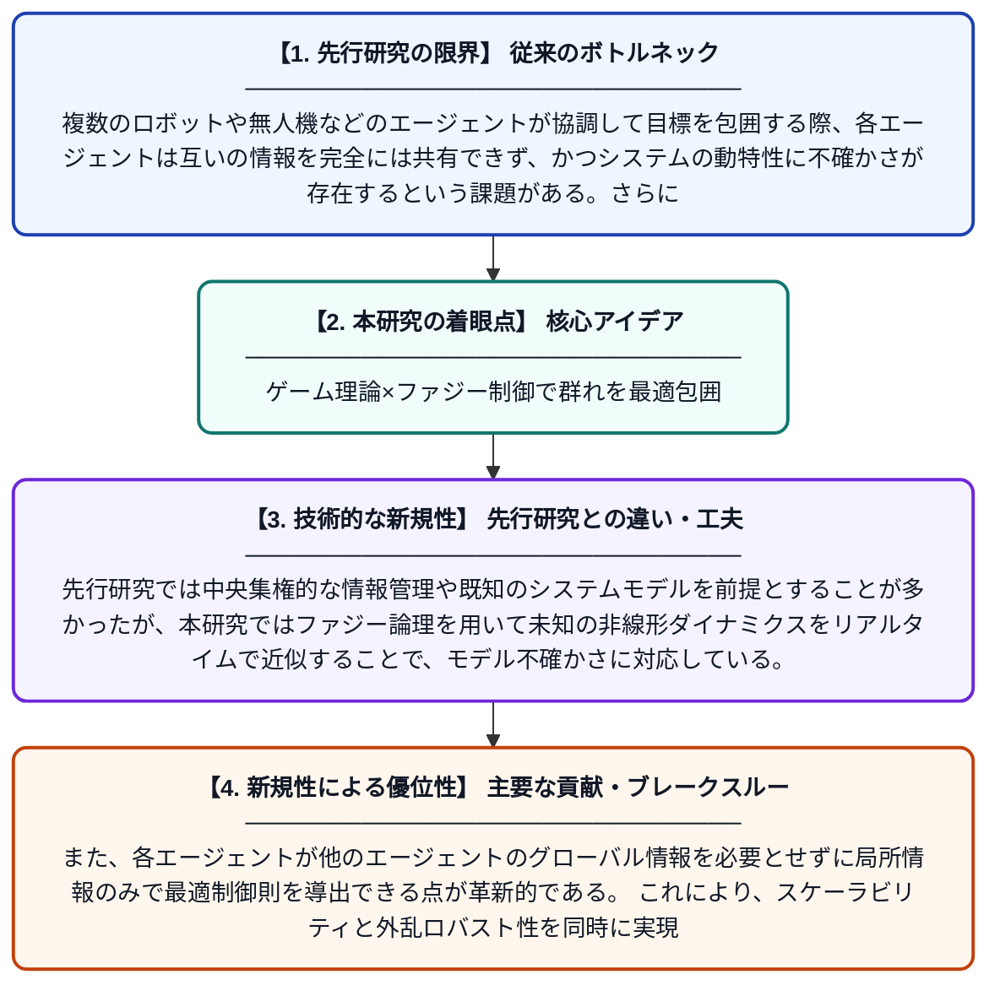

# マルチエージェントシステムにおけるゲーム理論に基づく完全分散型最適ファジー包囲制御

**Original Title**: *Game-Based Fully Distributed Optimal Fuzzy Encircling Control for Multi-Agent Systems*

> **💡 一言要約**: ゲーム理論×ファジー制御で群れを最適包囲

| 項目 | 内容 |
|---|---|
| **著者** | Y Li, M Wang, K Li |
| **掲載誌** | IEEE Transactions on Fuzzy Systems 2026 |
| **アラートキーワード** | multi agent |
| **原文リンク** | [https://ieeexplore.ieee.org/abstract/document/11622867/](https://ieeexplore.ieee.org/abstract/document/11622867/) |
| **PDF版要約** | [README.pdf](./README.pdf) |

---

## 📊 新規性の図解（先行研究との違いと本研究のブレークスルー）

## 📝 要約

本論文は、不確かな非線形マルチエージェントシステムにおける完全分散型の最適包囲制御問題を研究している。個々のエージェント間のナッシュ均衡ゲームと、エージェントと外乱の間のゼロサムゲームを組み合わせたゲーム理論的枠組みを採用している。ファジー論理を活用することで、システムの不確かさに対処しながら最適な包囲制御を実現する手法を提案している。

## ❓ どんな問題に取り組んだか

複数のロボットや無人機などのエージェントが協調して目標を包囲する際、各エージェントは互いの情報を完全には共有できず、かつシステムの動特性に不確かさが存在するという課題がある。さらに、外部からの干渉や妨害に対してもロバストな制御を実現しながら、全体として最適な包囲戦略を達成する必要がある。中央集権的なコントローラーを用いずに、各エージェントが自律的に意思決定できる分散型の制御設計が求められている。

## ✨ 何が新しい？何がすごい？（新規性）

本研究の最大の新規性は、ナッシュ均衡ゲームとゼロサムゲームを統合した二重ゲーム理論的枠組みを、完全分散型の包囲制御に初めて適用した点である。先行研究では中央集権的な情報管理や既知のシステムモデルを前提とすることが多かったが、本研究ではファジー論理を用いて未知の非線形ダイナミクスをリアルタイムで近似することで、モデル不確かさに対応している。また、各エージェントが他のエージェントのグローバル情報を必要とせずに局所情報のみで最適制御則を導出できる点が革新的である。これにより、スケーラビリティと外乱ロバスト性を同時に実現している。

## 🎓 大学1年生向けの解説

複数のドローンやロボットが協力して、逃げようとする目標を取り囲む（包囲する）問題を考えてみてください。このとき、各ロボットは自分の近くにいる仲間の情報しか知らず、しかも自分自身の動き方も完全には把握できないという難しい状況があります。この論文では、「ゲーム理論」というお互いの戦略を考え合うしくみと、「ファジー制御」という曖昧な情報をうまく扱う技術を組み合わせることで、各ロボットが自律的に賢く動ける方法を開発しました。全員が協力しながらも、外部からの妨害にも負けない最強の包囲戦略を、分散して実現できるのが大きなポイントです。
