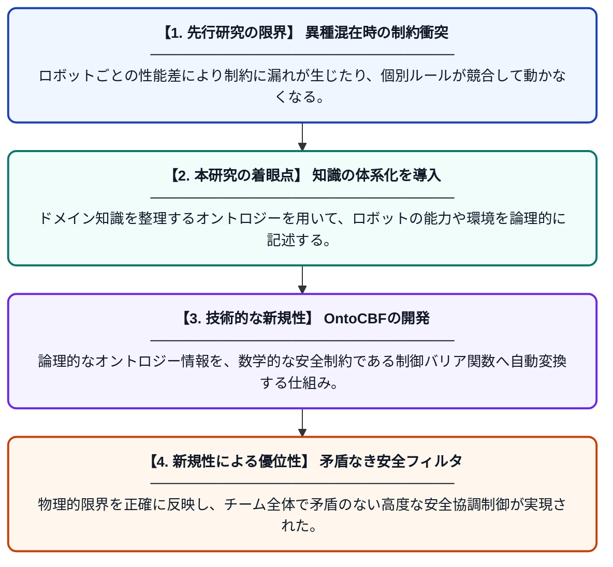

# 異種ロボットチームのためのオントロジー構築による制御バリア関数

**Original Title**: *Ontology-Compiled Control Barrier Functions for Heterogeneous Robot Teams*

> **💡 一言要約**: オントロジーで異種ロボットの安全を賢く統合管理

| 項目 | 内容 |
|---|---|
| **著者** | P Wu, SF Ghoreishi, N Bastian, M Imani, T Lan, M Imani |
| **掲載誌** | arXiv preprint arXiv … 2026 |
| **アラートキーワード** | Ontology |
| **PDF** | [https://arxiv.org/pdf/2611.20306](https://arxiv.org/pdf/2611.20306) |
| **原文リンク** | [https://arxiv.org/pdf/2611.20306](https://arxiv.org/pdf/2611.20306) |
| **PDF版要約** | [README.pdf](./README.pdf) |

---

## 📊 新規性の図解（先行研究との違いと本研究のブレークスルー）

## 📝 要約

性能や制約が異なる多様なロボット（異種ロボット）が混在するチームにおいて、安全性と効率性を両立させるためのフレームワーク「OntoCBF」を提案しています。ドメイン知識を体系化したオントロジーを用いることで、ロボット間の制約の矛盾や制約の漏れを解消し、安全な協調制御を実現します。

## ❓ どんな問題に取り組んだか

種類の異なるロボットが混在する場合、従来の安全フィルタでは制約の記述漏れやブレーキ性能の誤見積もり、個々のロボットが持つ制約同士の衝突が発生し、システム全体の安全性が損なわれるという課題がありました。

## ✨ 何が新しい？何がすごい？（新規性）

知識表現の枠組みである「オントロジー」を制御バリア関数（CBF）と統合した点が最大の新規性です。各ロボットの能力や物理的制約、タスク間の関係性をドメインオントロジーとして定式化し、それをリアルタイムな安全フィルタに変換することで、複雑な環境下でも矛盾のない安全制約を自動的に生成・適用することを可能にしました。

## 🎓 大学1年生向けの解説

例えば、ドローンと自動運転車が一緒に動くとき、それぞれ止まり方や曲がり方が違うため、同じ安全ルールを当てはめると衝突したり動けなくなったりします。この研究では、それぞれのロボットの「個性」や「ルール」をまとめた知識の辞書（オントロジー）を作ることで、ロボット同士が互いの違いを考慮しながら、絶対にぶつからないような賢いブレーキの仕組みを作りました。これにより、多種多様なロボットが協力して安全に作業できるようになります。
