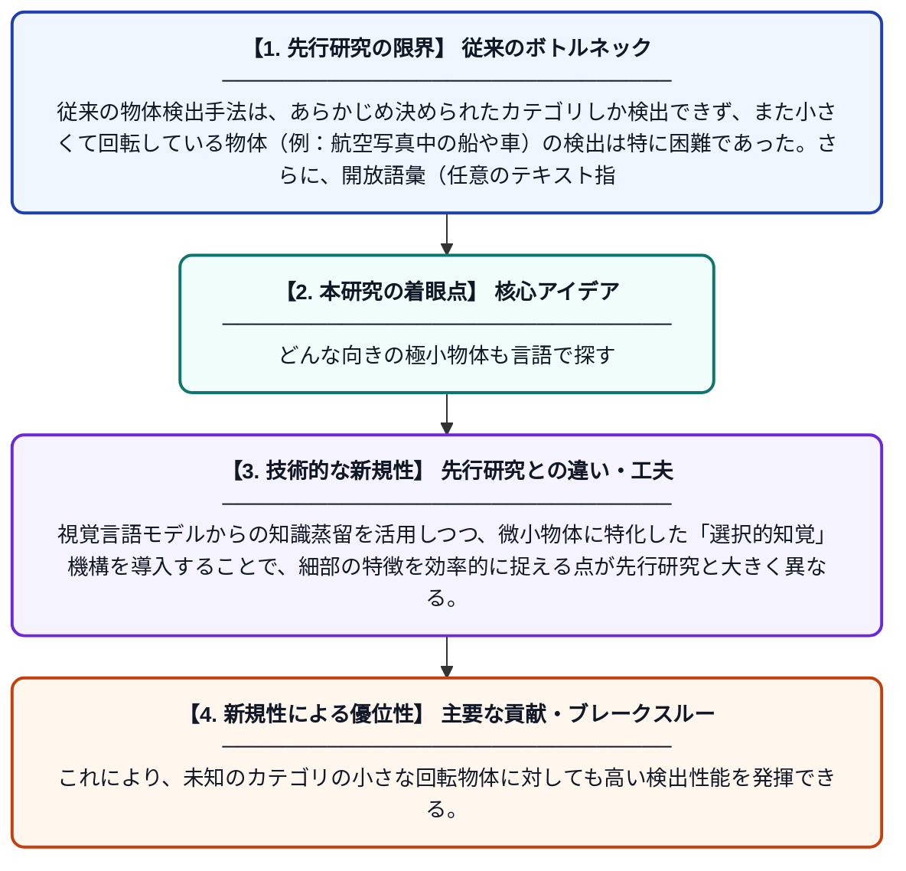

# 選択的知覚による開放語彙回転微小物体探索

**Original Title**: *OVRD: Open-Vocabulary Rotated Tiny-Object Discovery via Selective Perception*

> **💡 一言要約**: どんな向きの極小物体も言語で探す

| 項目 | 内容 |
|---|---|
| **著者** | T Xie, LBF Wu |
| **アラートキーワード** | Open-Vocabulary Object ... |
| **PDF** | [http://linklings.s3.amazonaws.com/organizations/WCCI/wcci2026/submissions/stype114/tnpYW-ijcnn_pap3676s2.pdf](http://linklings.s3.amazonaws.com/organizations/WCCI/wcci2026/submissions/stype114/tnpYW-ijcnn_pap3676s2.pdf) |
| **原文リンク** | [http://linklings.s3.amazonaws.com/organizations/WCCI/wcci2026/submissions/stype114/tnpYW-ijcnn_pap3676s2.pdf](http://linklings.s3.amazonaws.com/organizations/WCCI/wcci2026/submissions/stype114/tnpYW-ijcnn_pap3676s2.pdf) |
| **PDF版要約** | [README.pdf](./README.pdf) |

---

## 📊 新規性の図解（先行研究との違いと本研究のブレークスルー）

## 📝 要約

本論文は、画像中の非常に小さく、かつ任意の角度で回転している物体を、あらかじめ定義されたカテゴリに縛られず自由に検出する新手法OVRDを提案する。大規模な視覚言語モデル（VLM）からの知識蒸留を活用し、開放語彙での回転微小物体検出を実現する。選択的知覚機構により、細かい物体に対する検出精度と汎化性能を両立させている。

## ❓ どんな問題に取り組んだか

従来の物体検出手法は、あらかじめ決められたカテゴリしか検出できず、また小さくて回転している物体（例：航空写真中の船や車）の検出は特に困難であった。さらに、開放語彙（任意のテキスト指定）での回転微小物体検出を統一的に扱う研究はほとんど存在しなかった。

## ✨ 何が新しい？何がすごい？（新規性）

本研究は、開放語彙検出と回転微小物体検出という二つの困難な課題を同時に解決する初めての統合フレームワークを提案している。視覚言語モデルからの知識蒸留を活用しつつ、微小物体に特化した「選択的知覚」機構を導入することで、細部の特徴を効率的に捉える点が先行研究と大きく異なる。これにより、未知のカテゴリの小さな回転物体に対しても高い検出性能を発揮できる。

## 🎓 大学1年生向けの解説

普通のカメラや衛星写真には、とても小さかったり斜めを向いていたりする物体がたくさん写っています。コンピュータにそれらを自動で見つけさせるのはとても難しい問題です。この研究では、大量の画像とテキストで学習した賢いAI（視覚言語モデル）の知識を使って、「文章で指定した物体」を小さくて回転していても見つけられる仕組みを作りました。人間が「小さな飛行機を探して」と言うだけで、AIがそれを画像の中から発見してくれるイメージです。
