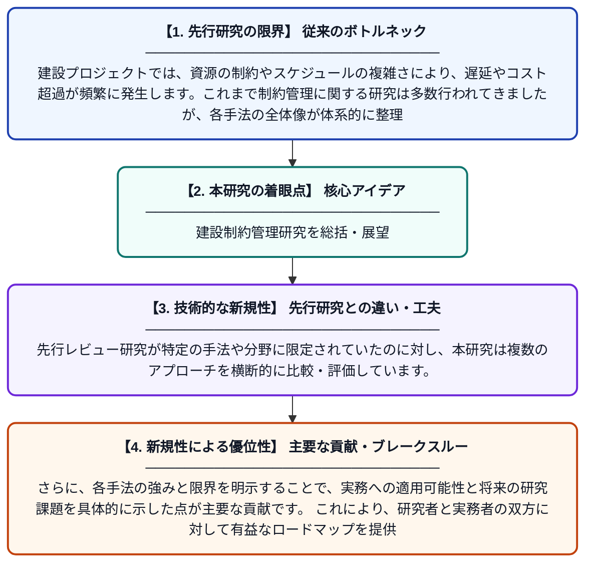

# 建設業における制約管理研究の体系的レビュー：現状と今後の方向性

**Original Title**: *A systematic review of constraint management studies in construction: current status and future direction*

> **💡 一言要約**: 建設制約管理研究を総括・展望

| 項目 | 内容 |
|---|---|
| **著者** | Z Mao, VA Gonzalez, M Abdelmegid, Y Zou |
| **掲載誌** | Production Planning & Control 2026 |
| **アラートキーワード** | rcpsp |
| **原文リンク** | [https://www.tandfonline.com/doi/abs/10.1080/09537287.2026.2704642](https://www.tandfonline.com/doi/abs/10.1080/09537287.2026.2704642) |
| **PDF版要約** | [README.pdf](./README.pdf) |

---

## 📊 新規性の図解（先行研究との違いと本研究のブレークスルー）

## 📝 要約

本論文は、建設プロジェクトにおける制約管理に関する既存研究を体系的にレビューし、現状の研究動向を整理したものです。資源制約付きプロジェクトスケジューリング問題（RCPSP）に関する文献を分析し、数理モデル、シミュレーション、ヒューリスティック、メタヒューリスティック、ハイブリッド手法の5つの方法論カテゴリを特定しました。さらに、現在の研究の限界を明らかにし、今後の研究に向けた方向性を提示しています。

## ❓ どんな問題に取り組んだか

建設プロジェクトでは、資源の制約やスケジュールの複雑さにより、遅延やコスト超過が頻繁に発生します。これまで制約管理に関する研究は多数行われてきましたが、各手法の全体像が体系的に整理されておらず、研究の重複や抜け落ちが生じていました。こうした現状を踏まえ、既存研究を横断的に俯瞰する包括的なレビューが求められていました。

## ✨ 何が新しい？何がすごい？（新規性）

本研究は、建設分野における制約管理研究を網羅的に収集・分類し、5つの方法論カテゴリに整理した点で新規性があります。先行レビュー研究が特定の手法や分野に限定されていたのに対し、本研究は複数のアプローチを横断的に比較・評価しています。さらに、各手法の強みと限界を明示することで、実務への適用可能性と将来の研究課題を具体的に示した点が主要な貢献です。これにより、研究者と実務者の双方に対して有益なロードマップを提供しています。

## 🎓 大学1年生向けの解説

建設工事では、作業員や重機などの資源が限られているため、工事の順番やスケジュールを上手に管理することがとても重要です。この論文は、これまでに世界中で行われてきた「どうすれば工事をうまく計画できるか」に関する研究をまとめて整理したものです。コンピューターで計算する方法やシミュレーションなど、5種類のアプローチに分類して分析しました。どの方法が得意なこと・苦手なことを明らかにすることで、今後の研究や現場での活用に役立てることを目指しています。いわば、建設スケジューリング研究の「地図」を作った論文です。
