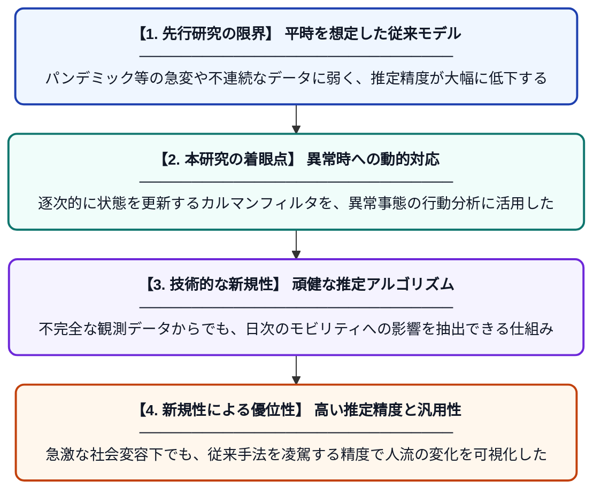

# COVID-19による日次モビリティへの影響を推定するカルマンフィルタリング：チュニジアの事例研究

**Original Title**: *Kalman Filtering for COVID-19 Daily Mobility Impact Estimation: A Tunisian Case Study*

> **💡 一言要約**: カルマンフィルタでコロナ禍の人流変化を精密に捉える

| 項目 | 内容 |
|---|---|
| **著者** | A Ghédira, K Ben Abdallah |
| **掲載誌** | … Statistical Methods for Transportation Economics and … 2027 |
| **アラートキーワード** | kalman filter |
| **原文リンク** | [https://www.worldscientific.com/doi/abs/10.1142/9781800619647_0009](https://www.worldscientific.com/doi/abs/10.1142/9781800619647_0009) |
| **PDF版要約** | [README.pdf](./README.pdf) |

---

## 📊 新規性の図解（先行研究との違いと本研究のブレークスルー）

## 📝 要約

カルマンフィルタを用いて、パンデミック発生時のような急激な社会変動下での人流（モビリティ）変化を正確に推定した研究です。チュニジアのデータを事例に、不連続なデータ環境下でも従来手法を凌駕する推定精度を実証しました。

## ❓ どんな問題に取り組んだか

従来の交通推定モデルの多くは平時（安定時）を前提としており、パンデミックのような異常事態における急激な行動変化に対応しきれないという課題がありました。また、連続的なセンサーデータが得られない不完全なデータ環境下での高精度な推定も困難でした。

## ✨ 何が新しい？何がすごい？（新規性）

本研究は、センサーデータが途切れがちな制約条件下で、カルマンフィルタを異常事態のモビリティ分析に適用した点が革新的です。従来の交通工学では平時の運用効率化に主眼が置かれていましたが、本手法はパンデミックという非定常な衝撃を動的に推定する枠組みを構築しました。実証研究としてチュニジアのデータを用い、既存手法に対する優位性を明確に示しました。

## 🎓 大学1年生向けの解説

カルマンフィルタという「ノイズの多いデータから真の状態を賢く予測する数学のテクニック」を使って、コロナ禍で人々の動きがどう変わったかを調べた研究です。普通の予測方法だと、急な外出制限などでデータが乱れると正確に計算できませんが、この手法は変化を素早く捉えることができます。実際にチュニジアのデータを使って、どれくらい移動が減ったかを正確に見積もることに成功しました。
