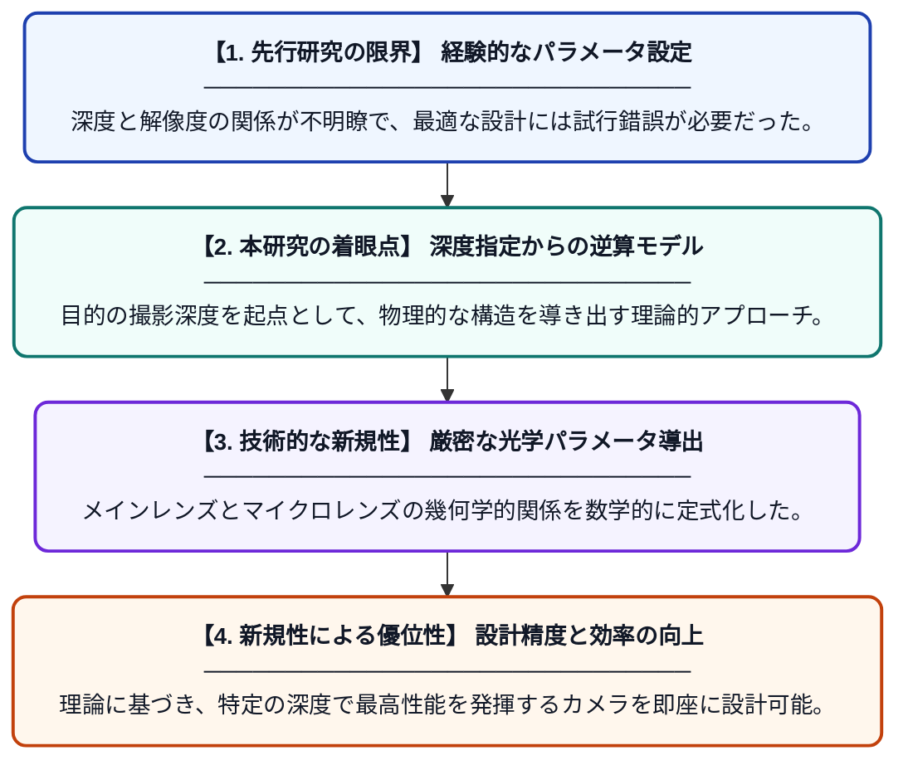

# 非合焦型プレノプティックカメラのための光学系解析と設計

**Original Title**: *Analysis and design of the optical system for unfocused plenoptic cameras*

> **💡 一言要約**: 理想のライトフィールドを実現する光学設計の決定版

| 項目 | 内容 |
|---|---|
| **著者** | L Weiqi, J Zhu, W Shen |
| **掲載誌** | def 2026 |
| **アラートキーワード** | ICA |
| **原文リンク** | [https://opg.optica.org/ao/upcoming_pdf.cfm?id=612436](https://opg.optica.org/ao/upcoming_pdf.cfm?id=612436) |
| **PDF版要約** | [README.pdf](./README.pdf) |

---

## 📊 新規性の図解（先行研究との違いと本研究のブレークスルー）

## 📝 要約

非合焦（アンフォーカス）型プレノプティックカメラの光学系を最適化するための解析手法と設計指針を提案しています。指定された深度範囲において最適な画質を得るためのカメラ構造パラメータを、理論的な導出によって詳細に明らかにしました。

## ❓ どんな問題に取り組んだか

従来のプレノプティックカメラの設計では、目的の撮影深度に対して各光学パラメータをどのように設定すべきかという体系的な基準が不足していました。そのため、特定の距離で高い解像度を得るための精密な設計が困難でした。

## ✨ 何が新しい？何がすごい？（新規性）

本研究は、指定された深度範囲からカメラの構造パラメータを逆算する独自の幾何学的解析モデルを構築した点が画期的です。マイクロレンズアレイとメインレンズの配置を数学的に定義し、設計段階で性能を予測可能にしました。これにより、特定の用途に特化した高性能なカメラ設計を理論的に導けるようになりました。

## 🎓 大学1年生向けの解説

「プレノプティックカメラ」は、撮影した後にピントの位置を自由に変えられる魔法のようなカメラです。この論文では、そのカメラの中にある数千個の小さなレンズを、どこに、どんな大きさで配置すれば一番きれいに撮れるかを数学を使って計算しました。これによって、撮りたい対象に合わせて「最強のカメラ」を作るための設計図が描けるようになります。
