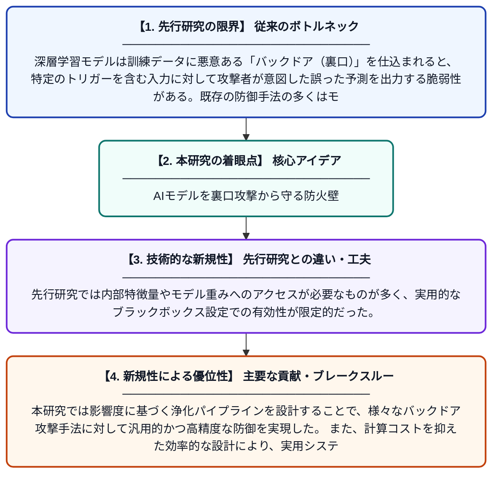

# BDFirewall: 影響度に基づく浄化によるブラックボックスバックドア攻撃への効果的・効率的な防御

**Original Title**: *BDFirewall: Effective and Efficient Black-Box Backdoor Defense via Impact-based Purification*

> **💡 一言要約**: AIモデルを裏口攻撃から守る防火壁

| 項目 | 内容 |
|---|---|
| **著者** | Y Li, C Zhu, Y Zhao, J Zhang, X Huang |
| **掲載誌** | IEEE Transactions on Dependable and Secure Computing 2026 |
| **アラートキーワード** | Secure Computing |
| **原文リンク** | [https://ieeexplore.ieee.org/abstract/document/11626056/](https://ieeexplore.ieee.org/abstract/document/11626056/) |
| **PDF版要約** | [README.pdf](./README.pdf) |

---

## 📊 新規性の図解（先行研究との違いと本研究のブレークスルー）

## 📝 要約

本論文は、深層学習モデルに埋め込まれたバックドア攻撃に対して、モデル内部構造へのアクセスを必要としないブラックボックス方式での防御手法「BDFirewall」を提案している。攻撃トリガーがモデルの予測に与える「影響度」を定量化し、それをもとに悪意ある入力を浄化する新しいアプローチをとる。この手法は従来手法と比べて高い防御精度と計算効率を両立している。

## ❓ どんな問題に取り組んだか

深層学習モデルは訓練データに悪意ある「バックドア（裏口）」を仕込まれると、特定のトリガーを含む入力に対して攻撃者が意図した誤った予測を出力する脆弱性がある。既存の防御手法の多くはモデルの内部パラメータや構造へのアクセスを前提とするホワイトボックス方式であり、実運用環境ではそのような情報が利用できない場合が多い。ブラックボックス環境、すなわちモデルの入出力しか観察できない状況での効果的な防御が未解決の課題であった。

## ✨ 何が新しい？何がすごい？（新規性）

BDFirewallはモデルの内部構造を一切参照せず、入力の各部分がモデル出力に与える「影響度」のみを指標としてバックドアトリガーを検出・除去するブラックボックス防御手法である。先行研究では内部特徴量やモデル重みへのアクセスが必要なものが多く、実用的なブラックボックス設定での有効性が限定的だった。本研究では影響度に基づく浄化パイプラインを設計することで、様々なバックドア攻撃手法に対して汎用的かつ高精度な防御を実現した。また、計算コストを抑えた効率的な設計により、実用システムへの導入可能性も高い。

## 🎓 大学1年生向けの解説

AIに「バックドア攻撃」という怖い罠を仕掛けることができます。例えば、画像認識AIに特定のシール（トリガー）が貼られた写真を見せると、わざと間違った答えを出すように悪意を持って訓練されることがあります。この論文では、AIの中身を見なくても（ブラックボックス）、入力がAIの判断にどれくらい影響しているかを調べることで、こうした罠を検出して無力化する「防火壁」のような仕組みを作りました。ちょうど、怪しいメールを開く前に中身の危険な部分だけを取り除くウイルス対策ソフトのようなイメージです。
