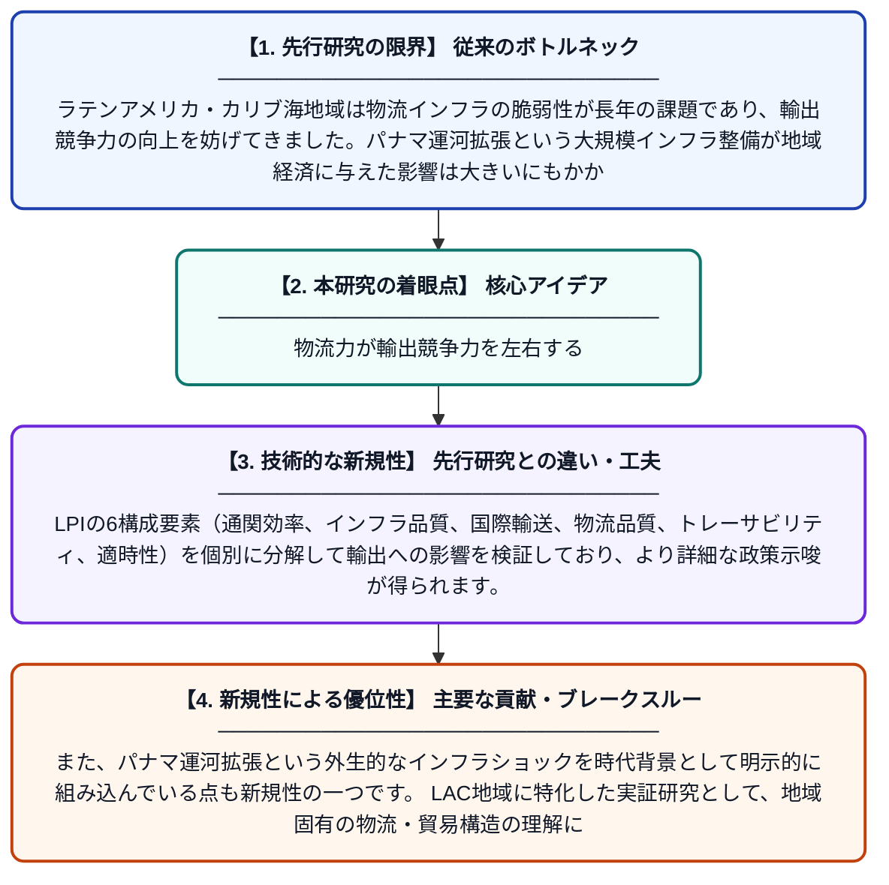

# パナマ運河拡張時代におけるラテンアメリカ・カリブ海経済圏の物流パフォーマンスと輸出に関する探索的マルチレベル分析

**Original Title**: *An exploratory multilevel analysis of logistics performance and exports in Latin American and Caribbean economies during the Panama Canal expansion era*

> **💡 一言要約**: 物流力が輸出競争力を左右する

| 項目 | 内容 |
|---|---|
| **著者** | K Miller |
| **掲載誌** | Marine Economics and Management 2026 |
| **アラートキーワード** | logistics |
| **原文リンク** | [https://www.emerald.com/maem/article/doi/10.1108/MAEM-11-2025-0029/1389518](https://www.emerald.com/maem/article/doi/10.1108/MAEM-11-2025-0029/1389518) |
| **PDF版要約** | [README.pdf](./README.pdf) |

---

## 📊 新規性の図解（先行研究との違いと本研究のブレークスルー）

## 📝 要約

本研究は、パナマ運河拡張（2010〜2018年）の時代に、ラテンアメリカ・カリブ海（LAC）地域の20カ国を対象に、物流パフォーマンスと輸出競争力の関係をマルチレベル分析で調査しています。世界銀行の物流パフォーマンス指数（LPI）を構成する6つの要素が、各国の輸出にどのような影響を与えるかを検証しています。さらに、海上輸送インフラの整備がこの地域の貿易拡大にどう貢献しているかも考察しています。

## ❓ どんな問題に取り組んだか

ラテンアメリカ・カリブ海地域は物流インフラの脆弱性が長年の課題であり、輸出競争力の向上を妨げてきました。パナマ運河拡張という大規模インフラ整備が地域経済に与えた影響は大きいにもかかわらず、複数国・複数年にわたる包括的な実証分析は不足していました。特に、物流パフォーマンスの個々の構成要素が輸出にどう影響するかを国レベル・年レベルで同時に分析した研究はほとんどありませんでした。

## ✨ 何が新しい？何がすごい？（新規性）

本研究は、国ごとの差異と時系列的変化を同時に考慮できるマルチレベル分析手法を採用した点が先行研究と異なります。LPIの6構成要素（通関効率、インフラ品質、国際輸送、物流品質、トレーサビリティ、適時性）を個別に分解して輸出への影響を検証しており、より詳細な政策示唆が得られます。また、パナマ運河拡張という外生的なインフラショックを時代背景として明示的に組み込んでいる点も新規性の一つです。LAC地域に特化した実証研究として、地域固有の物流・貿易構造の理解に貢献しています。

## 🎓 大学1年生向けの解説

パナマ運河はアメリカ大陸を横断する大きな水路で、2016年に大型船が通れるよう拡張工事が完了しました。この研究では、その拡張工事が行われた時期（2010〜2018年）に、中南米や Caribbean の20カ国で「物の運びやすさ（物流）」がどれだけ輸出の増加に役立ったかを調べています。物流とは、荷物を素早く・正確に・安く届ける仕組みのことで、国の物流が良くなると輸出も増えやすいと考えられています。複数の国と年度のデータを統計的にまとめて分析する「マルチレベル分析」という高度な手法を使い、どの物流要素が特に重要かを明らかにしています。この研究の結果は、途上国が輸出を伸ばすためにどこに投資すべきかを考える上で役立つ知見を提供しています。
