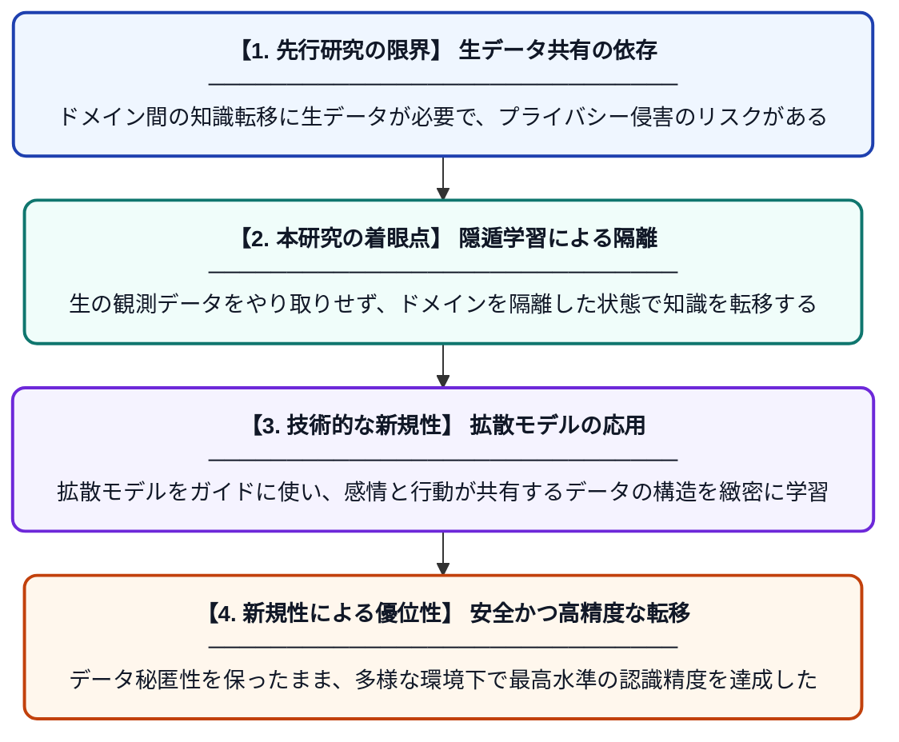

# DGAFT-R：ドメイン横断的なマルチモーダル感情・行動認識のための隠遁型拡散フレームワーク

**Original Title**: *DGAFT-R: a reclusive diffusion framework for cross-domain multimodal emotion and behaviour recognition*

> **💡 一言要約**: 生データ不要の拡散モデル学習で感情認識を進化

| 項目 | 内容 |
|---|---|
| **著者** | J Gracewell, CT Kalaivani, R Renugadevi… |
| **掲載誌** | International Journal of … 2026 |
| **アラートキーワード** | manifold learning |
| **原文リンク** | [https://link.springer.com/article/10.1007/s13042-026-03357-1](https://link.springer.com/article/10.1007/s13042-026-03357-1) |
| **PDF版要約** | [README.pdf](./README.pdf) |

---

## 📊 新規性の図解（先行研究との違いと本研究のブレークスルー）

## 📝 要約

異なるドメイン間で生データを直接やり取りすることなく、感情と行動の認識知識を転移させる「ドメイン隔離型隠遁学習」を提案しています。拡散モデルを用いて感情と行動の共有多様体を学習することで、プライバシーを保護しつつ高度な認識性能を実現しました。

## ❓ どんな問題に取り組んだか

従来のドメイン横断学習では、異なる環境間で生のマルチモーダルデータを共有する必要があり、プライバシー保護や通信負荷が大きな壁となっていました。また、異なるドメイン間での複雑な感情・行動パターンの相関を、ノイズに強くかつ一貫して捉えることも困難でした。

## ✨ 何が新しい？何がすごい？（新規性）

生データを直接交換せずに知識を転移する「隠遁学習（Reclusive Learning）」戦略を導入した点が最大の特徴です。技術的には、生成AIで使われる拡散モデルをガイドとして活用し、感情と行動の共有多様体（マニフォールド）を学習する仕組みを構築しました。これにより、先行研究と比較してデータセキュリティを劇的に向上させつつ、未知のドメインに対しても高い汎用性と認識精度を両立させています。

## 🎓 大学1年生向けの解説

AIに人の感情を教えるとき、通常は大量の映像や音声を共有する必要がありますが、これではプライバシーが心配です。この研究では、元のデータは見せずに「学習した知識のコツ」だけを共有する新しい仕組みを作りました。さらに、画像生成などで使われる「拡散モデル」という技術を応用して、複雑な感情の動きを正しく捉えられるようにしています。結果として、個人情報を守りながら、どんな場所でも正確に人の気持ちを理解できるAIが可能になります。
