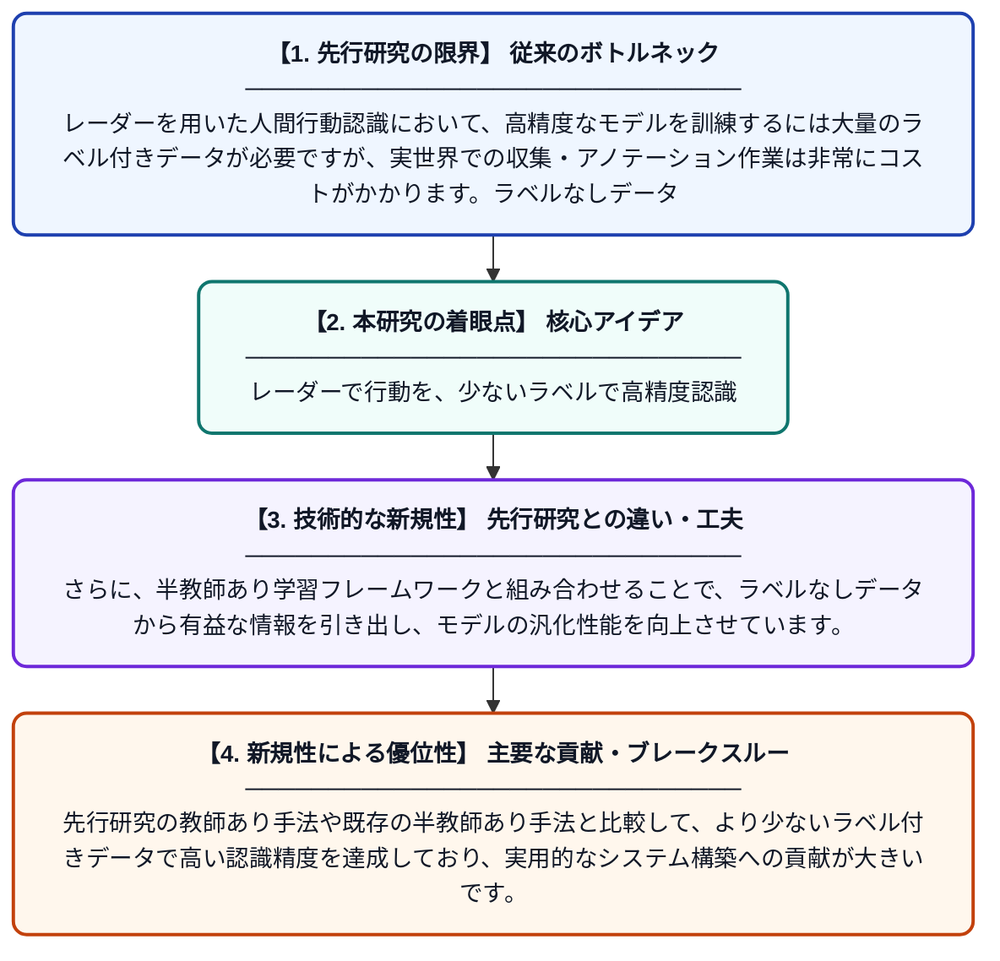

# マルチチャネル散乱分離を用いたレーダーベースの半教師あり人間行動認識

**Original Title**: *Radar-Based Semi-Supervised Human Activity Recognition With Multichannel Scattering Separation*

> **💡 一言要約**: レーダーで行動を、少ないラベルで高精度認識

| 項目 | 内容 |
|---|---|
| **著者** | P Xiao, W Li, Y Jia, S Guo |
| **掲載誌** | IEEE Transactions on Human-Machine Systems 2026 |
| **アラートキーワード** | Semi supervise |
| **原文リンク** | [https://ieeexplore.ieee.org/abstract/document/11623316/](https://ieeexplore.ieee.org/abstract/document/11623316/) |
| **PDF版要約** | [README.pdf](./README.pdf) |

---

## 📊 新規性の図解（先行研究との違いと本研究のブレークスルー）

## 📝 要約

本論文では、レーダー信号を用いて人間の行動を認識するシステムに、半教師あり学習を組み合わせた手法を提案しています。ラベルなしデータを有効活用するためにマルチチャネル散乱分離技術を導入し、少量のラベル付きサンプルでも高精度な認識を実現します。提案手法は、完全教師あり学習のベースラインや最新の半教師あり手法を一貫して上回る性能を示しています。

## ❓ どんな問題に取り組んだか

レーダーを用いた人間行動認識において、高精度なモデルを訓練するには大量のラベル付きデータが必要ですが、実世界での収集・アノテーション作業は非常にコストがかかります。ラベルなしデータは大量に入手可能であるにもかかわらず、従来の教師あり学習ではそれを活用できないという課題がありました。

## ✨ 何が新しい？何がすごい？（新規性）

提案手法は、マルチチャネル散乱分離をレーダー信号の特徴抽出に取り入れることで、行動ごとの散乱成分を効果的に分離・活用できる点が新しいアプローチです。さらに、半教師あり学習フレームワークと組み合わせることで、ラベルなしデータから有益な情報を引き出し、モデルの汎化性能を向上させています。先行研究の教師あり手法や既存の半教師あり手法と比較して、より少ないラベル付きデータで高い認識精度を達成しており、実用的なシステム構築への貢献が大きいです。

## 🎓 大学1年生向けの解説

レーダーとは電波を使って物体の動きを検知する技術で、スマートホームや医療などで人の行動（歩く・転ぶなど）を認識するために使われています。AIにこれを学習させるには通常「正解ラベル（この動きは歩行です）」を大量に用意する必要があり、それがとても大変な作業です。この研究では、正解ラベルのないデータもうまく使える「半教師あり学習」という方法と、レーダー信号を細かく分けて分析する技術を組み合わせました。その結果、少ない正解データでも高精度に人の行動を見分けられるAIを作ることに成功しました。
