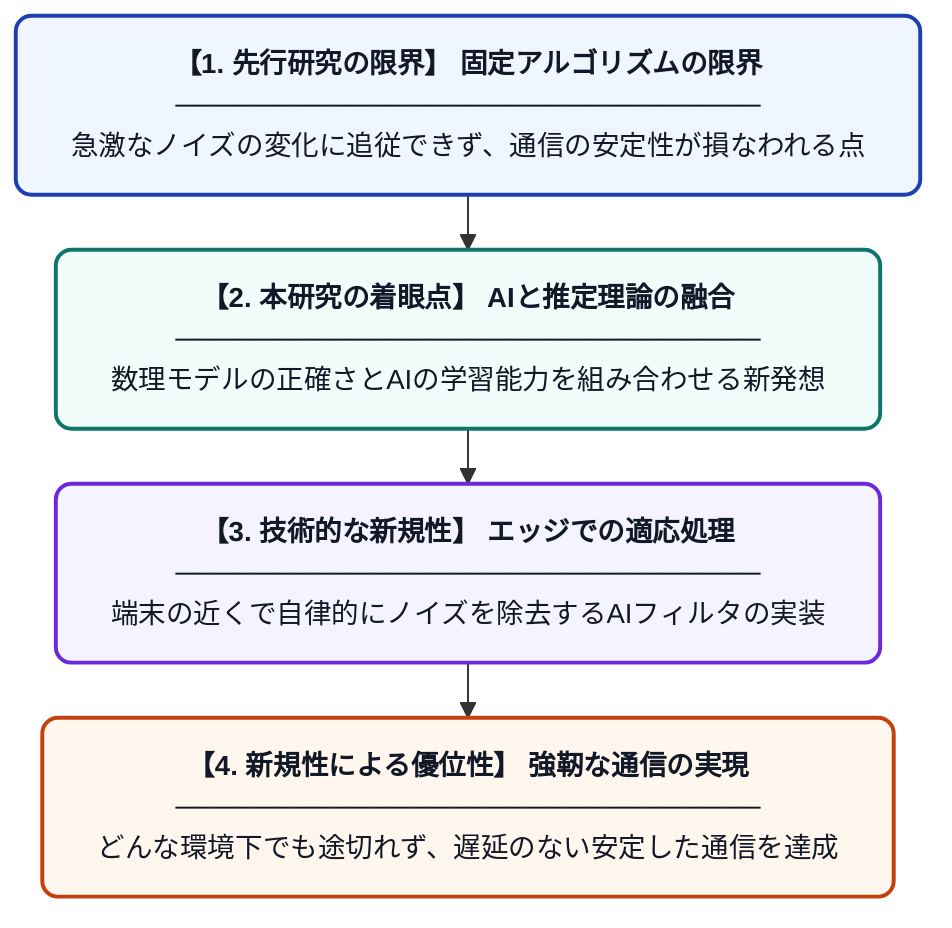

# 強靭な通信を実現するAI駆動型適応信号処理

**Original Title**: *AI-DRIVEN ADAPTIVE SIGNAL PROCESSING FOR RESILIENT COMMUNICATIONS*

> **💡 一言要約**: AIがノイズを瞬時に除去し、途切れない通信を作る

| 項目 | 内容 |
|---|---|
| **著者** | R DHAYA |
| **掲載誌** | AI-Powered Adaptive Signal Processing Techniques … 2026 |
| **アラートキーワード** | kalman filter  "anomaly ... |
| **原文リンク** | [https://books.google.com/books?hl=ja&lr=lang_ja|lang_en&id=W1cxEgAAQBAJ&oi=fnd&pg=PA247&dq=kalman+filter++"anomaly+detection"&ots=eGYhZBbi-0&sig=lGmSqkJsufs4MP15Zc1M80ZSxw4](https://books.google.com/books?hl=ja&lr=lang_ja|lang_en&id=W1cxEgAAQBAJ&oi=fnd&pg=PA247&dq=kalman+filter++"anomaly+detection"&ots=eGYhZBbi-0&sig=lGmSqkJsufs4MP15Zc1M80ZSxw4) |
| **PDF版要約** | [README.pdf](./README.pdf) |

---

## 📊 新規性の図解（先行研究との違いと本研究のブレークスルー）

## 📝 要約

AI技術と伝統的なカルマンフィルタを融合させ、通信環境のノイズをリアルタイムで最適に推定・除去する手法を提案しています。エッジデバイスに適応型フィルタリング機能を搭載することで、過酷な環境下でも安定した通信品質を維持する「レジリエンス」の向上を目指しています。

## ❓ どんな問題に取り組んだか

従来の通信システムでは、急激に変化する環境ノイズや動的な信号変化に対して、固定的なアルゴリズムでは柔軟に対応できず通信が不安定になる課題がありました。また、信号処理の遅延や処理負荷も、リアルタイム通信における大きな障壁となっていました。

## ✨ 何が新しい？何がすごい？（新規性）

本研究の核心は、最適な状態推定を行うカルマンフィルタにAIの学習能力を組み合わせ、エッジコンピューティングの枠組みで実装した点にあります。先行研究の多くが中央集中型の処理だったのに対し、本手法は各エッジノードが自律的にノイズを学習し最適化する仕組みを導入しました。これにより、通信の信頼性を劇的に向上させつつ、低遅延な信号処理を可能にするという、理論と実践を繋ぐ貢献をしています。

## 🎓 大学1年生向けの解説

私たちがスマホを使うとき、周りの電波の状態が悪くなると通信が途切れたり遅くなったりします。この論文では、AIに「ノイズ（雑音）を取り除く職人」のような役割をさせ、どんなに環境が悪くてもきれいに信号を読み取る技術を紹介しています。さらに、その処理を身近な通信機器（エッジ）で行うことで、一瞬の遅れも許されない状況でもスムーズに通信できるように工夫されています。大学で学ぶ数学的なフィルターの知識が、AIと合体して最新の通信を支える仕組みです。
