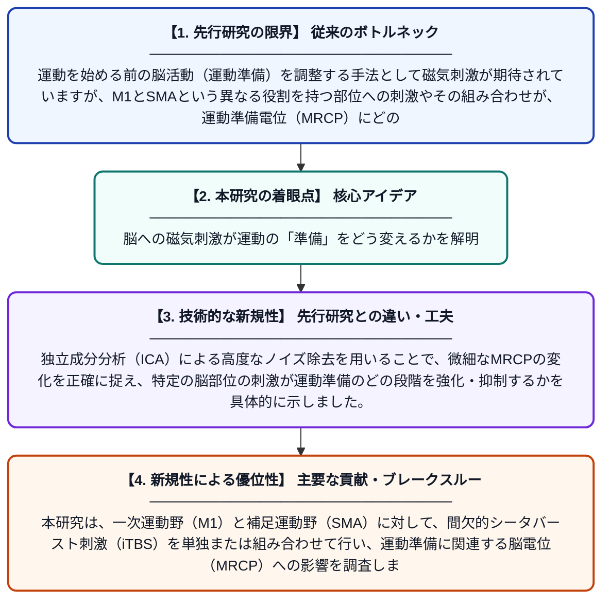

# M1、SMA、およびその組み合わせへのiTBS塗布による運動準備の差異的変調

**Original Title**: *Differential modulation of motor preparation by iTBS Over M1, SMA, and their combination*

> **💡 一言要約**: 脳への磁気刺激が運動の「準備」をどう変えるかを解明

| 項目 | 内容 |
|---|---|
| **著者** | PJ Wolfe, R Du, A Ravi, A Arami, WR Staines |
| **掲載誌** | Journal of NeuroEngineering and … 2026 |
| **アラートキーワード** | independent component ... |
| **原文リンク** | [https://link.springer.com/article/10.1186/s12984-026-02146-9](https://link.springer.com/article/10.1186/s12984-026-02146-9) |
| **PDF版要約** | [README.pdf](./README.pdf) |

---

## 📊 新規性の図解（先行研究との違いと本研究のブレークスルー）

## 📝 要約

本研究は、一次運動野（M1）と補足運動野（SMA）に対して、間欠的シータバースト刺激（iTBS）を単独または組み合わせて行い、運動準備に関連する脳電位（MRCP）への影響を調査しました。その結果、刺激する脳領域の組み合わせによって、運動を開始する前の脳活動の変調パターンが異なることが明らかになりました。

## ❓ どんな問題に取り組んだか

運動を始める前の脳活動（運動準備）を調整する手法として磁気刺激が期待されていますが、M1とSMAという異なる役割を持つ部位への刺激やその組み合わせが、運動準備電位（MRCP）にどのような具体的な影響を与えるかは不明な点が多く残されていました。

## ✨ 何が新しい？何がすごい？（新規性）

本研究は、M1とSMAという運動制御に不可欠な2つの領域に対し、最新の刺激プロトコルであるiTBSを適用し、その単独効果と併用効果を直接比較した点が画期的です。独立成分分析（ICA）による高度なノイズ除去を用いることで、微細なMRCPの変化を正確に捉え、特定の脳部位の刺激が運動準備のどの段階を強化・抑制するかを具体的に示しました。

## 🎓 大学1年生向けの解説

私たちが体を動かそうとする直前、脳では「動かす準備」のための電気信号が流れます。この研究では、磁石の力で脳を刺激する装置を使い、脳の「運動の命令を出す場所（M1）」や「計画を立てる場所（SMA）」を刺激したときに、準備信号がどう変わるかを実験しました。その結果、刺激する場所によって準備信号の強まり方が違うことがわかりました。これは、将来リハビリなどで効率よく運動機能を回復させるための重要な手がかりになります。
