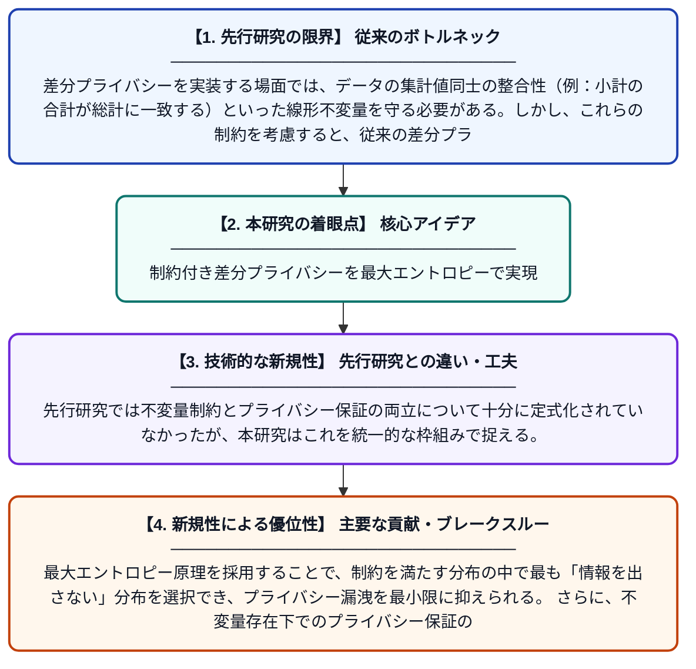

# 線形不変量制約下における差分プライバシーの最大エントロピー実装

**Original Title**: *A Maximum Entropy Implementation of Differential Privacy Under Linear Invariants*

> **💡 一言要約**: 制約付き差分プライバシーを最大エントロピーで実現

| 項目 | 内容 |
|---|---|
| **著者** | R Lafferty, A Roy |
| **掲載誌** | arXiv preprint arXiv:2607.22450 2026 |
| **アラートキーワード** | differential privacy |
| **PDF** | [https://arxiv.org/pdf/2607.22450](https://arxiv.org/pdf/2607.22450) |
| **原文リンク** | [https://arxiv.org/abs/2607.22450](https://arxiv.org/abs/2607.22450) |
| **PDF版要約** | [README.pdf](./README.pdf) |

---

## 📊 新規性の図解（先行研究との違いと本研究のブレークスルー）

## 📝 要約

本論文は、差分プライバシーを実装する際に「不変量」と呼ばれる線形制約（例：集計値の整合性）を満たしながら、どのようにプライバシー保護ノイズを付加すべきかという問題を扱う。従来の差分プライバシー保証はこうした制約の存在によって再評価が必要となるため、著者らは最大エントロピー原理に基づく高エントロピーな差分プライバシー手法を提案する。この手法は制約を守りつつ、情報の不確実性を最大化することで余分な情報漏洩を抑える。

## ❓ どんな問題に取り組んだか

差分プライバシーを実装する場面では、データの集計値同士の整合性（例：小計の合計が総計に一致する）といった線形不変量を守る必要がある。しかし、これらの制約を考慮すると、従来の差分プライバシー理論で保証されていたプライバシーレベルが変化してしまう。このギャップを埋める理論的・実装的な枠組みが不足していた。

## ✨ 何が新しい？何がすごい？（新規性）

本研究の新規性は、線形不変量制約を満たしながら差分プライバシーを実現するために、最大エントロピー分布を活用する点にある。先行研究では不変量制約とプライバシー保証の両立について十分に定式化されていなかったが、本研究はこれを統一的な枠組みで捉える。最大エントロピー原理を採用することで、制約を満たす分布の中で最も「情報を出さない」分布を選択でき、プライバシー漏洩を最小限に抑えられる。さらに、不変量存在下でのプライバシー保証の再評価方法も提示している。

## 🎓 大学1年生向けの解説

差分プライバシーとは、個人の情報を守りながらデータを公開する技術です。例えば国勢調査では「市の人口」と「区ごとの人口の合計」が一致しなければならないという制約（不変量）があります。この制約を守りながらノイズを加えると、従来のプライバシー保護レベルが変わってしまう問題が生じます。この論文では「最大エントロピー」という考え方—つまり、制約を満たす中で最も『不確実性が高い（情報を漏らしにくい）』分布を選ぶ方法—を使ってこの問題を解決しています。
