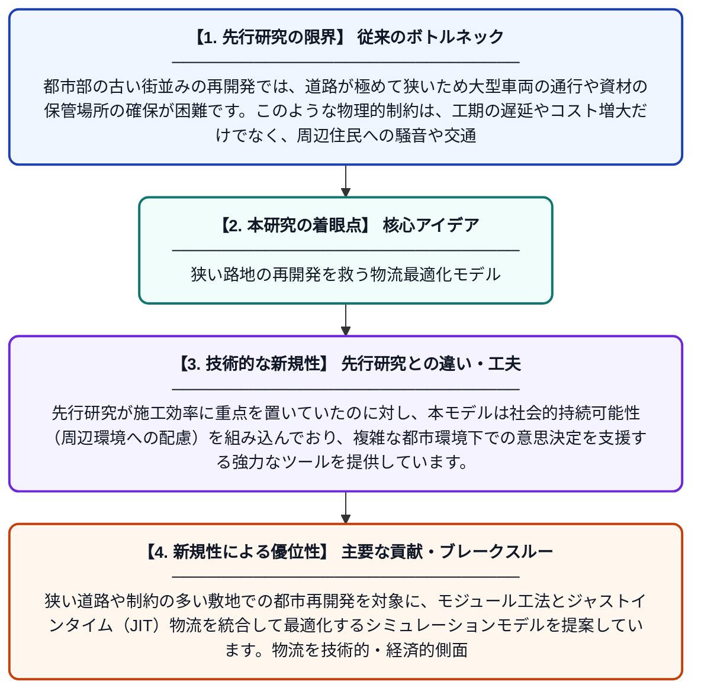

# 狭隘な道路が広がる都市再開発エリアにおけるモジュール工法とジャストインタイム物流の統合：シミュレーションベースの最適化モデル

**Original Title**: *Modular construction and just-in-time logistics integration in narrow-street urban regeneration areas: a simulation-based optimization model*

> **💡 一言要約**: 狭い路地の再開発を救う物流最適化モデル

| 項目 | 内容 |
|---|---|
| **著者** | HA Uçan |
| **掲載誌** | Engineering, Construction and Architectural … 2026 |
| **アラートキーワード** | logistics |
| **原文リンク** | [https://www.emerald.com/ecam/article-abstract/doi/10.1108/ECAM-05-2026-0851/1403951](https://www.emerald.com/ecam/article-abstract/doi/10.1108/ECAM-05-2026-0851/1403951) |
| **PDF版要約** | [README.pdf](./README.pdf) |

---

## 📊 新規性の図解（先行研究との違いと本研究のブレークスルー）

## 📝 要約

狭い道路や制約の多い敷地での都市再開発を対象に、モジュール工法とジャストインタイム（JIT）物流を統合して最適化するシミュレーションモデルを提案しています。物流を技術的・経済的側面だけでなく、社会的持続可能性の観点からも捉え、効率的な施工計画を可能にしました。

## ❓ どんな問題に取り組んだか

都市部の古い街並みの再開発では、道路が極めて狭いため大型車両の通行や資材の保管場所の確保が困難です。このような物理的制約は、工期の遅延やコスト増大だけでなく、周辺住民への騒音や交通渋滞といった社会的な問題も引き起こします。

## ✨ 何が新しい？何がすごい？（新規性）

この研究は、狭隘な路地という厳しい環境に特化し、モジュール工法とJIT物流を組み合わせたシミュレーションベースの最適化手法を開発した点が斬新です。先行研究が施工効率に重点を置いていたのに対し、本モデルは社会的持続可能性（周辺環境への配慮）を組み込んでおり、複雑な都市環境下での意思決定を支援する強力なツールを提供しています。

## 🎓 大学1年生向けの解説

道がとても狭い場所で大きな建物を建てるのは、まるでパズルを解くように大変です。この論文では、部屋などのパーツを工場で作ってから、必要な時にちょうどいいタイミングで現場へ届ける「ジャストインタイム」という仕組みをコンピューターで計算して最適化しました。これにより、工事がスムーズに進むだけでなく、近所迷惑も最小限に抑えながら街を新しくすることができます。
