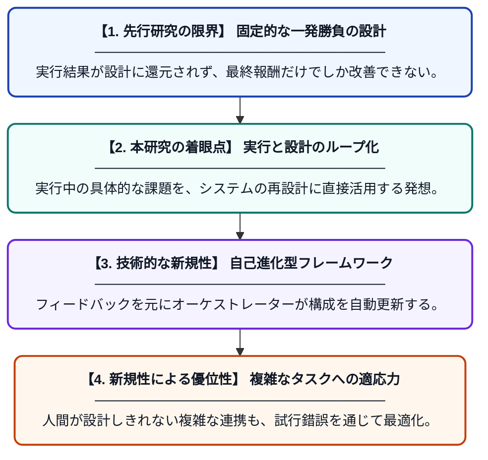

# MAS-Loop: ワンショット編成を超え、自己進化するマルチエージェントシステムへ

**Original Title**: *MAS-Loop: Beyond One-Shot Orchestration towards Self-Evolving Multi-Agent Systems*

> **💡 一言要約**: 実行の失敗を糧に、チーム編成を自ら進化させるAI

| 項目 | 内容 |
|---|---|
| **著者** | H Lin, Q Yang, C Qin |
| **掲載誌** | arXiv preprint arXiv:2610.38946 2026 |
| **アラートキーワード** | one shot |
| **PDF** | [https://arxiv.org/pdf/2610.38946](https://arxiv.org/pdf/2610.38946) |
| **原文リンク** | [https://arxiv.org/pdf/2610.38946](https://arxiv.org/pdf/2610.38946) |
| **PDF版要約** | [README.pdf](./README.pdf) |

---

## 📊 新規性の図解（先行研究との違いと本研究のブレークスルー）

## 📝 要約

従来のマルチエージェントシステム（MAS）が抱える「設計と実行フィードバックの乖離」を解消する、自己進化型のフレームワーク「MAS-Loop」を提案しています。実行中の具体的な挙動を設計に反映させることで、一度限りの編成（ワンショット）ではなく、継続的に最適化される連携を実現しました。

## ❓ どんな問題に取り組んだか

現在のマルチエージェント学習では、システム設計と実際の実行結果が切り離されており、エージェントの司令塔（オーケストレーター）は最終的な成否という断片的な報酬からしか学べません。そのため、複雑なタスクにおいて最適な役割分担や連携フローを効率的に構築できないという課題がありました。

## ✨ 何が新しい？何がすごい？（新規性）

本研究は、実行時の詳細なフィードバックを設計プロセスに直接統合する「MAS-Loop」を開発しました。従来のワンショットな最適化とは異なり、実行・評価・再設計のループを回すことで、MAS自体の構成を動的に進化させることが可能です。これにより、疎な報酬に頼ることなく、タスク特化型の洗練されたエージェント連携を自動で獲得できる点が革新的です。

## 🎓 大学1年生向けの解説

複数のAIが協力して仕事をする際、これまでは「最初に決めた作戦」を途中で変えることが困難でした。この研究では、AIが実際に動いてみて「うまくいかない」と感じた部分を即座に作戦会議にフィードバックし、チームの組み方やルールを自分で作り直せるようにしました。失敗を繰り返すたびにチームが強くなっていく、成長するAIチームのような仕組みです。
