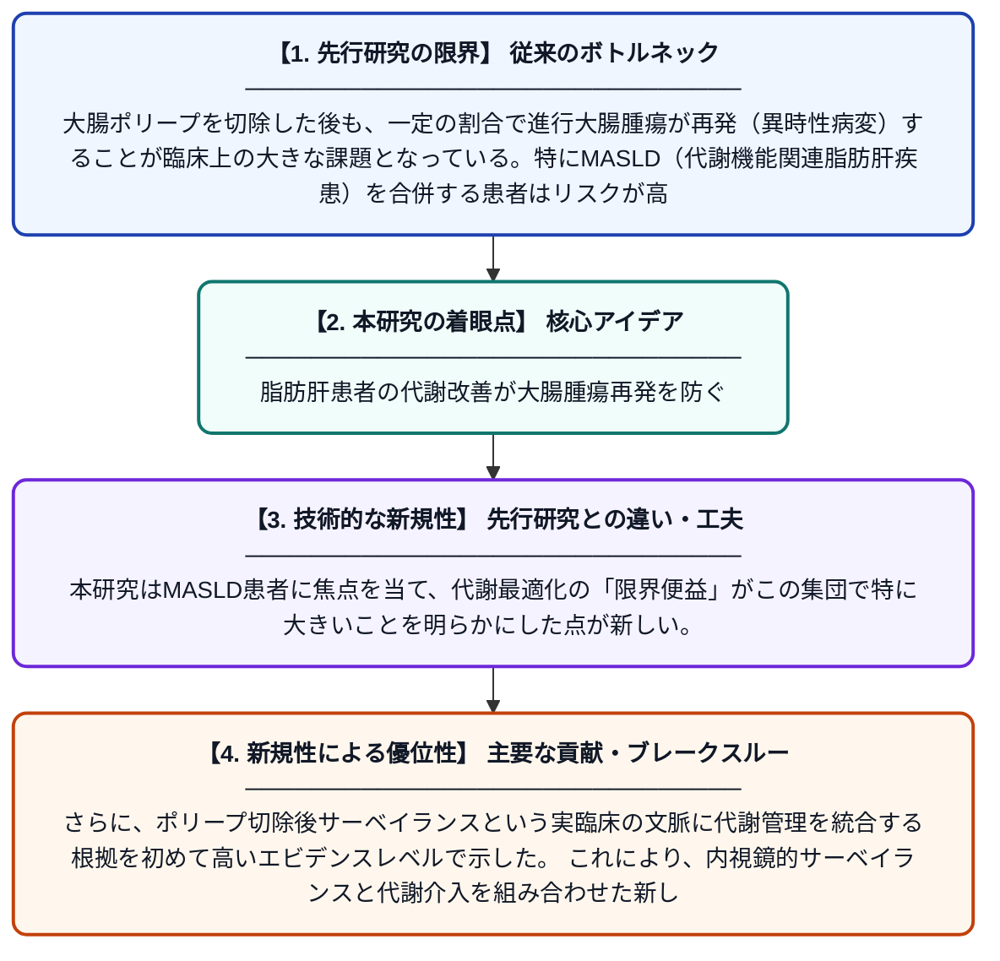

# MASLD患者における代謝最適化と異時性進行大腸腫瘍のリスク

**Original Title**: *Metabolic Optimization and Risk of Metachronous Advanced Colorectal Neoplasia in Patients With MASLD*

> **💡 一言要約**: 脂肪肝患者の代謝改善が大腸腫瘍再発を防ぐ

| 項目 | 内容 |
|---|---|
| **著者** | WY Chang, J Wang, HH Lin, HY Wu, HH Tseng |
| **掲載誌** | JAMA Network Open 2026 |
| **アラートキーワード** | optimization |
| **PDF** | [https://jamanetwork.com/journals/jamanetworkopen/articlepdf/2852140/chang_2026_oi_260711_1784645743.31625.pdf](https://jamanetwork.com/journals/jamanetworkopen/articlepdf/2852140/chang_2026_oi_260711_1784645743.31625.pdf) |
| **原文リンク** | [https://jamanetwork.com/journals/jamanetworkopen/articlepdf/2852140/chang_2026_oi_260711_1784645743.31625.pdf](https://jamanetwork.com/journals/jamanetworkopen/articlepdf/2852140/chang_2026_oi_260711_1784645743.31625.pdf) |
| **PDF版要約** | [README.pdf](./README.pdf) |

---

## 📊 新規性の図解（先行研究との違いと本研究のブレークスルー）

## 📝 要約

本研究は、代謝機能関連脂肪肝疾患（MASLD）を有する患者において、代謝パラメータの改善（代謝最適化）が大腸ポリープ切除後の進行大腸腫瘍の再発リスクを低下させるかどうかを検討した。MASLDを持つ患者では代謝最適化による「限界便益」が特に大きく、ポリープ切除後のサーベイランスに代謝管理を組み込む重要性が示唆された。これにより、大腸腫瘍の再発予防における代謝介入の有効性を支持する高いエビデンスが提供された。

## ❓ どんな問題に取り組んだか

大腸ポリープを切除した後も、一定の割合で進行大腸腫瘍が再発（異時性病変）することが臨床上の大きな課題となっている。特にMASLD（代謝機能関連脂肪肝疾患）を合併する患者はリスクが高いとされるが、代謝状態の改善がこのリスクを軽減できるかについては十分に検討されていなかった。

## ✨ 何が新しい？何がすごい？（新規性）

先行研究では大腸腫瘍と代謝疾患の関連性が示されてきたが、代謝パラメータを積極的に改善することが異時性進行大腸腫瘍の発生を実際に抑制するかを定量的に示した研究はほとんどなかった。本研究はMASLD患者に焦点を当て、代謝最適化の「限界便益」がこの集団で特に大きいことを明らかにした点が新しい。さらに、ポリープ切除後サーベイランスという実臨床の文脈に代謝管理を統合する根拠を初めて高いエビデンスレベルで示した。これにより、内視鏡的サーベイランスと代謝介入を組み合わせた新しい予防戦略の可能性が開かれた。

## 🎓 大学1年生向けの解説

大腸にできるポリープ（良性のできもの）は放置するとがんになることがあるため、内視鏡で切除します。しかし切除しても別の場所に新しいポリープやがんが再発することがあります。この研究では、肝臓に脂肪がたまる「脂肪肝」の患者さんに注目し、血糖・血圧・体重などの「代謝」を改善すると再発リスクが下がることを調べました。脂肪肝の人ほど代謝を整えることによる恩恵が大きいことがわかり、ポリープを取った後の経過観察に「代謝の管理」を加えることが再発予防につながる可能性を示しています。
