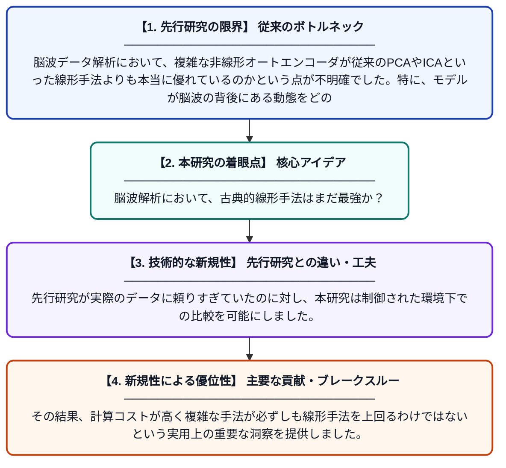

# EEG次元削減における潜在変数回復の制御された評価フレームワーク：合成グラウンドトゥルースを用いた分析

**Original Title**: *A controlled evaluation framework for latent-driven recovery in EEG dimensionality reduction: A Synthetic Ground-Truth Analysis*

> **💡 一言要約**: 脳波解析において、古典的線形手法はまだ最強か？

| 項目 | 内容 |
|---|---|
| **著者** | S Dabiri, E Abdelaleem, T Celikel, A Sederberg |
| **掲載誌** | Frontiers in Neuroimaging |
| **アラートキーワード** | ICA |
| **原文リンク** | [https://www.frontiersin.org/journals/neuroimaging/articles/10.3389/fnimg.2026.1998546/full](https://www.frontiersin.org/journals/neuroimaging/articles/10.3389/fnimg.2026.1998546/full) |
| **PDF版要約** | [README.pdf](./README.pdf) |

---

## 📊 新規性の図解（先行研究との違いと本研究のブレークスルー）

## 📝 要約

本研究は、脳波（EEG）解析における次元削減手法を評価するための合成データを用いた検証フレームワークを提案しました。その結果、複雑な非線形オートエンコーダが期待される一方で、従来のPCAやICAといった線形手法が依然として高い堅牢性と効率性を備えていることが示されました。

## ❓ どんな問題に取り組んだか

脳波データ解析において、複雑な非線形オートエンコーダが従来のPCAやICAといった線形手法よりも本当に優れているのかという点が不明確でした。特に、モデルが脳波の背後にある動態をどの程度正確に復元できているかを評価する基準が十分に確立されていませんでした。

## ✨ 何が新しい？何がすごい？（新規性）

本研究の新規性は、真の値が既知である合成EEGデータを用いることで、各手法の潜在変数の復元能力を厳密に定量評価した点にあります。先行研究が実際のデータに頼りすぎていたのに対し、本研究は制御された環境下での比較を可能にしました。その結果、計算コストが高く複雑な手法が必ずしも線形手法を上回るわけではないという実用上の重要な洞察を提供しました。

## 🎓 大学1年生向けの解説

脳波データは情報量が非常に多いため、PCA（主成分分析）などの手法で情報を圧縮して整理することが一般的です。最近ではAI技術（ニューラルネットワーク）を使った高度な圧縮法も注目されていますが、「本当に昔からの手法より優れているの？」という疑問がありました。この研究では、正解データがわかっている合成脳波を作って両者を徹底的に比較しました。結果として、シンプルな昔からの手法の方が、実は性能も計算効率も安定していて信頼できることが明らかになりました。
