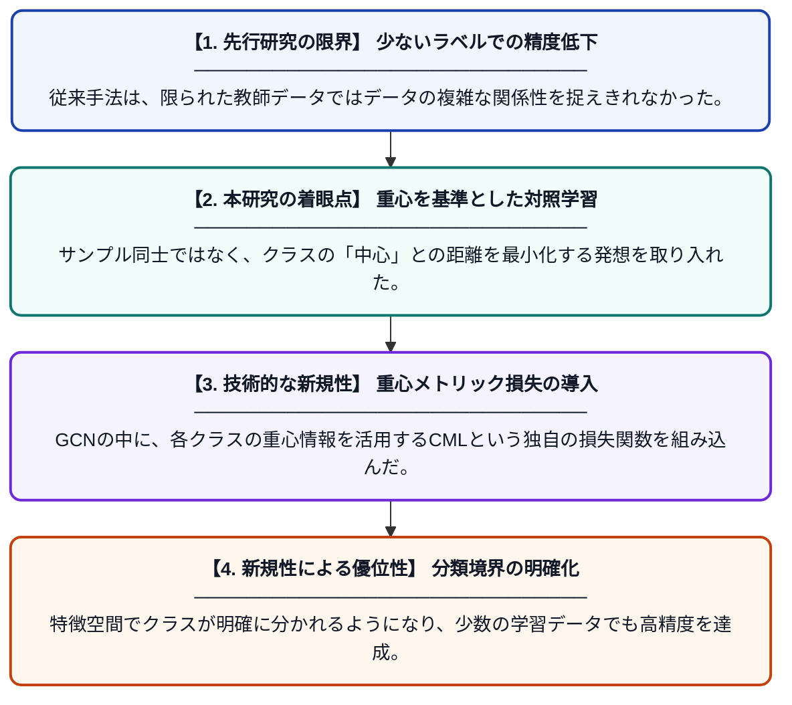

# 重心駆動型対照学習を用いたグラフベース半教師ありハイパースペクトル画像分類

**Original Title**: *Graph-Based Semi-Supervised Hyperspectral Image Classification with Centroid-Driven Contrastive Learning*

> **💡 一言要約**: 重心駆動の対照学習で、高品質な画像分類を実現

| 項目 | 内容 |
|---|---|
| **著者** | C Khmiri, W Inoubli, M Farah |
| **掲載誌** | International Web Information Systems Engineering … 2026 |
| **アラートキーワード** | Semi supervise |
| **PDF** | [https://hal.science/hal-05864952/document](https://hal.science/hal-05864952/document) |
| **原文リンク** | [https://hal.science/hal-05864952/document](https://hal.science/hal-05864952/document) |
| **PDF版要約** | [README.pdf](./README.pdf) |

---

## 📊 新規性の図解（先行研究との違いと本研究のブレークスルー）

## 📝 要約

ハイパースペクトル画像分類において、少量のラベル付きデータでも高精度な分類を実現するため、グラフ畳み込みネットワーク（GCN）に重心駆動型の対照学習を統合したフレームワークを提案しています。重心メトリック損失（CML）を導入することで、クラス間の特徴をより明確に分離し、限られた教師情報からの学習効率を向上させました。

## ❓ どんな問題に取り組んだか

ハイパースペクトル画像は非常に多次元であるため、ラベル付けに多大なコストがかかります。既存の半教師あり学習手法では、データの構造的な関係を十分に活用できず、ラベルが少ない場合に分類精度が大幅に低下するという課題がありました。

## ✨ 何が新しい？何がすごい？（新規性）

本研究の核心は、GCNの構造に「重心駆動型対照学習」を組み込んだ点にあります。従来の対照学習がサンプル間のペアを個別に扱うのに対し、本手法は各クラスの「重心」を基準に特徴量を最適化するCentroid Metric Loss (CML) を提案しました。これにより、計算コストを抑えつつ、同じクラスのデータをより密に、異なるクラスをより遠くに配置することに成功しました。

## 🎓 大学1年生向けの解説

人工衛星などで撮影される「ハイパースペクトル画像」は、普通の写真よりもはるかに多くの色（波長）の情報を持っています。この画像から「ここは森」「ここは建物」と分類するには専門家の手作業が必要ですが、この論文は、少量の見本だけでAIが賢く学習する方法を開発しました。クラスごとの「中心」を意識してデータを整理する新しい工夫により、少ないデータでも正確に分類できるようになります。
