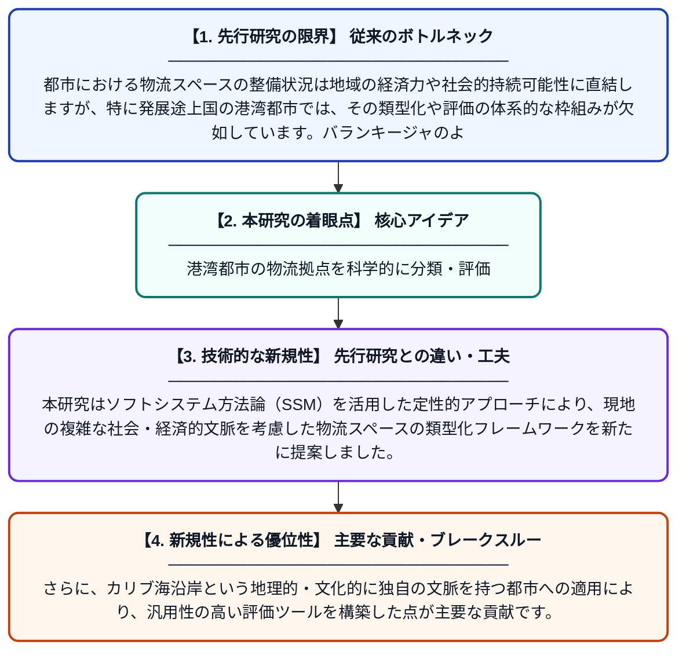

# 港湾都市における短距離物流スペースの展開：コロンビア・バランキージャを事例とした類型化と評価フレームワーク

**Original Title**: *The deployment of short-range logistics spaces in port cities: Categorization and evaluation framework via the case of Barranquilla (Colombia)*

> **💡 一言要約**: 港湾都市の物流拠点を科学的に分類・評価

| 項目 | 内容 |
|---|---|
| **著者** | KTM Peralta, AK Saryazdi, J Gonzalez-Feliu |
| **掲載誌** | Case Studies on Transport Policy 2026 |
| **アラートキーワード** | logistics |
| **原文リンク** | [https://www.sciencedirect.com/science/article/pii/S2213624X26002191](https://www.sciencedirect.com/science/article/pii/S2213624X26002191) |
| **PDF版要約** | [README.pdf](./README.pdf) |

---

## 📊 新規性の図解（先行研究との違いと本研究のブレークスルー）

## 📝 要約

本論文は、コロンビアのカリブ海港湾都市バランキージャを対象に、都市内の短距離物流スペース（ラストマイル配送拠点など）の類型化と評価フレームワークを構築した研究です。定性的なソフトシステム手法を用い、物流能力が地域の経済・社会に与える影響を分析しています。港湾都市特有の物流空間の配置と機能を体系的に整理することで、持続可能な都市物流計画への示唆を提供しています。

## ❓ どんな問題に取り組んだか

都市における物流スペースの整備状況は地域の経済力や社会的持続可能性に直結しますが、特に発展途上国の港湾都市では、その類型化や評価の体系的な枠組みが欠如しています。バランキージャのような中南米の港湾都市では、急増する物流需要に対応するための効率的な短距離物流スペースの計画・配置が急務となっています。

## ✨ 何が新しい？何がすごい？（新規性）

従来の研究は欧米の先進都市を対象としたものが多く、発展途上国の港湾都市における物流空間の分析は限られていました。本研究はソフトシステム方法論（SSM）を活用した定性的アプローチにより、現地の複雑な社会・経済的文脈を考慮した物流スペースの類型化フレームワークを新たに提案しました。さらに、カリブ海沿岸という地理的・文化的に独自の文脈を持つ都市への適用により、汎用性の高い評価ツールを構築した点が主要な貢献です。

## 🎓 大学1年生向けの解説

私たちがネットで注文した荷物は、倉庫から家に届くまでにいくつかの中継地点（物流スペース）を経由します。この研究では、コロンビアの港町バランキージャにある様々な物流の拠点がどんな種類に分けられるか、そしてそれらがどれだけうまく機能しているかを調べる方法を作りました。物流の仕組みをきちんと整理することで、街がより豊かになり、環境にも優しい配送システムを設計できるようになります。
