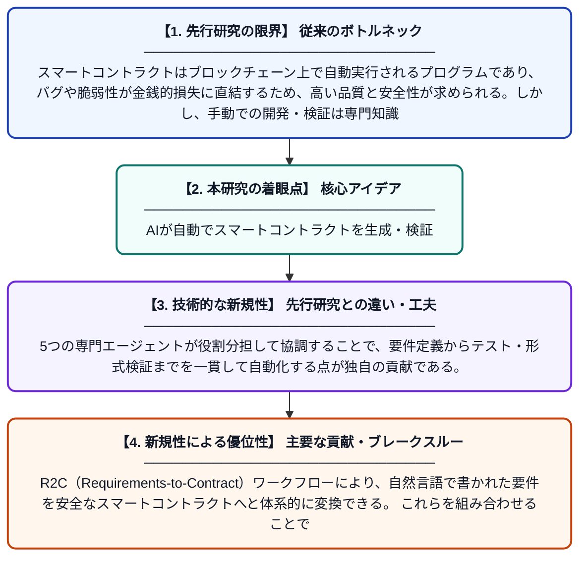

# MAGen: 自動テストと検証を組み込んだマルチエージェントによるスマートコントラクト生成

**Original Title**: *MAGen: Multi-agent smart contract generation with automated testing and verification*

> **💡 一言要約**: AIが自動でスマートコントラクトを生成・検証

| 項目 | 内容 |
|---|---|
| **著者** | L Liu, W Ke, H Chi, J Yan |
| **掲載誌** | Empirical Software Engineering 2027 |
| **アラートキーワード** | multi agent |
| **原文リンク** | [https://link.springer.com/article/10.1007/s10664-026-10931-2](https://link.springer.com/article/10.1007/s10664-026-10931-2) |
| **PDF版要約** | [README.pdf](./README.pdf) |

---

## 📊 新規性の図解（先行研究との違いと本研究のブレークスルー）

## 📝 要約

本論文では、LLM（大規模言語モデル）を活用したマルチエージェントフレームワーク「MAGen」を提案し、スマートコントラクトの生成ループ内に自動検証を埋め込む仕組みを実現している。Coordinator・Planner・Generator・Tester・Verifierの5つの軽量な役割を持つエージェントが協調し、要件からコントラクトへの変換（R2Cワークフロー）を構造化プロンプトで実行する。これにより、スマートコントラクトの品質・安全性・正確性を大幅に向上させることを目指している。

## ❓ どんな問題に取り組んだか

スマートコントラクトはブロックチェーン上で自動実行されるプログラムであり、バグや脆弱性が金銭的損失に直結するため、高い品質と安全性が求められる。しかし、手動での開発・検証は専門知識が必要で時間コストが高く、LLMを単純に利用するだけでは生成コードの正確性や安全性を保証することが難しい。生成と検証を統合した自動化された仕組みが欠如していることが大きな課題であった。

## ✨ 何が新しい？何がすごい？（新規性）

MAGenは、生成ループの内部に検証フェーズを組み込むという設計思想が先行研究と根本的に異なり、単なるコード生成にとどまらない。5つの専門エージェントが役割分担して協調することで、要件定義からテスト・形式検証までを一貫して自動化する点が独自の貢献である。R2C（Requirements-to-Contract）ワークフローにより、自然言語で書かれた要件を安全なスマートコントラクトへと体系的に変換できる。これらを組み合わせることで、従来手法と比較してコードの正確性・安全性・信頼性を大幅に向上させることに成功している。

## 🎓 大学1年生向けの解説

スマートコントラクトとは、ブロックチェーン上で自動的に実行される契約プログラムのことで、お金のやり取りなどを自動で管理します。このプログラムにバグがあると大きな損失につながるため、正確に作ることがとても重要です。MAGenは、ChatGPTのようなAIを複数の「役割を持つ担当者」に見立て、チームで協力してプログラムを自動作成・チェック・修正する仕組みです。人間が一から書いてチェックする作業をAIチームが丸ごと代わりに行うイメージです。これにより、専門家でなくても安全なスマートコントラクトを効率よく作れるようになることを目指しています。
