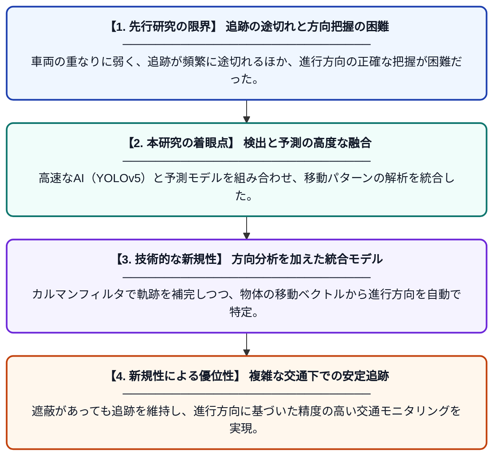

# YOLOv5とカルマンフィルタを用いたCCTV映像における移動方向分析機能付き車両追跡システムの最適化

**Original Title**: *OPTIMIZATION OF A YOLOV5 AND KALMAN FILTER-BASED VEHICLE TRACKING SYSTEM WITH VEHICLE MOVEMENT DIRECTION ANALYSIS IN CCTV VIDEO*

> **💡 一言要約**: 最新AIと予測技術で車両の動きを逃さず追跡

| 項目 | 内容 |
|---|---|
| **著者** | S Sumarno, FN Tambunan, PAMZR ZER |
| **掲載誌** | JURTEKSI (jurnal Teknologi dan Sistem … 2026 |
| **アラートキーワード** | kalman filter |
| **PDF** | [https://jurnal.stmikroyal.ac.id/index.php/jurteksi/article/download/4775/2339](https://jurnal.stmikroyal.ac.id/index.php/jurteksi/article/download/4775/2339) |
| **原文リンク** | [https://jurnal.stmikroyal.ac.id/index.php/jurteksi/article/download/4775/2339](https://jurnal.stmikroyal.ac.id/index.php/jurteksi/article/download/4775/2339) |
| **PDF版要約** | [README.pdf](./README.pdf) |

---

## 📊 新規性の図解（先行研究との違いと本研究のブレークスルー）

## 📝 要約

物体検出アルゴリズムのYOLOv5と軌跡予測を行うカルマンフィルタを統合し、CCTV映像内の車両追跡と移動方向の解析を最適化した研究です。検出精度を維持しながら、カルマンフィルタによって車両の動きを予測することで、複雑な交通状況下でも安定したリアルタイム監視を実現しました。

## ❓ どんな問題に取り組んだか

都市部の監視カメラ（CCTV）映像において、車両同士の重なりや高速移動によって追跡が途切れてしまうことが大きな課題でした。また、単なる位置の把握だけでなく、車両がどの方向に進んでいるかを自動で正確に判別する仕組みが不足していました。

## ✨ 何が新しい？何がすごい？（新規性）

本研究は、高速な物体検出を実現するYOLOv5と、動体の軌跡を予測するカルマンフィルタを統合し、さらに「移動方向の自動分析」を組み込んだ点が独創的です。先行研究と比較して、検出後の軌跡の連続性を維持するアルゴリズムを最適化し、遮蔽物があっても追跡を継続できる仕組みを構築しました。これにより、交通違反の検知や高度な交通流解析が可能になるという具体的な貢献をしています。

## 🎓 大学1年生向けの解説

街中にある監視カメラの映像から、AIを使って「車」を自動で見つけ、追いかける技術についての研究です。最新のAIで車を見つけるだけでなく、数学的な方法（カルマンフィルタ）を使って「車が次にどこへ動くか」を予測するのがポイントです。これにより、車が他の車に隠れてしまっても見失わずに追い続けることができます。さらに、その車がどこに向かっているかも自動でわかるようになります。
