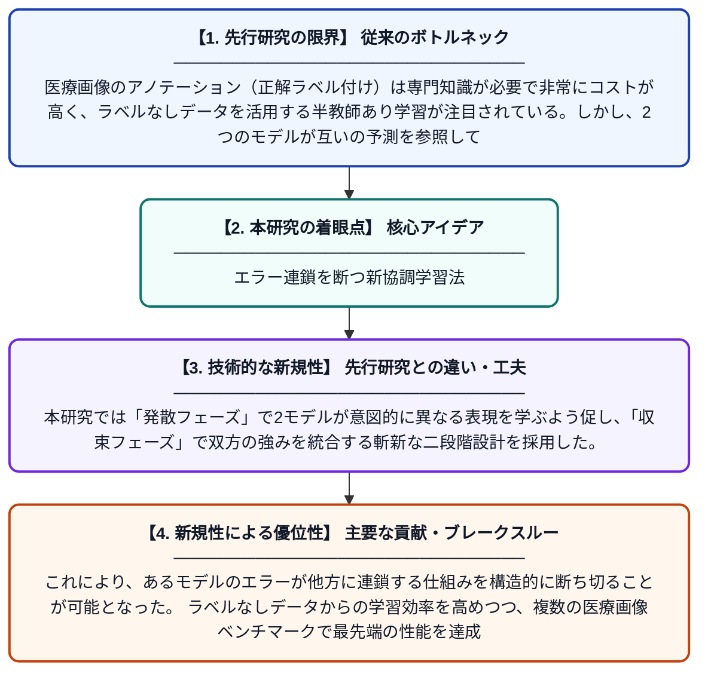

# 半教師あり医療画像セグメンテーションのための発散-収束協調によるエラー結合の打破

**Original Title**: *Breaking error coupling via divergent–convergent coordination for semi-supervised medical image segmentation*

> **💡 一言要約**: エラー連鎖を断つ新協調学習法

| 項目 | 内容 |
|---|---|
| **著者** | Y Wan, Z Chen, Y Xu, Y Xu, M Li, Y Wang |
| **掲載誌** | Medical Image Analysis 2026 |
| **アラートキーワード** | Semi supervise |
| **原文リンク** | [https://www.sciencedirect.com/science/article/pii/S1361841526003051](https://www.sciencedirect.com/science/article/pii/S1361841526003051) |
| **PDF版要約** | [README.pdf](./README.pdf) |

---

## 📊 新規性の図解（先行研究との違いと本研究のブレークスルー）

## 📝 要約

本研究は、半教師あり医療画像セグメンテーションにおける双モデル協調学習で生じる「エラー結合」とモデルの均質化という課題に取り組む。これを解決するために、発散-収束フレームワーク（DCF）を提案し、2つのモデルが互いに異なる視点を持ちながらも最終的に正確な予測へ収束するよう設計した。限られたラベルデータしか使えない状況でも、セグメンテーション精度を大幅に向上させることを実証している。

## ❓ どんな問題に取り組んだか

医療画像のアノテーション（正解ラベル付け）は専門知識が必要で非常にコストが高く、ラベルなしデータを活用する半教師あり学習が注目されている。しかし、2つのモデルが互いの予測を参照して学習する従来の双モデル協調学習では、一方のモデルのエラーがもう一方に伝播・増幅する「エラー結合」が深刻な問題となる。さらに、2モデルが同じ傾向に染まる「均質化」により、多様な視点から学ぶ本来の効果が失われてしまう。

## ✨ 何が新しい？何がすごい？（新規性）

従来の双モデル協調学習はモデルを単に異なるアーキテクチャにするだけで均質化を防ごうとしていたが、エラー結合の根本的解決には至っていなかった。本研究では「発散フェーズ」で2モデルが意図的に異なる表現を学ぶよう促し、「収束フェーズ」で双方の強みを統合する斬新な二段階設計を採用した。これにより、あるモデルのエラーが他方に連鎖する仕組みを構造的に断ち切ることが可能となった。ラベルなしデータからの学習効率を高めつつ、複数の医療画像ベンチマークで最先端の性能を達成している。

## 🎓 大学1年生向けの解説

病院のCTやMRI画像から臓器や病変の範囲を自動で見つけるAIを作る研究です。AIの学習には「正解データ」が必要ですが、医療画像の正解を作るには専門家が手作業で行う必要があり、とても大変です。そこで、正解のない画像も使って学習する方法（半教師あり学習）が研究されていますが、2つのAIが互いに間違いを教え合ってしまう「エラーの連鎖」が問題でした。この研究では、まず2つのAIをあえて違う方向に育て、その後に良いところだけを合わせる「発散→収束」という新しいアプローチでこの問題を解決しました。
