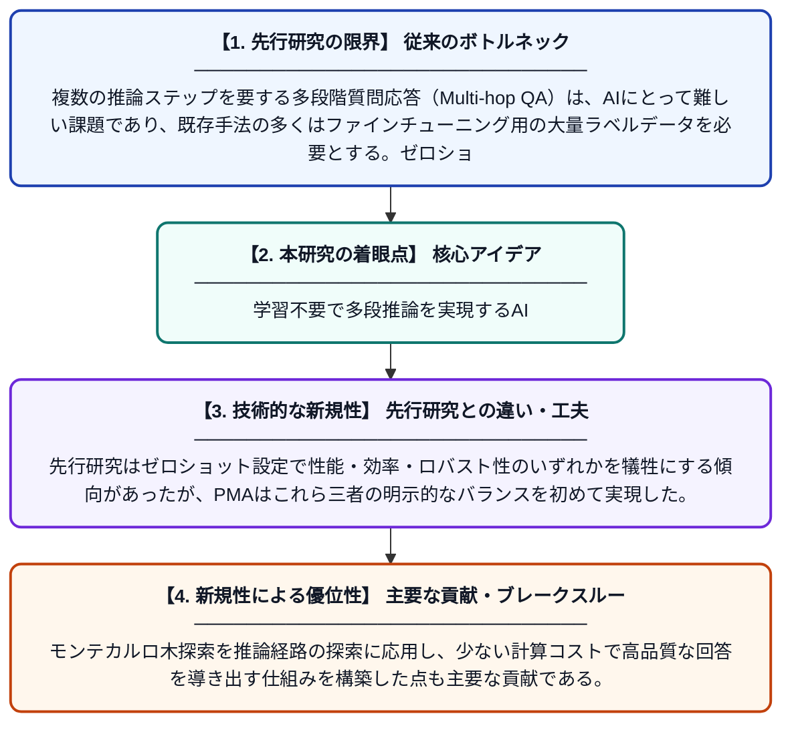

# 少ないほど良い：ゼロショット多段階質問応答のためのPMAフレームワーク

**Original Title**: *Less is more: a PMA framework for zero-shot multi-hop question answering*

> **💡 一言要約**: 学習不要で多段推論を実現するAI

| 項目 | 内容 |
|---|---|
| **著者** | R Dong, X Wang, S Li, F Li |
| **掲載誌** | Journal of Intelligent Information Systems 2026 |
| **アラートキーワード** | zero shot |
| **原文リンク** | [https://link.springer.com/article/10.1007/s10844-026-01081-4](https://link.springer.com/article/10.1007/s10844-026-01081-4) |
| **PDF版要約** | [README.pdf](./README.pdf) |

---

## 📊 新規性の図解（先行研究との違いと本研究のブレークスルー）

## 📝 要約

本論文では、ゼロショット設定における多段階質問応答を実現するPMA（Predictor-MCTS-Aggregation）フレームワークを提案する。PMAは性能・効率・ロバスト性の三つを明示的にバランスさせる設計となっており、追加の学習データなしで複数ステップの推論を可能にする。モンテカルロ木探索（MCTS）を活用することで、推論経路の探索と集約を効果的に行う。

## ❓ どんな問題に取り組んだか

複数の推論ステップを要する多段階質問応答（Multi-hop QA）は、AIにとって難しい課題であり、既存手法の多くはファインチューニング用の大量ラベルデータを必要とする。ゼロショット設定（追加学習なし）での高精度・高効率・高ロバスト性の同時達成は未解決の問題であった。

## ✨ 何が新しい？何がすごい？（新規性）

本研究は、Predictor・MCTS・Aggregationという三つのモジュールを組み合わせた統合フレームワークPMAを新たに提案している点が独創的である。先行研究はゼロショット設定で性能・効率・ロバスト性のいずれかを犠牲にする傾向があったが、PMAはこれら三者の明示的なバランスを初めて実現した。モンテカルロ木探索を推論経路の探索に応用し、少ない計算コストで高品質な回答を導き出す仕組みを構築した点も主要な貢献である。

## 🎓 大学1年生向けの解説

「多段階質問応答」とは、例えば『Aさんの母校の創立者は誰か？』のように、複数の情報をつなげないと答えられない質問に答えるタスクです。多くのAIはこのような質問が苦手で、大量の練習データが必要でした。この研究では、練習データなしでも賢く推論できる『PMA』という仕組みを作りました。ゲームのAIでよく使われる『木探索』のアイデアを応用することで、効率よく正確な答えを見つけられるようにしています。つまり、少ない情報・少ない計算でも、より賢い推論ができることを示した研究です。
