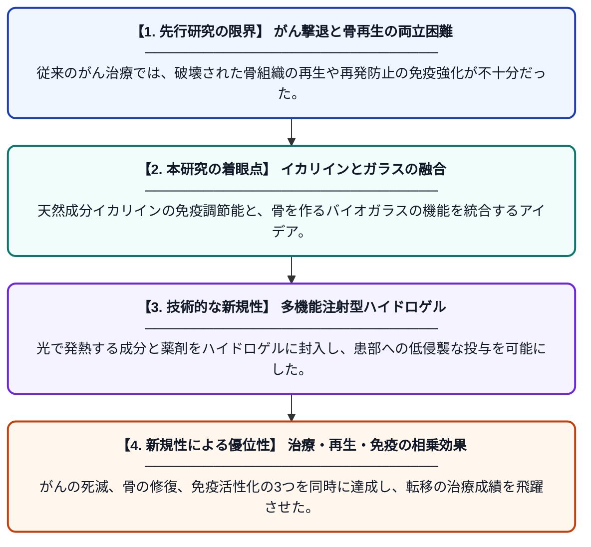

# イカリイン含有バイオアクティブガラスハイドロゲルを用いた乳がん骨転移の相乗的光熱・免疫・骨再生療法

**Original Title**: *Synergistic photothermal-immuno-osteogenic therapy of breast cancer bone metastasis using an icariin-bioactive glass hydrogel*

> **💡 一言要約**: 光・免疫・骨再生で乳がん骨転移を撃退する新ゲル

| 項目 | 内容 |
|---|---|
| **著者** | X Wen, Z Guo, J Chen, W Liang, Y Diao, D Huang… |
| **掲載誌** | Colloid and Interface … 2026 |
| **アラートキーワード** | ICA |
| **原文リンク** | [https://www.sciencedirect.com/science/article/pii/S2215038226000567](https://www.sciencedirect.com/science/article/pii/S2215038226000567) |
| **PDF版要約** | [README.pdf](./README.pdf) |

---

## 📊 新規性の図解（先行研究との違いと本研究のブレークスルー）

## 📝 要約

イカリイン（ICA）をバイオアクティブガラス（BG）に組み込み、注射可能なハイドロゲルに封入した新しい治療システムを開発しました。このシステムは、光熱療法によるがん細胞の破壊、免疫環境の改善、および失われた骨組織の再生を同時に促進することで、難治性の乳がん骨転移を効果的に治療します。

## ❓ どんな問題に取り組んだか

乳がんの骨転移は、がん細胞の増殖だけでなく深刻な骨組織の破壊を伴うため、極めて治療が困難な疾患です。既存の治療法では、がんの死滅と破壊された骨の再生を両立させることが難しく、さらに再発を防ぐための免疫系の制御も大きな課題となっていました。

## ✨ 何が新しい？何がすごい？（新規性）

本研究の最大の新規性は、天然由来の薬効成分イカリインとバイオアクティブガラスを融合させ、注射可能な多機能ハイドロゲルとして構築した点にあります。近赤外光による光熱療法（PTT）に加え、イカリインによる免疫チェックポイント阻害に似た免疫調節効果、そしてバイオガラスによる骨形成促進を一つのシステムで実現しました。これにより、局所的ながん治療、全身的な免疫応答の誘導、そして損傷した骨の修復という三つの機能を相乗的に発揮させることに成功しています。

## 🎓 大学1年生向けの解説

乳がんが骨に転移すると、がんが骨を溶かしてボロボロにしてしまうため、非常に治しにくい状態になります。この研究では、注射で骨の悪い部分に直接届けられる「特別なゼリー（ハイドロゲル）」を作りました。このゼリーに光を当てると熱が出てがん細胞を直接焼き殺し、さらに中に入っている成分が骨を新しく作り直し、体自身の免疫力を高めて再発も防いでくれます。つまり、「がんを掃除しながら、骨の修理もして、再発の見張り番も育てる」という、一人三役のすごい治療法なのです。
