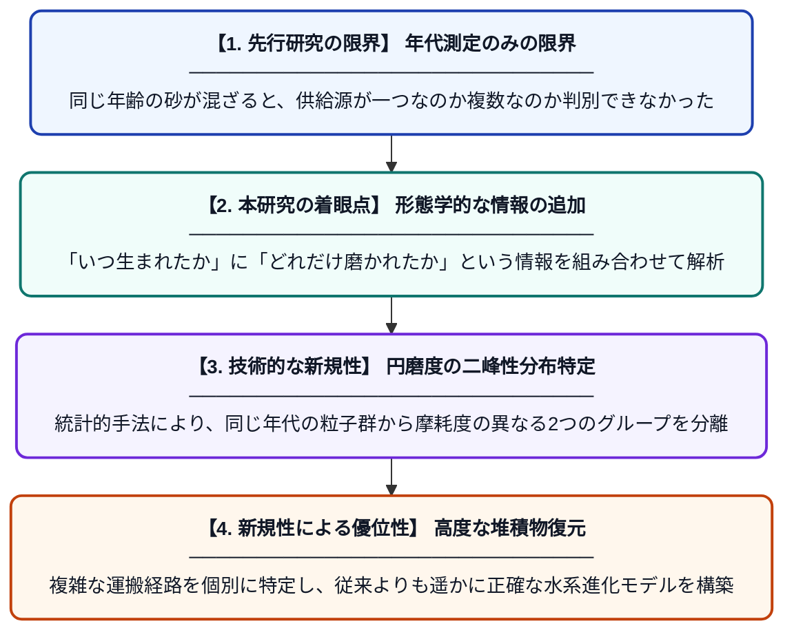

# 砕屑性ジルコンの年代測定と形態学的特徴からみる渤海湾盆地・饒陽陥没の堆積物経路と水系進化の制約

**Original Title**: *Constraints From Detrital Zircon Geochronology and Morphology on Sediment Routing and Drainage Evolution of the Paleogene Raoyang Sag, Bohai Bay Basin …*

> **💡 一言要約**: ジルコンの「年齢」と「形」で古代の川を復元

| 項目 | 内容 |
|---|---|
| **著者** | H Chen, GR Sharman, X Zhu |
| **掲載誌** | Basin Research 2026 |
| **アラートキーワード** | kernel density estimation |
| **PDF** | [https://www.researchgate.net/profile/Hehe-Chen-2/publication/416768872_Constraints_From_Detrital_Zircon_Geochronology_and_Morphology_on_Sediment_Routing_and_Drainage_Evolution_of_the_Paleogene_Raoyang_Sag_Bohai_Bay_Basin_China/links/6add73ba27751b4f5d38b1e1/Constraints-From-Detrital-Zircon-Geochronology-and-Morphology-on-Sediment-Routing-and-Drainage-Evolution-of-the-Paleogene-Raoyang-Sag-Bohai-Bay-Basin-China.pdf](https://www.researchgate.net/profile/Hehe-Chen-2/publication/416768872_Constraints_From_Detrital_Zircon_Geochronology_and_Morphology_on_Sediment_Routing_and_Drainage_Evolution_of_the_Paleogene_Raoyang_Sag_Bohai_Bay_Basin_China/links/6add73ba27751b4f5d38b1e1/Constraints-From-Detrital-Zircon-Geochronology-and-Morphology-on-Sediment-Routing-and-Drainage-Evolution-of-the-Paleogene-Raoyang-Sag-Bohai-Bay-Basin-China.pdf) |
| **原文リンク** | [https://www.researchgate.net/profile/Hehe-Chen-2/publication/416768872_Constraints_From_Detrital_Zircon_Geochronology_and_Morphology_on_Sediment_Routing_and_Drainage_Evolution_of_the_Paleogene_Raoyang_Sag_Bohai_Bay_Basin_China/links/6add73ba27751b4f5d38b1e1/Constraints-From-Detrital-Zircon-Geochronology-and-Morphology-on-Sediment-Routing-and-Drainage-Evolution-of-the-Paleogene-Raoyang-Sag-Bohai-Bay-Basin-China.pdf](https://www.researchgate.net/profile/Hehe-Chen-2/publication/416768872_Constraints_From_Detrital_Zircon_Geochronology_and_Morphology_on_Sediment_Routing_and_Drainage_Evolution_of_the_Paleogene_Raoyang_Sag_Bohai_Bay_Basin_China/links/6add73ba27751b4f5d38b1e1/Constraints-From-Detrital-Zircon-Geochronology-and-Morphology-on-Sediment-Routing-and-Drainage-Evolution-of-the-Paleogene-Raoyang-Sag-Bohai-Bay-Basin-China.pdf) |
| **PDF版要約** | [README.pdf](./README.pdf) |

---

## 📊 新規性の図解（先行研究との違いと本研究のブレークスルー）

## 📝 要約

渤海湾盆地の饒陽陥没において、ジルコンの年代分布と結晶の円磨度を組み合わせた解析を実施しました。特定の年代層で円磨度が二峰性を示すことを発見し、異なる運搬履歴を持つ複数の供給源が混在していたことを明らかにしました。

## ❓ どんな問題に取り組んだか

堆積物の供給源を特定する際、ジルコンの年代測定だけでは、同じ年代値を持つ異なる場所からの供給を区別できないという課題がありました。特に複雑な地質構造を持つ盆地では、単一の指標だけでは詳細な水系の変遷を追うことが困難でした。

## ✨ 何が新しい？何がすごい？（新規性）

本研究は、ジルコンの年代データに「円磨度（結晶の丸み）」という形態学的指標を統合した点が非常に画期的です。核密度推定（KDE）を用いて、100–200 Maなどの特定年代層内に、摩耗の進んだ粒子と未熟な粒子が混在する二峰性分布を特定しました。これにより、同じ年代の砂でも異なる距離や経路を経て運ばれてきたことを数学的に分離し、古第三紀の詳細な水系進化を復元することに成功しました。

## 🎓 大学1年生向けの解説

大昔の川がどこから砂を運んできたかを調べるために、地層に含まれる「ジルコン」という非常に丈夫な宝石の一種を分析しました。ジルコンには誕生した時の年齢が刻まれていますが、同じ年齢でも「角張ったもの」と「丸みを帯びたもの」があることに注目したのがこの研究の面白い点です。丸いほど遠くから旅をしてきた証拠になるため、砂の年齢と形のセットから、数千万年前の中国の地形がどのように変わっていったのかを精密に突き止めました。
