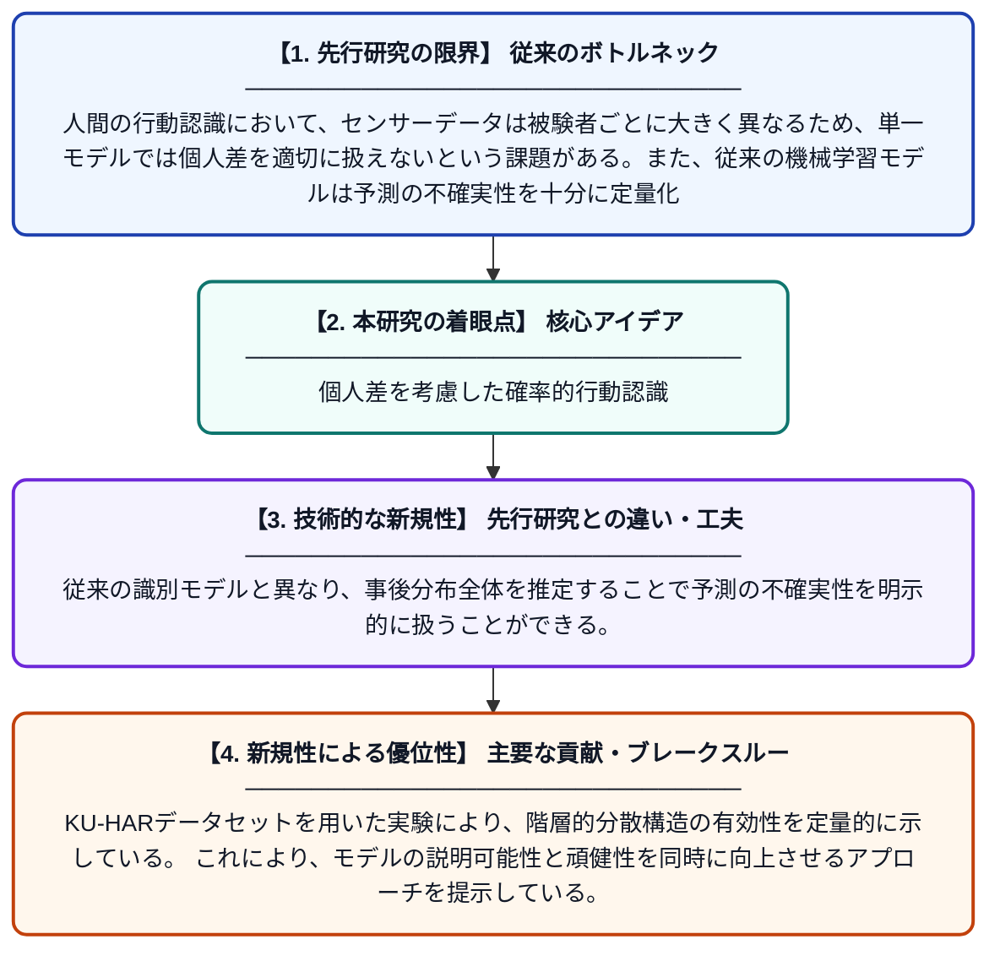

# 人間行動認識のための階層ベイズ推論：被験者レベルの変動と事後不確実性のモデリング

**Original Title**: *Hierarchical Bayesian Inference for Human Activity: Modeling Subject-Level Variability and Posterior Uncertainty*

> **💡 一言要約**: 個人差を考慮した確率的行動認識

| 項目 | 内容 |
|---|---|
| **著者** | U Yasmeen |
| **掲載誌** | 2026 |
| **アラートキーワード** | Bayesian hierarchical ... |
| **PDF** | [https://pdpublishers.com/wp-content/uploads/2026/07/PD2601208003-Uzma-Yasmeen.pdf](https://pdpublishers.com/wp-content/uploads/2026/07/PD2601208003-Uzma-Yasmeen.pdf) |
| **原文リンク** | [https://pdpublishers.com/wp-content/uploads/2026/07/PD2601208003-Uzma-Yasmeen.pdf](https://pdpublishers.com/wp-content/uploads/2026/07/PD2601208003-Uzma-Yasmeen.pdf) |
| **PDF版要約** | [README.pdf](./README.pdf) |

---

## 📊 新規性の図解（先行研究との違いと本研究のブレークスルー）

## 📝 要約

本論文は、KU-HAR人間行動データセットを用いて、階層ベイズモデルによる行動認識の推論結果を示している。被験者ごとのばらつきを階層構造でモデル化し、事後分布の推定と不確実性の定量化を実現している。これにより、個人差を考慮したより信頼性の高い行動認識が可能となる。

## ❓ どんな問題に取り組んだか

人間の行動認識において、センサーデータは被験者ごとに大きく異なるため、単一モデルでは個人差を適切に扱えないという課題がある。また、従来の機械学習モデルは予測の不確実性を十分に定量化できず、信頼性の評価が困難であった。

## ✨ 何が新しい？何がすごい？（新規性）

本研究は、階層ベイズモデルを人間行動認識に適用し、被験者レベルのパラメータ変動をグループレベルの事前分布でまとめて学習する点が新しい。従来の識別モデルと異なり、事後分布全体を推定することで予測の不確実性を明示的に扱うことができる。KU-HARデータセットを用いた実験により、階層的分散構造の有効性を定量的に示している。これにより、モデルの説明可能性と頑健性を同時に向上させるアプローチを提示している。

## 🎓 大学1年生向けの解説

スマートフォンのセンサーを使って「今、歩いているのか、走っているのか」を当てるシステムを想像してください。ただし、人によって歩き方や体の動かし方は全然違います。この研究では「ベイズ統計」という確率を使った方法で、人それぞれの違いをうまく取り込みながら行動を予測しています。さらに、「この予測はどのくらい自信があるか」という不確かさも一緒に計算できるのが特徴です。人の多様性を考慮した、より賢くて正直な行動認識システムを目指しています。
