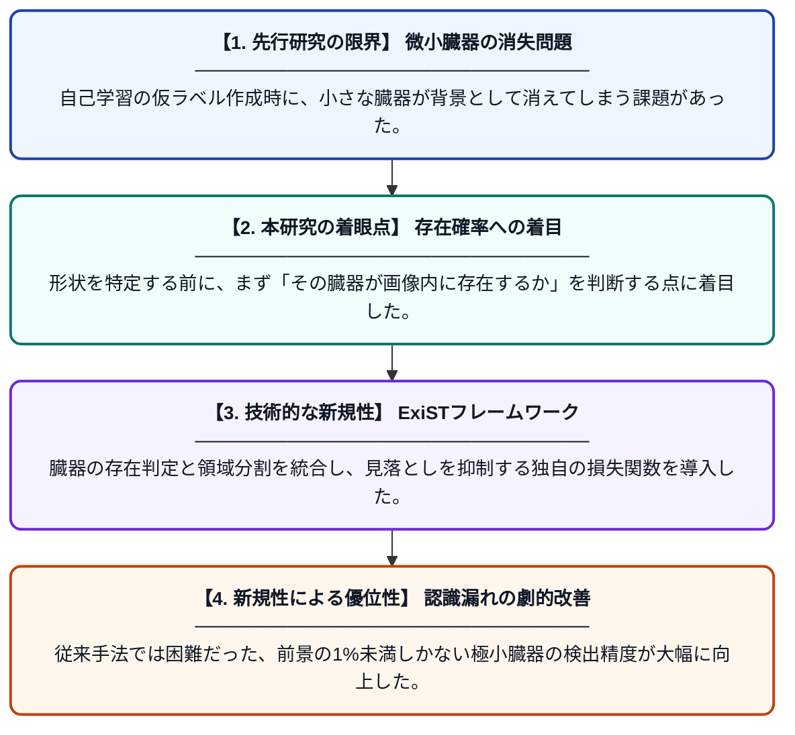

# ExiST：半教師あり複数臓器セグメンテーションのための存在を考慮した自己学習

**Original Title**: *ExiST: Existence-Aware Self-Training for Semi-Supervised Multi-Organ Segmentation*

> **💡 一言要約**: 消えゆく微小臓器を「存在感」で救うAI技術

| 項目 | 内容 |
|---|---|
| **著者** | MR Rahman, P Kumar, W Maass |
| **掲載誌** | arXiv preprint arXiv:2611.23581 2026 |
| **アラートキーワード** | Semi supervise |
| **PDF** | [https://arxiv.org/pdf/2611.23581](https://arxiv.org/pdf/2611.23581) |
| **原文リンク** | [https://arxiv.org/pdf/2611.23581](https://arxiv.org/pdf/2611.23581) |
| **PDF版要約** | [README.pdf](./README.pdf) |

---

## 📊 新規性の図解（先行研究との違いと本研究のブレークスルー）

## 📝 要約

わずかなラベル付きデータから十数種類の臓器を識別する半教師あり学習において、微小な臓器が無視される問題を解決する新手法「ExiST」を提案しました。臓器の有無を明示的に判定する仕組みを導入することで、背景に埋もれがちな小さな臓器の認識精度を大幅に向上させています。

## ❓ どんな問題に取り組んだか

従来の自己学習（Self-Training）では、ラベルのない画像に対してAIが生成する「仮の正解ラベル」から小さな臓器が消えてしまうことが多く、学習が停滞する問題がありました。特に前景の1%未満しか占めない微小な臓器は、背景の一部として誤認されやすく、一度見失うと学習を再開できない「失敗モード」に陥りがちです。

## ✨ 何が新しい？何がすごい？（新規性）

本研究の最大の特徴は、臓器が「そこに存在するかどうか」を判定する存在認識モジュールを自己学習に組み込んだ点です。先行研究がピクセル単位の分類のみに依存していたのに対し、ExiSTは画像全体から臓器の有無を特定し、その確信度を損失関数に同期させる独自の「Existence-Aware Loss」を開発しました。これにより、仮ラベルから臓器が欠落していても、その存在を考慮してモデルを修正し続けることが可能になりました。

## 🎓 大学1年生向けの解説

医療画像から臓器を自動で見つけ出すAIを、少ないお手本で賢くするための研究です。これまでのAIは、大きな臓器を見つけるのは得意でしたが、豆粒のような小さな臓器は見逃してしまうと「そこには何もなかった」と勘違いして、それ以上学習しなくなる癖がありました。この研究では、AIに「このあたりに小さな臓器があるはずだ」と予測させる新しいアンテナを取り付けました。これにより、はっきり見えにくい小さな臓器もしっかり認識して、精度の高い診断をサポートできるようになります。
