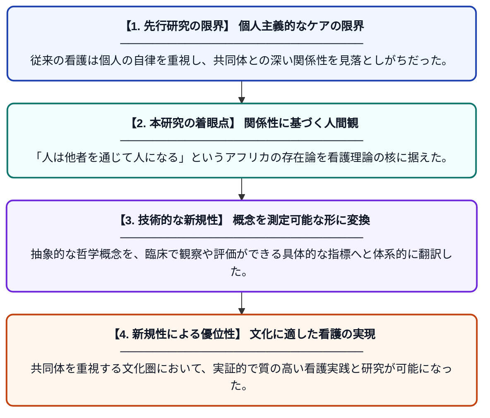

# アフリカの関係論的存在論の具体化：共同体・関係的「人への生成」理論の概念導出

**Original Title**: *Operationalizing African Relational Ontology: Concept Derivation for the Theory of Communal–Relational Person-Becoming*

> **💡 一言要約**: アフリカ哲学を看護の現場で使える指標に変換

| 項目 | 内容 |
|---|---|
| **著者** | J Bayuo |
| **掲載誌** | Advances in Nursing Science 2026 |
| **アラートキーワード** | Ontology |
| **原文リンク** | [https://www.ovid.com/jnls/advancesinnursingscience/abstract/10.1097/ans.0000000000000714~operationalizing-african-relational-ontology-concept](https://www.ovid.com/jnls/advancesinnursingscience/abstract/10.1097/ans.0000000000000714~operationalizing-african-relational-ontology-concept) |
| **PDF版要約** | [README.pdf](./README.pdf) |

---

## 📊 新規性の図解（先行研究との違いと本研究のブレークスルー）

## 📝 要約

本研究は、アフリカの哲学に基づく「関係論的存在論」を看護学において初めて体系的に具体化し、抽象的な理論を測定可能で臨床的に意味のある概念へと翻訳しました。これにより、個人を共同体や他者との関係性の中で捉えるケアの質を、客観的に評価・実践するための基盤を構築しています。

## ❓ どんな問題に取り組んだか

従来の看護理論は西洋的な個人主義に偏る傾向があり、共同体や他者との繋がりを重視するアフリカ的な存在論を、実際の臨床現場や研究で客観的に評価・適用するための具体的な指標が不足していました。

## ✨ 何が新しい？何がすごい？（新規性）

看護学においてアフリカの関係論的存在論を初めて体系的に「操作化（具体化）」した点が最大の貢献です。単なる哲学的な議論に留まらず、観察・測定が可能な臨床概念へと落とし込むことで、多様な文化的背景を持つ患者へのケアを科学的に検証し、実践する道を開拓しました。先行研究の理論的枠組みを実証的な研究ツールへと進化させています。

## 🎓 大学1年生向けの解説

「自分」という存在は、一人で完成するのではなく、周りの人や地域との関わりの中で作られていくという考え方があります。この論文は、そのアフリカ特有の考え方を、看護師さんが病院で実際に使える「具体的な指標」に変えたものです。これによって、家族や仲間との絆を大切にする患者さんに対して、よりその人の文化や価値観に合った適切なケアができるようになります。
