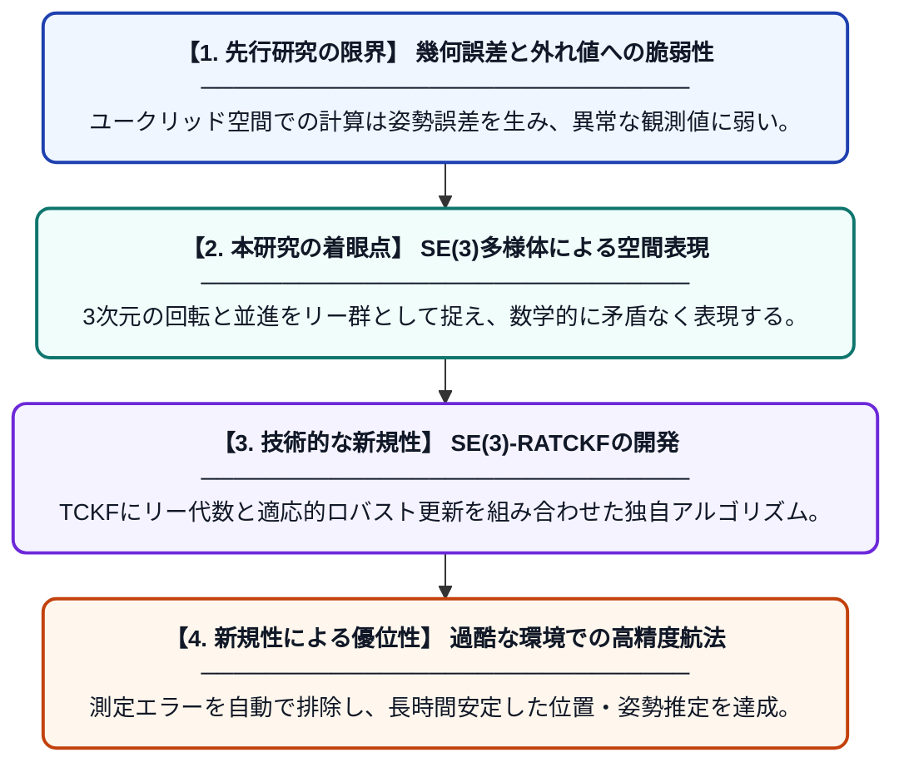

# SE(3)に基づく適応的ロバストフィルタリングとSINS/DVL航法への応用

**Original Title**: *Adaptive Robust Filtering Based on SE (3) and Its Application in SINS/DVL Navigation*

> **💡 一言要約**: リー群で水中航法の精度と安定性を劇的に向上

| 項目 | 内容 |
|---|---|
| **著者** | L MingMing, L Jinlai |
| **掲載誌** | 2026 |
| **アラートキーワード** | kalman filter |
| **原文リンク** | [https://www.researchsquare.com/article/rs-11442439/latest](https://www.researchsquare.com/article/rs-11442439/latest) |
| **PDF版要約** | [README.pdf](./README.pdf) |

---

## 📊 新規性の図解（先行研究との違いと本研究のブレークスルー）

## 📝 要約

本論文は、リー群・リー代数理論（SE(3)）を変換求積カルマンフィルタ（TCKF）に導入した新しい航法アルゴリズムを提案しています。異常な測定データに対処するための適応的ロバスト機能を備えたSE(3)-RATCKFを構築し、慣性航法システム（SINS）とドップラー速度ログ（DVL）の統合精度を大幅に向上させました。

## ❓ どんな問題に取り組んだか

従来のSINS/DVL統合航法では、3次元の回転や平行移動をユークリッド空間で処理するため、幾何学的な制約が無視され誤差が生じる問題がありました。また、水中環境では測定データに突発的な外れ値が含まれることが多く、これが推定精度を著しく悪化させる要因となっていました。

## ✨ 何が新しい？何がすごい？（新規性）

本研究の新規性は、状態推定プロセス全体をSE(3)多様体上で行うことで、剛体運動の幾何学的構造を厳密に維持した点にあります。さらに、適応的ロバスト制御をTCKFの観測更新フェーズに統合したことで、測定エラーの影響を自動的に抑制する仕組みを構築しました。これにより、複雑な水中環境下においても、従来のフィルタリング手法を上回る推定安定性と精度を同時に実現しています。

## 🎓 大学1年生向けの解説

水中を進む探査機が自分の位置を知る際、センサーの誤差やノイズが大きな問題になります。この研究は、数学の「リー群」という高度な道具を使って、3次元の動きをより正確に計算できるようにしました。さらに、センサーが間違ったデータを出したときに、それを自動的に「怪しい」と判断して無視する賢い機能も備えています。その結果、たとえ海の状態が悪くても、迷子にならずに正確に進み続けることが可能になりました。
