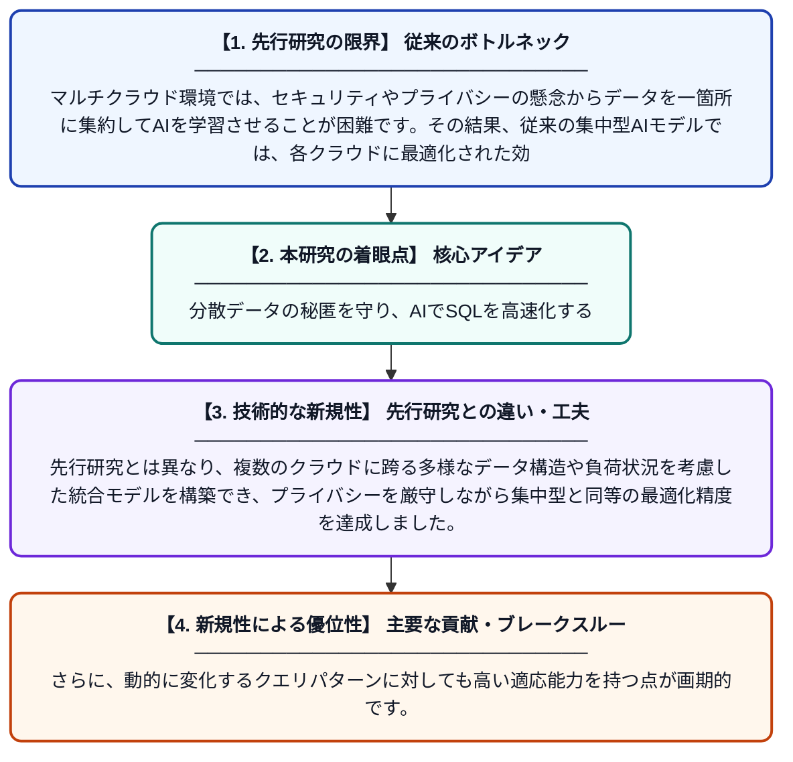

# マルチクラウド・データウェアハウスにおけるAI駆動型クエリ最適化のための連合学習

**Original Title**: *Federated Learning for AI-Driven Query Optimization in Multi-Cloud Data Warehouses*

> **💡 一言要約**: 分散データの秘匿を守り、AIでSQLを高速化する

| 項目 | 内容 |
|---|---|
| **著者** | R Puchhakayala, C Krishnama, F Gouri, S Kotha |
| **掲載誌** | IEEE Access 2026 |
| **アラートキーワード** | Federated Learning |
| **PDF** | [https://ieeexplore.ieee.org/iel8/6287639/6514899/11745422.pdf](https://ieeexplore.ieee.org/iel8/6287639/6514899/11745422.pdf) |
| **原文リンク** | [https://ieeexplore.ieee.org/iel8/6287639/6514899/11745422.pdf](https://ieeexplore.ieee.org/iel8/6287639/6514899/11745422.pdf) |
| **PDF版要約** | [README.pdf](./README.pdf) |

---

## 📊 新規性の図解（先行研究との違いと本研究のブレークスルー）

## 📝 要約

マルチクラウド環境に分散したデータのプライバシーを保護しつつ、AIを用いてSQLクエリを最適化する「連合学習（FL）」ベースのフレームワークを提案しています。データを一箇所に集めることなく、各拠点の学習結果を統合することで、安全かつ高効率なデータベース操作を実現します。

## ❓ どんな問題に取り組んだか

マルチクラウド環境では、セキュリティやプライバシーの懸念からデータを一箇所に集約してAIを学習させることが困難です。その結果、従来の集中型AIモデルでは、各クラウドに最適化された効率的なクエリ実行計画を立てることができず、処理速度が低下する課題がありました。

## ✨ 何が新しい？何がすごい？（新規性）

本研究の核心は、データの移動を一切行わずにAIモデルの「知識」だけを共有する連合学習をクエリ最適化に適用した点にあります。先行研究とは異なり、複数のクラウドに跨る多様なデータ構造や負荷状況を考慮した統合モデルを構築でき、プライバシーを厳守しながら集中型と同等の最適化精度を達成しました。さらに、動的に変化するクエリパターンに対しても高い適応能力を持つ点が画期的です。

## 🎓 大学1年生向けの解説

インターネット上の別々の場所（クラウド）にデータが保存されているとき、セキュリティの関係でデータを一箇所にまとめることは禁止されています。しかし、データがバラバラだと、欲しい情報を探すAIは賢くなれません。この研究は、データはその場に置いたまま、AIの『勉強した結果』だけを集めて、みんなで賢くなる方法を開発しました。これにより、秘密を守りながら、膨大なデータから一瞬で目的の情報を探せるようになります。
