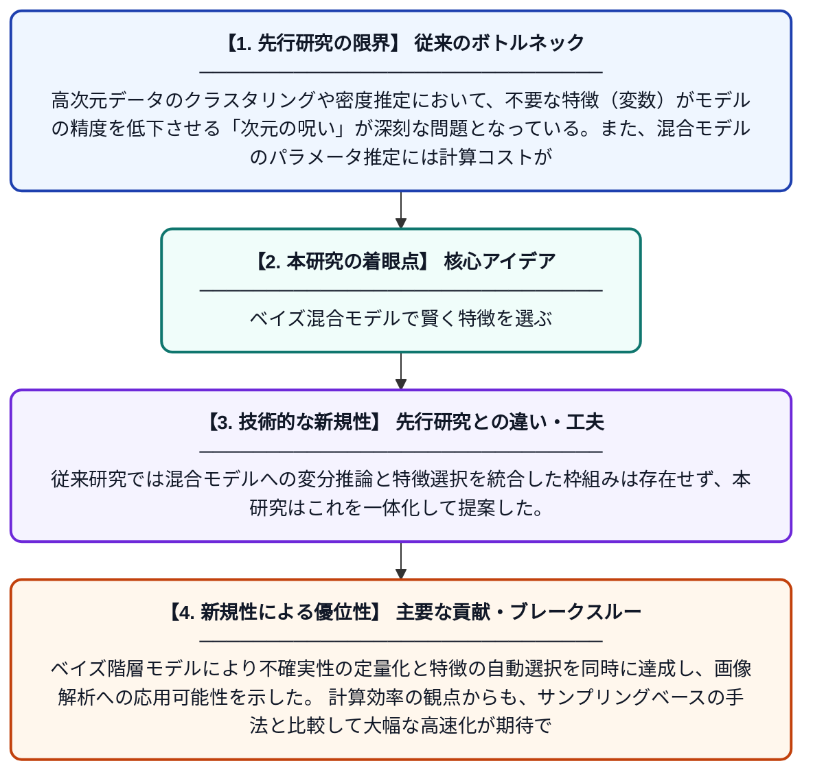

# 特徴選択を伴うベイズリビー・ノビックベータ混合モデルに対する変分推論

**Original Title**: *Variational Inference for the Bayesian Libby‐Novick Beta Mixture Model With Feature Selection*

> **💡 一言要約**: ベイズ混合モデルで賢く特徴を選ぶ

| 項目 | 内容 |
|---|---|
| **著者** | D Azzam, M Azam, N Bouguila |
| **掲載誌** | International Journal of Imaging Systems and Technology 2026 |
| **アラートキーワード** | Bayesian hierarchical ... |
| **原文リンク** | [https://onlinelibrary.wiley.com/doi/abs/10.1002/ima.70397](https://onlinelibrary.wiley.com/doi/abs/10.1002/ima.70397) |
| **PDF版要約** | [README.pdf](./README.pdf) |

---

## 📊 新規性の図解（先行研究との違いと本研究のブレークスルー）

## 📝 要約

本論文は、ベイズ階層構造を用いたリビー・ノビックベータ混合モデル（BLNBMM）に対して変分推論を適用する手法を提案している。パラメータの不確実性を定量化しながら、同時に特徴選択を行うことで、画像処理などの高次元データ解析を効率化する。変分ベイズ推論により、従来の計算コストの高いサンプリング手法に代わる近似推論を実現している。

## ❓ どんな問題に取り組んだか

高次元データのクラスタリングや密度推定において、不要な特徴（変数）がモデルの精度を低下させる「次元の呪い」が深刻な問題となっている。また、混合モデルのパラメータ推定には計算コストが高いMCMC法が用いられることが多く、大規模データへの適用が困難であった。さらに、パラメータの不確実性を適切に扱うベイズ的なアプローチと特徴選択を同時に行う枠組みが不足していた。

## ✨ 何が新しい？何がすごい？（新規性）

本研究は、リビー・ノビックベータ分布を基底分布とする混合モデルにベイズ階層構造を導入し、変分推論によって効率的なパラメータ推定を実現した点が新しい。従来研究では混合モデルへの変分推論と特徴選択を統合した枠組みは存在せず、本研究はこれを一体化して提案した。ベイズ階層モデルにより不確実性の定量化と特徴の自動選択を同時に達成し、画像解析への応用可能性を示した。計算効率の観点からも、サンプリングベースの手法と比較して大幅な高速化が期待できる。

## 🎓 大学1年生向けの解説

データをグループ分け（クラスタリング）するとき、たくさんの情報の中から重要なものだけを自動で選びたいという問題があります。本論文では、「ベイズ統計」という不確かさをうまく扱う考え方と、「変分推論」という計算を速くする工夫を組み合わせた手法を提案しています。例えるなら、大量の写真の中から似た写真をグループ分けするとき、重要な特徴だけに注目してすばやく仕分けするイメージです。この方法を使うと、精度を保ちながら計算時間を大幅に短縮できます。画像認識や医療診断など、さまざまな分野への応用が期待されています。
