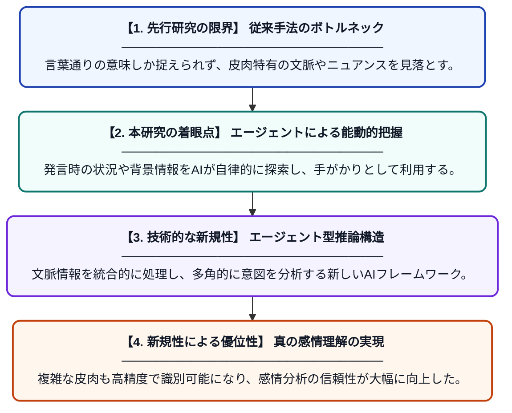

# 文脈を考慮した皮肉検出のためのエージェントAIフレームワーク

**Original Title**: *An Agentic Artificial Intelligence Framework for Context-Aware Sarcasm Detection*

> **💡 一言要約**: 文脈を読むAIが、隠れた「皮肉」を暴く。

| 項目 | 内容 |
|---|---|
| **著者** | A Kar, Y Nikam |
| **掲載誌** | IEEE World Skills Conference on Universal Data … 2026 |
| **アラートキーワード** | affective computing |
| **原文リンク** | [https://ieeexplore.ieee.org/abstract/document/11766991/](https://ieeexplore.ieee.org/abstract/document/11766991/) |
| **PDF版要約** | [README.pdf](./README.pdf) |

---

## 📊 新規性の図解（先行研究との違いと本研究のブレークスルー）

## 📝 要約

従来の機械学習では捉えきれなかった皮肉の微妙なニュアンスや行動の手がかりを特定するため、エージェント型のAIフレームワークを提案しています。文脈を深く理解することで、感情分析や意見マイニングにおける真の感情把握の精度を向上させます。

## ❓ どんな問題に取り組んだか

従来の機械学習やディープラーニングの手法では、言葉の裏に隠された皮肉や文脈に依存する微妙な表現を正確に識別することが困難でした。その結果、感情分析や意見抽出において、ユーザーの真意を読み違えてしまうという大きな課題がありました。

## ✨ 何が新しい？何がすごい？（新規性）

本研究の新規性は、自律的に思考・行動する「エージェント型」のAIアーキテクチャを皮肉検出に導入した点にあります。先行研究が静的なテキスト解析に終始していたのに対し、本フレームワークは動的な文脈情報をエージェントが能動的に統合して判断します。これにより、言葉の意味と発信者の意図の乖離をより高度に検知できる点が画期的です。

## 🎓 大学1年生向けの解説

「最高の天気だね」という言葉が、晴天を喜んでいるのか、土砂降りの中で皮肉を言っているのかをAIが判断するのはとても難しいことです。この研究では、AIを単なる翻訳機ではなく、周りの状況を自分で調べて考える「エージェント」として設計しました。これにより、AIは私たちの本当の気持ちや、言葉の裏に隠された「トゲ」をもっと正確に理解できるようになります。
