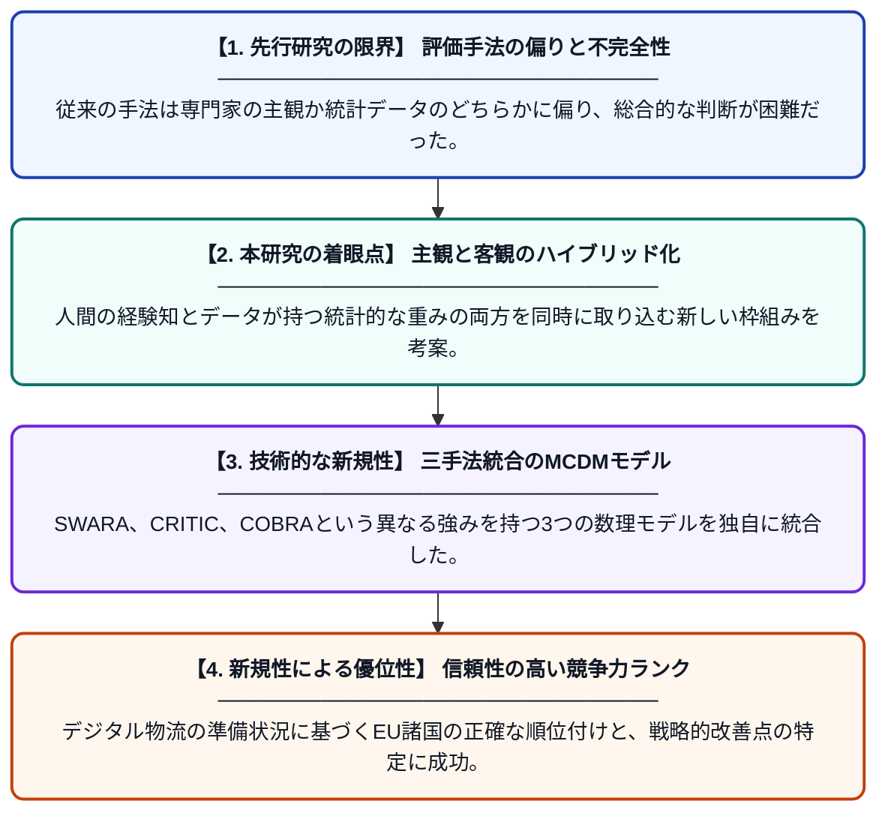

# EUにおけるデジタル物流の準備状況と地域競争力：新たなハイブリッドSWARA–CRITIC–COBRA MCDMモデル

**Original Title**: *Digital logistics readiness and regional competitiveness in the EU: A new hybrid SWARA–CRITIC–COBRA MCDM model*

> **💡 一言要約**: デジタル物流が解く、EU各国の地域競争力格差

| 項目 | 内容 |
|---|---|
| **著者** | GA Kayar, II Avsar |
| **掲載誌** | Technology in Society 2026 |
| **アラートキーワード** | logistics |
| **原文リンク** | [https://www.sciencedirect.com/science/article/pii/S0160791X26003957](https://www.sciencedirect.com/science/article/pii/S0160791X26003957) |
| **PDF版要約** | [README.pdf](./README.pdf) |

---

## 📊 新規性の図解（先行研究との違いと本研究のブレークスルー）

## 📝 要約

この研究は、EU諸国におけるデジタル物流の準備状況が地域競争力に与える影響を評価するための新しい多基準意思決定（MCDM）モデルを提案しています。SWARA、CRITIC、COBRAという3つの手法を組み合わせることで、主観的・客観的指標を統合し、デジタル化がサプライチェーンの競争力にどのように寄与するかを明らかにしました。

## ❓ どんな問題に取り組んだか

物流システムのデジタル化は戦略的に不可欠ですが、既存の文献には主観的な専門家の意見と客観的な統計データの両方を統合して、地域競争力を正確に評価する包括的な枠組みが不足していました。また、デジタル物流の準備状況を多角的に測定し、国別のランキングを導き出す堅牢な数理モデルが必要とされていました。

## ✨ 何が新しい？何がすごい？（新規性）

本研究は、専門家の判断を反映するSWARA法と、データの相関から重みを決めるCRITIC法を統合し、さらに最新のランキング手法であるCOBRA法を組み合わせたハイブリッドモデルを世界で初めて構築しました。この手法により、単一の評価法では捉えきれないデジタル物流の複雑な要因を精度高く分析することが可能となりました。物流のデジタル化指標と地域競争力の相関を、理論と実践の両面から精緻に示した点が最大の貢献です。

## 🎓 大学1年生向けの解説

「荷物を運ぶ仕組み（物流）」がどれくらいIT化されているかは、その国が経済的にどれだけ強いかに大きく関係しています。この論文は、EUの国々を対象に、インターネットやAIをどのくらい物流に活用できているかを計算する新しい「ものさし」を作ったというお話です。3つの複雑な計算式を組み合わせて使うことで、単なる推測ではなく、データに基づいてどの国が最も進んでいるかをはっきりと示しました。これにより、これからどの国が成長しそうかを予測しやすくなります。
