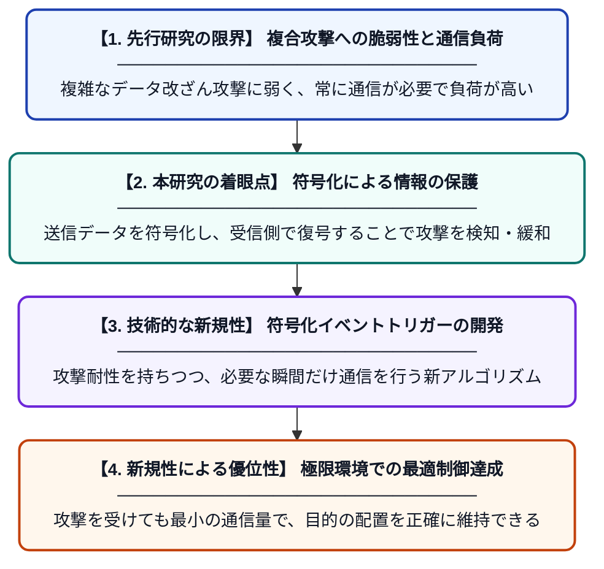

# 符号化イベントトリガー方式によるマルチエージェントシステムの最適レジリエント二部包含制御

**Original Title**: *Optimal Resilient Bipartite Containment Control for Multi-Agent Systems via Coded Event-Triggered Scheme*

> **💡 一言要約**: 攻撃をかわし通信も節約する、最強の集団制御AI

| 項目 | 内容 |
|---|---|
| **著者** | Y Chen, H Liang, J Yang, T Li |
| **掲載誌** | Artificial Intelligence Science and Engineering 2026 |
| **アラートキーワード** | multi agent |
| **PDF** | [https://ieeexplore.ieee.org/iel8/10899809/11769698/11769699.pdf](https://ieeexplore.ieee.org/iel8/10899809/11769698/11769699.pdf) |
| **原文リンク** | [https://ieeexplore.ieee.org/iel8/10899809/11769698/11769699.pdf](https://ieeexplore.ieee.org/iel8/10899809/11769698/11769699.pdf) |
| **PDF版要約** | [README.pdf](./README.pdf) |

---

## 📊 新規性の図解（先行研究との違いと本研究のブレークスルー）

## 📝 要約

この論文は、加法および乗法の両方の形態を含む複合的な虚偽データ注入（FDI）攻撃にさらされたマルチエージェントシステムにおいて、安全かつ効率的な二部包含制御を実現する手法を提案しています。符号化イベントトリガー方式を導入することで、通信リソースを節約しながら、攻撃の影響を最小限に抑える最適な制御性能を達成しています。

## ❓ どんな問題に取り組んだか

複数のドローンやロボットが協力・敵対しながら特定の範囲に集まる際、外部からデータを改ざんされる攻撃を受けると、制御が崩壊する危険があります。特に、データの値を書き換えるだけでなく、値を何倍にも増幅させる複雑な攻撃に対処しつつ、限られた通信帯域を効率的に使うことが大きな課題でした。

## ✨ 何が新しい？何がすごい？（新規性）

本研究の最大の貢献は、従来個別に議論されていた「加法・乗法の複合攻撃への耐性」と「イベントトリガーによる通信節約」を、情報の符号化・復号技術によって統合した点にあります。二部グラフ（協力と敵対が混在する関係）上での包含制御において、攻撃の影響を打ち消すレジリエントな仕組みと、システム全体のコストを最小化する最適制御を同時に実現しました。これにより、過酷なサイバー攻撃環境下でも、先行研究より高い精度とリソース効率を両立させています。

## 🎓 大学1年生向けの解説

たくさんのロボットが、味方と協力したりライバルと距離を置いたりしながら、決められたエリア内に集まる様子を想像してください。この研究では、悪意のあるハッカーがロボット同士の通信に嘘の情報を混ぜて邪魔をしてきても、それを賢く見破って正しく動く方法を開発しました。さらに、ロボットたちが四六時中お喋りするのではなく「大事なときだけ」通信するように工夫したことで、バッテリーも長持ちします。セキュリティと省エネを同時に解決した、未来のロボット集団のための頭脳です。
