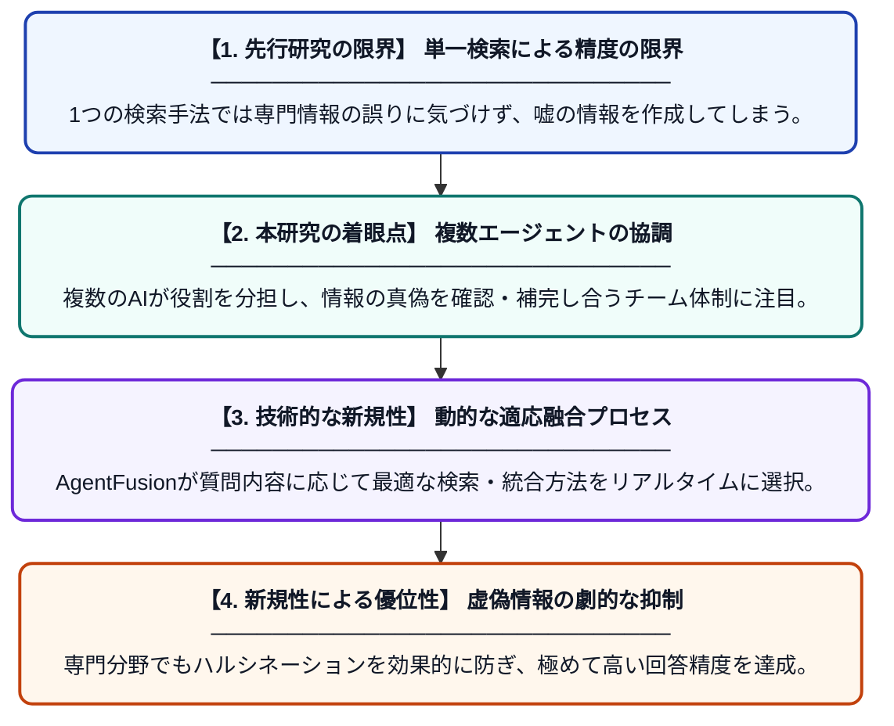

# AgentFusion-RAG：ハルシネーションを抑制する、専門領域向け適応型マルチエージェント検索拡張生成フレームワーク

**Original Title**: *AgentFusion-RAG: An Adaptive Multi-Agent Retrieval-Augmented Framework for Hallucination-Resistant Domain-Specific Question Answering*

> **💡 一言要約**: AIの「嘘」を複数の専門エージェントの連携で防ぐ

| 項目 | 内容 |
|---|---|
| **著者** | AHR Dalal, K Patil, R Batule |
| **掲載誌** | International Conference on Innovations in … 2026 |
| **アラートキーワード** | graph rag |
| **原文リンク** | [https://ieeexplore.ieee.org/abstract/document/11761155/](https://ieeexplore.ieee.org/abstract/document/11761155/) |
| **PDF版要約** | [README.pdf](./README.pdf) |

---

## 📊 新規性の図解（先行研究との違いと本研究のブレークスルー）

## 📝 要約

AgentFusion-RAGは、複数の自律エージェントを協調させることで、特定の専門分野におけるAIの「もっともらしい嘘（ハルシネーション）」を劇的に減らす新しいRAG手法です。従来の単一の検索方法に頼らず、状況に応じて最適な情報を動的に取得・統合することで、極めて精度の高い回答生成を可能にします。

## ❓ どんな問題に取り組んだか

従来のRAG（検索拡張生成）システムは単一の検索手法に依存していることが多く、複雑な専門知識を扱う際に不正確な情報を生成してしまう課題がありました。また、質問の内容やドメインに合わせて検索戦略を柔軟に切り替えることが難しく、回答の信頼性に限界がありました。

## ✨ 何が新しい？何がすごい？（新規性）

本研究の革新性は、複数の検索エージェントを動的に統合・調整する「AgentFusion」というマルチエージェント構造を導入した点にあります。先行研究とは異なり、単一のベクトル検索に限定せず、状況に応じて最適なエージェントが連携して情報を検証・融合するため、ハルシネーションに対する耐性が飛躍的に向上しています。専門的なドメインにおいても、各エージェントが互いの情報の欠落を補完し合い、高度に最適化された回答プロセスを実現したことが主要な貢献です。

## 🎓 大学1年生向けの解説

AIが「知ったかぶり」をして嘘をついてしまう問題を解決するための新しい仕組みです。1つの検索方法だけに頼るのではなく、複数の「専門家エージェント」がチームを組んで正しい情報を探し出し、内容をダブルチェックするようなイメージです。これにより、医療や技術などの間違えてはいけない専門的な質問に対しても、非常に正確で信頼できる答えを返せるようになります。
