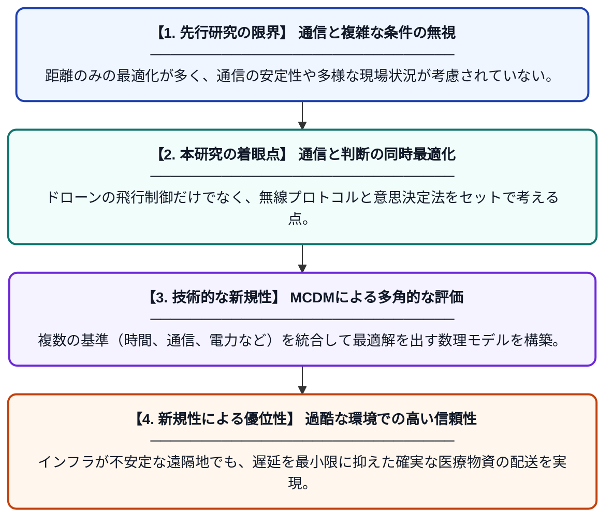

# 無線プロトコルと多基準意思決定を用いたUAVによる救急医療物流の性能最適化

**Original Title**: *Performance optimization of UAV-based emergency healthcare logistics using wireless protocols and multi-criteria decision-making*

> **💡 一言要約**: ドローンと意思決定AIで、僻地の救急医療を最速化

| 項目 | 内容 |
|---|---|
| **著者** | IA Najm, MA Mohammed, M Deveci, R Martinek |
| **掲載誌** | Expert Systems with Applications 2026 |
| **アラートキーワード** | logistics |
| **原文リンク** | [https://www.sciencedirect.com/science/article/pii/S0957417426039618](https://www.sciencedirect.com/science/article/pii/S0957417426039618) |
| **PDF版要約** | [README.pdf](./README.pdf) |

---

## 📊 新規性の図解（先行研究との違いと本研究のブレークスルー）

## 📝 要約

インフラが乏しい遠隔地における救急医療サービス（EMS）を改善するため、ドローン（UAV）を用いた配送システムを提案しています。無線通信プロトコルと多基準意思決定（MCDM）を統合することで、通信の信頼性を確保しながら配送時間を最小化するルートと拠点選択の最適化を実現しました。

## ❓ どんな問題に取り組んだか

遠隔地やインフラ不足の地域では、救急搬送や医療物資の配送に時間がかかり、命を救うための「黄金の時間」を逃すリスクがあります。また、ドローン運用における不安定な通信環境や、多くの制約条件の中で最適な配送ルートを瞬時に判断することが困難であるという課題があります。

## ✨ 何が新しい？何がすごい？（新規性）

本研究の最大の特徴は、高度な無線通信プロトコルの最適化と、複雑な判断を可能にする多基準意思決定（MCDM）手法を救急物流に統合した点にあります。従来の配送モデルが距離や時間のみを重視していたのに対し、本研究は通信品質やエネルギー効率、緊急度など複数の相反する指標を同時に考慮しました。これにより、リアルタイムで変化する環境下でも、極めて高い信頼性と迅速な応答速度を両立させています。

## 🎓 大学1年生向けの解説

山奥などの病院から遠い場所で怪我をしたとき、ドローンが薬やAEDを届けてくれたら助かりますよね。でも、ドローンは電波が届きにくい場所があったり、電池の限界があったりと、最適な道を選ぶのがとても難しいのです。この論文では、数学的な「賢い決め方」を使って、一番速くて確実なルートを瞬時に計算する仕組みを作りました。これによって、これまで助けるのが難しかった場所でも、素早く医療が届くようになります。
