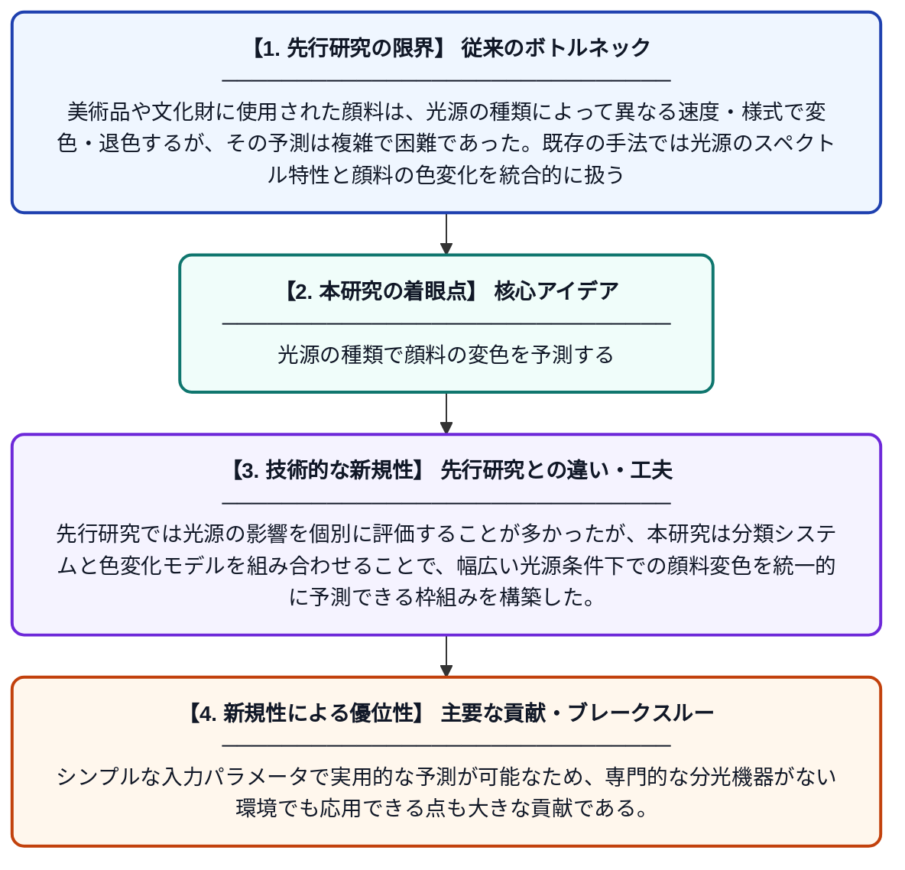

# 顔料の変色を理解・予測するための光源分類と色変化モデリング

**Original Title**: *Light source classification and colour change modelling for understanding and predicting pigments discolouration: authors: Panagiotis Siozos, ICA Sandu,[et al.]*

> **💡 一言要約**: 光源の種類で顔料の変色を予測する

| 項目 | 内容 |
|---|---|
| **著者** | ICA Sandu, P Siozos |
| **アラートキーワード** | ICA |
| **原文リンク** | [https://munch.tind.io/record/46831](https://munch.tind.io/record/46831) |
| **PDF版要約** | [README.pdf](./README.pdf) |

---

## 📊 新規性の図解（先行研究との違いと本研究のブレークスルー）

## 📝 要約

本研究では、赤・緑・青の各領域における相対的なパワー分布によって光源のスペクトルプロファイルを近似し、光源を分類するシステムと、それに組み合わせたシンプルかつ効果的な色変化モデルを提案している。このモデルは、さまざまな光源にさらされた際に顔料がどのように変色するかを予測することを目的としている。文化財の保存や照明設計において、顔料の退色・変色リスクを事前に評価するための実用的なツールとなることが期待される。

## ❓ どんな問題に取り組んだか

美術品や文化財に使用された顔料は、光源の種類によって異なる速度・様式で変色・退色するが、その予測は複雑で困難であった。既存の手法では光源のスペクトル特性と顔料の色変化を統合的に扱うモデルが不足しており、保存管理や展示環境の設計において科学的根拠に基づく判断が難しかった。

## ✨ 何が新しい？何がすごい？（新規性）

本研究の新規性は、光源をR・G・Bの相対パワー分布という単純な指標で分類するシステムを導入した点にある。先行研究では光源の影響を個別に評価することが多かったが、本研究は分類システムと色変化モデルを組み合わせることで、幅広い光源条件下での顔料変色を統一的に予測できる枠組みを構築した。シンプルな入力パラメータで実用的な予測が可能なため、専門的な分光機器がない環境でも応用できる点も大きな貢献である。

## 🎓 大学1年生向けの解説

絵画や文化財に使われている顔料（色の素）は、光に当たることで少しずつ色が変わってしまいます。どんな光（蛍光灯・LED・太陽光など）を当てるかによって、色の変わり方が異なります。この研究では、光の赤・緑・青の強さのバランスで光源を分類し、どの光がどれくらい顔料を変色させるかを予測する計算モデルを作りました。これにより、美術館などで展示品をどんな照明で照らすべきかを科学的に判断できるようになります。
