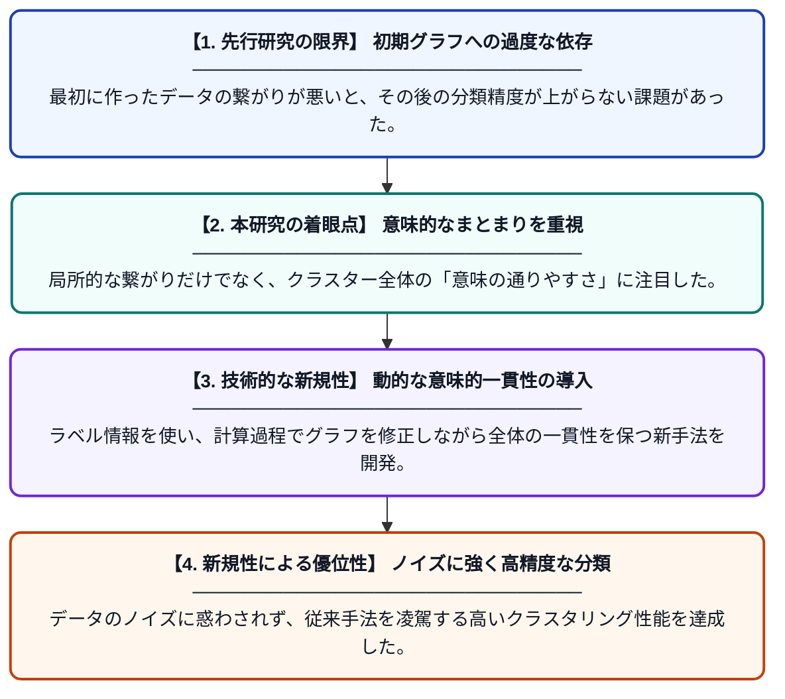

# クラスターレベルの意味的一貫性を備えた半教師あり対称非負値行列因子分解

**Original Title**: *Semi-supervised symmetric nonnegative matrix factorization with cluster-level semantic consistency*

> **💡 一言要約**: クラスタ全体の意味を捉える、進化版グラフ解析技術

| 項目 | 内容 |
|---|---|
| **著者** | Y Sun, Y Yang, X Ren |
| **掲載誌** | Applied Soft Computing 2026 |
| **アラートキーワード** | Semi supervise |
| **原文リンク** | [https://www.sciencedirect.com/science/article/pii/S1568494626023756](https://www.sciencedirect.com/science/article/pii/S1568494626023756) |
| **PDF版要約** | [README.pdf](./README.pdf) |

---

## 📊 新規性の図解（先行研究との違いと本研究のブレークスルー）

## 📝 要約

グラフクラスタリングにおける性能を向上させるため、データの局所的な関係性だけでなく、クラスター全体の意味的な一貫性を考慮した新しいSNMF手法を提案しています。動的なグラフ更新プロセスに教師あり情報を統合し、より精度の高いデータ分類を実現しました。

## ❓ どんな問題に取り組んだか

従来の対称非負値行列因子分解（SNMF）は、初期の類似度グラフの質に性能が大きく依存するという弱点がありました。また、既存の動的なグラフ構築手法はデータの局所的な構造ばかりを重視し、クラスター全体の意味的なまとまりを十分に反映できていないという課題がありました。

## ✨ 何が新しい？何がすごい？（新規性）

本研究の核心は、クラスターレベルの意味的一貫性を損失関数に組み込んだ点にあります。単に近接するデータ同士を結びつけるだけでなく、ラベル情報を活用して同じクラスに属するデータ群が全体として矛盾なく構成されるよう、グラフを動的に最適化します。これにより、ノイズの多いデータセットでも、先行研究より頑健で高精度なクラスタリングが可能になりました。

## 🎓 大学1年生向けの解説

たくさんのデータをグループ分けするとき、これまでは「近くにあるもの同士をまとめる」という単純なルールが主流でした。しかしこの研究では、「このグループ全体として何を目指しているか」という大きな視点を計算に取り入れました。一部のデータに正解のヒントを与えつつ、グループ全体の意味が通るように調整することで、データの分類ミスを大幅に減らすことに成功しています。
