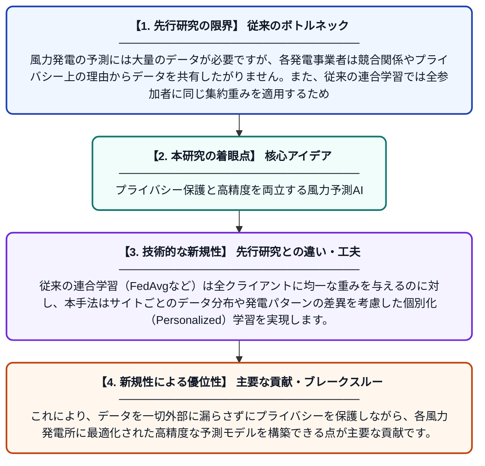

# 集約重みの最適化による個別化連合学習を用いた正確でプライバシーを保護した風力発電予測

**Original Title**: *Personalized Federated Learning with Aggregation Weight Optimization for Accurate and Privacy-Preserving Wind Power Forecasting*

> **💡 一言要約**: プライバシー保護と高精度を両立する風力予測AI

| 項目 | 内容 |
|---|---|
| **著者** | S Zhang, J He, L Wang, L Wang, S Xu, W Shao |
| **掲載誌** | Applied Soft Computing 2026 |
| **アラートキーワード** | Federated Learning |
| **原文リンク** | [https://www.sciencedirect.com/science/article/pii/S1568494626015243](https://www.sciencedirect.com/science/article/pii/S1568494626015243) |
| **PDF版要約** | [README.pdf](./README.pdf) |

---

## 📊 新規性の図解（先行研究との違いと本研究のブレークスルー）

## 📝 要約

本論文は、複数の風力発電事業者がデータを直接共有せずに協調して予測モデルを学習できる「連合学習」の手法を改良したものです。従来の連合学習では各参加者のデータ特性の違いにより予測精度が低下する問題がありましたが、本研究では各クライアントに最適化された集約重みを割り当てる新しいマルチウェイト集約方式を提案しています。これにより、プライバシーを守りながら個々の発電所に適した高精度な風力発電予測を実現しています。

## ❓ どんな問題に取り組んだか

風力発電の予測には大量のデータが必要ですが、各発電事業者は競合関係やプライバシー上の理由からデータを共有したがりません。また、従来の連合学習では全参加者に同じ集約重みを適用するため、各サイトの気象条件や発電特性の違いに対応できず予測精度が低下するという課題がありました。

## ✨ 何が新しい？何がすごい？（新規性）

本研究は、各クライアントの特性に応じて集約重みを個別に最適化する「マルチウェイト集約連合学習」という新しいフレームワークを提案しています。従来の連合学習（FedAvgなど）は全クライアントに均一な重みを与えるのに対し、本手法はサイトごとのデータ分布や発電パターンの差異を考慮した個別化（Personalized）学習を実現します。これにより、データを一切外部に漏らさずにプライバシーを保護しながら、各風力発電所に最適化された高精度な予測モデルを構築できる点が主要な貢献です。

## 🎓 大学1年生向けの解説

風力発電は天気によって発電量が大きく変わるため、事前に正確に予測することが重要です。予測精度を上げるにはたくさんのデータが必要ですが、電力会社は自社のデータを他社に見せたくありません。この研究では、各電力会社がデータを共有しなくても、みんなで協力して賢いAIを作れる「連合学習」という仕組みを使っています。さらに、それぞれの発電所の特徴に合わせて学習の重さを調整することで、プライバシーを守りながらより正確な風力発電の予測ができるようにしました。
