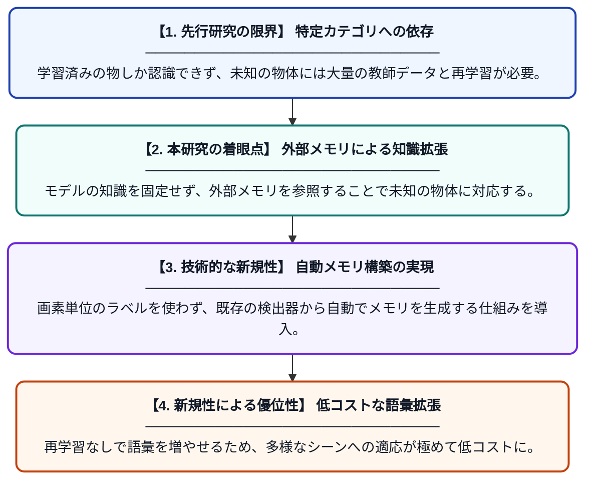

# オープン語彙パノプティックセグメンテーションのためのセミパラメトリックな枠組み

**Original Title**: *A Semi-Parametric Framework For Open Vocabulary Panoptic Segmentation*

> **💡 一言要約**: ラベルなしで未知の物を学べる、拡張自在な画像分割技術

| 項目 | 内容 |
|---|---|
| **著者** | N Sadeq, Q Liu, M El-Khamy |
| **掲載誌** | IEEE 36th International Workshop on Machine … 2026 |
| **アラートキーワード** | Open-Vocabulary Object ... |
| **原文リンク** | [https://ieeexplore.ieee.org/abstract/document/11772610/](https://ieeexplore.ieee.org/abstract/document/11772610/) |
| **PDF版要約** | [README.pdf](./README.pdf) |

---

## 📊 新規性の図解（先行研究との違いと本研究のブレークスルー）

## 📝 要約

未知の物体を認識・分割するオープン語彙パノプティックセグメンテーションにおいて、外部メモリを活用する新しい手法を提案しています。画素単位のラベルなしでメモリを自動構築でき、語彙の拡張が容易なスケーラブルな構造を実現しました。

## ❓ どんな問題に取り組んだか

従来のパノプティックセグメンテーションは、学習した特定のカテゴリしか認識できず、未知の物体に対応するには膨大な画素単位のアノテーションが必要でした。また、新しい語彙を追加する際にモデルを再学習させる必要があり、コストと拡張性に課題がありました。

## ✨ 何が新しい？何がすごい？（新規性）

本研究の最大の特徴は、画素レベルの教師データを必要とせずに、オープン語彙物体検出器を用いてメモリを自動構築するパイプラインを開発した点です。モデルの重みを固定したまま、外部メモリに新しい情報を追加する「セミパラメトリック」なアプローチを採用しています。これにより、モデル全体を再学習することなく、新しい語彙に対しても柔軟かつスケーラブルに対応できる仕組みを構築しました。

## 🎓 大学1年生向けの解説

画像に写っている「すべての物」を、言葉で指示するだけで切り抜く技術の話です。これまでは「犬」や「車」など、あらかじめ教えられた物しか見分けられませんでしたが、この研究では初めて見る物でも自動で学習できます。しかも、人間が細かく色を塗って教えるような大変な作業は必要ありません。辞書に新しい言葉を書き足すように、簡単に認識できる物を増やせるのがこの技術のすごいところです。
