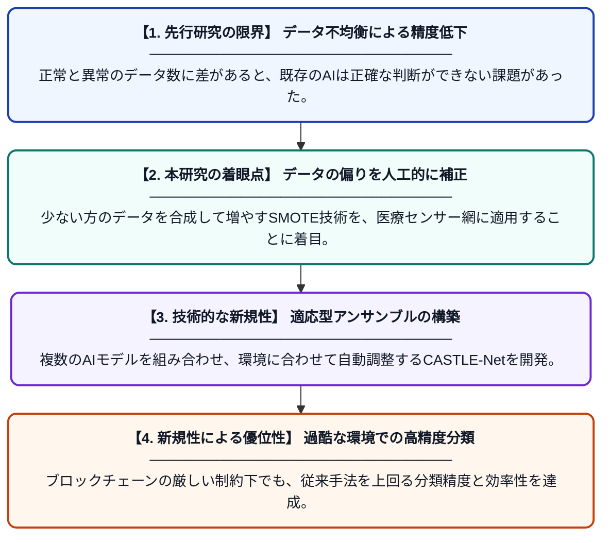

# CASTLE-Net: ブロックチェーン保護された電子健康記録無線センサネットワークにおける効率的分類のためのSMOTEを用いた適応型アンサンブルフレームワーク

**Original Title**: *CASTLE-Net: Adaptive Ensemble Framework with Smote for Efficient Classification in Blockchain-Secured EHR WSNs*

> **💡 一言要約**: AIとデータ補正で医療センサー網の安全と効率を両立

| 項目 | 内容 |
|---|---|
| **著者** | K Malarkodi, R Jayalakshmi, S Sargunavathi… |
| **掲載誌** | 10th International … 2026 |
| **アラートキーワード** | SMOTE |
| **原文リンク** | [https://ieeexplore.ieee.org/abstract/document/11790099/](https://ieeexplore.ieee.org/abstract/document/11790099/) |
| **PDF版要約** | [README.pdf](./README.pdf) |

---

## 📊 新規性の図解（先行研究との違いと本研究のブレークスルー）

## 📝 要約

ブロックチェーンで保護された電子健康記録（EHR）の無線センサネットワークにおいて、ノードの効率性を高精度に分類する新しいフレームワーク「CASTLE-Net」を提案しています。データの偏りを解消するSMOTE技術と、複数のモデルを組み合わせる適応型アンサンブル学習を統合し、複雑なネットワーク環境下での分類精度を向上させています。

## ❓ どんな問題に取り組んだか

電子健康記録（EHR）を扱う無線センサネットワークでは、セキュリティ確保のためにブロックチェーンが用いられますが、ネットワーク内のノードを効率的に管理するための分類が困難でした。特に、取得できるデータに大きな偏りがある「不均衡データ問題」や、複雑なトポロジー制約により、従来の機械学習手法では十分な精度が得られないという課題がありました。

## ✨ 何が新しい？何がすごい？（新規性）

本研究の最大の特徴は、不均衡データを補正するSMOTE（Synthetic Minority Over-sampling Technique）と、動的に最適化される適応型アンサンブル学習を組み合わせた「CASTLE-Net」を開発した点にあります。従来の静的な分類手法とは異なり、ブロックチェーン環境特有の高度なセキュリティ制限とトポロジーの変化に柔軟に対応できる設計となっています。これにより、データの信頼性を維持しながら、特定ノードの効率性を極めて高い精度で識別・分類することが可能になりました。

## 🎓 大学1年生向けの解説

病院で使われる電子カルテのデータを無線で安全に送るために「ブロックチェーン」という技術を使いますが、そのネットワークの中にはたくさんのセンサー（ノード）があります。この研究は、そのセンサーたちがうまく動いているかをAIで判定する魔法のような仕組みを作りました。データの偏りを直す特別な計算方法（SMOTE）を使うことで、珍しいケースも見逃さずに正しく判断できます。これによって、病院の大事なデータがより確実かつ効率的に守られるようになります。
