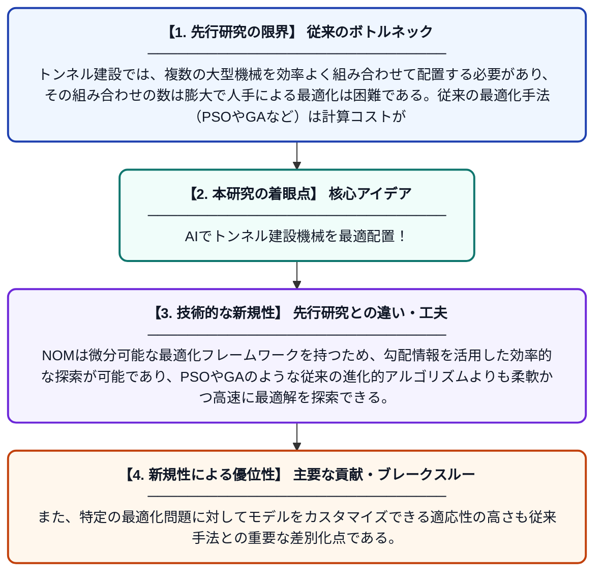

# ニューラル最適化マシンに基づくトンネル建設機械グループ構成の最適化モデル

**Original Title**: *Optimization model of tunnel construction machine groups configuration based on neural optimization machine*

> **💡 一言要約**: AIでトンネル建設機械を最適配置！

| 項目 | 内容 |
|---|---|
| **著者** | X Hou, Z Jia, J Jia, Y Yu, Y He, R Yuan, AMO Barahim |
| **掲載誌** | Scientific Reports 2026 |
| **アラートキーワード** | optimization |
| **PDF** | [https://www.nature.com/articles/s41598-026-63601-0_reference.pdf](https://www.nature.com/articles/s41598-026-63601-0_reference.pdf) |
| **原文リンク** | [https://www.nature.com/articles/s41598-026-63601-0_reference.pdf](https://www.nature.com/articles/s41598-026-63601-0_reference.pdf) |
| **PDF版要約** | [README.pdf](./README.pdf) |

---

## 📊 新規性の図解（先行研究との違いと本研究のブレークスルー）

## 📝 要約

本論文は、トンネル建設における機械グループの構成を最適化するための数理モデルを提案し、ニューラル最適化マシン（NOM）を用いてその問題を解いている。NOMは従来の粒子群最適化（PSO）や遺伝的アルゴリズム（GA）とは異なり、微分可能な最適化フレームワークを提供する。これにより、トンネル建設機械の効率的な配置と運用コストの削減が期待される。

## ❓ どんな問題に取り組んだか

トンネル建設では、複数の大型機械を効率よく組み合わせて配置する必要があり、その組み合わせの数は膨大で人手による最適化は困難である。従来の最適化手法（PSOやGAなど）は計算コストが高く、特定の問題に柔軟に適応させることが難しいという課題があった。このため、より効率的かつ汎用的な最適化手法の開発が求められていた。

## ✨ 何が新しい？何がすごい？（新規性）

本研究の主な新規性は、ニューラルネットワークをベースとしたニューラル最適化マシン（NOM）をトンネル建設機械の構成最適化に初めて適用した点にある。NOMは微分可能な最適化フレームワークを持つため、勾配情報を活用した効率的な探索が可能であり、PSOやGAのような従来の進化的アルゴリズムよりも柔軟かつ高速に最適解を探索できる。また、特定の最適化問題に対してモデルをカスタマイズできる適応性の高さも従来手法との重要な差別化点である。

## 🎓 大学1年生向けの解説

トンネルを掘るときには、ショベルカーやクレーンなど多くの大型機械をうまく組み合わせて使う必要があります。どの機械を何台使えば一番効率よく工事できるかを考えるのは非常に難しい問題です。この研究では、人工知能（AI）の一種である「ニューラル最適化マシン」を使って、この組み合わせ問題を自動的に解く方法を開発しました。これにより、コンピュータが最も良い機械の組み合わせを素早く見つけられるようになります。工事のコスト削減や工期短縮につながる実用的な研究です。
