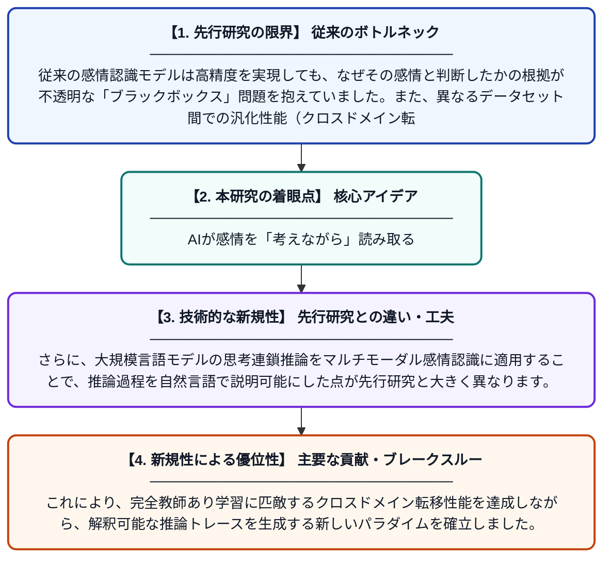

# EmoThink：能動的視覚認知と思考連鎖推論によるマルチモーダル感情認識

**Original Title**: *EmoThink: Multimodal Emotion Recognition via Active Visual Cognition and Chain-of-Thought Reasoning*

> **💡 一言要約**: AIが感情を「考えながら」読み取る

| 項目 | 内容 |
|---|---|
| **著者** | J Wang, H Wang, F Xie, J He, J Chen, L Li, X Feng |
| **掲載誌** | International Conference on Intelligent Computing 2026 |
| **アラートキーワード** | affective computing |
| **原文リンク** | [https://dl.acm.org/doi/abs/10.1007/978-981-92-3444-8_34](https://dl.acm.org/doi/abs/10.1007/978-981-92-3444-8_34) |
| **PDF版要約** | [README.pdf](./README.pdf) |

---

## 📊 新規性の図解（先行研究との違いと本研究のブレークスルー）

## 📝 要約

本論文では、映像・音声・テキストなど複数の情報源から人間の感情を認識するマルチモーダル感情認識システム「EmoThink」を提案しています。能動的な視覚認知メカニズムと思考連鎖（Chain-of-Thought）推論を組み合わせることで、モデルが感情を認識する過程を人間が理解できる形で説明できます。MELD、IEMOCAP、DFEWの3つのベンチマークデータセットで評価した結果、完全教師あり学習のベースラインと競合するクロスドメイン性能を達成しました。

## ❓ どんな問題に取り組んだか

従来の感情認識モデルは高精度を実現しても、なぜその感情と判断したかの根拠が不透明な「ブラックボックス」問題を抱えていました。また、異なるデータセット間での汎化性能（クロスドメイン転移）が低く、実際の多様な場面への適用が難しいという課題もありました。さらに、視覚・音声・言語を統合する際に各モダリティの重要な特徴を効果的に捉えきれないケースが多くありました。

## ✨ 何が新しい？何がすごい？（新規性）

EmoThinkは、人間の認知プロセスを模倣した「能動的視覚認知」モジュールを導入し、感情に関連する視覚的手がかりを選択的に注目する仕組みを実現しています。さらに、大規模言語モデルの思考連鎖推論をマルチモーダル感情認識に適用することで、推論過程を自然言語で説明可能にした点が先行研究と大きく異なります。これにより、完全教師あり学習に匹敵するクロスドメイン転移性能を達成しながら、解釈可能な推論トレースを生成する新しいパラダイムを確立しました。

## 🎓 大学1年生向けの解説

人と話すとき、私たちは相手の顔の表情、声のトーン、言葉の内容を同時に見て感情を読み取っています。この研究は、コンピュータが同じように複数の情報を組み合わせて感情を認識するシステム「EmoThink」を作りました。特に面白いのは、AIが「この人は目が細まっていて、声が震えているから悲しいと思う」というように、なぜそう判断したかを言葉で説明できる点です。これは医療や接客ロボットなど、AIの判断根拠が重要な場面でとても役立つ技術です。
