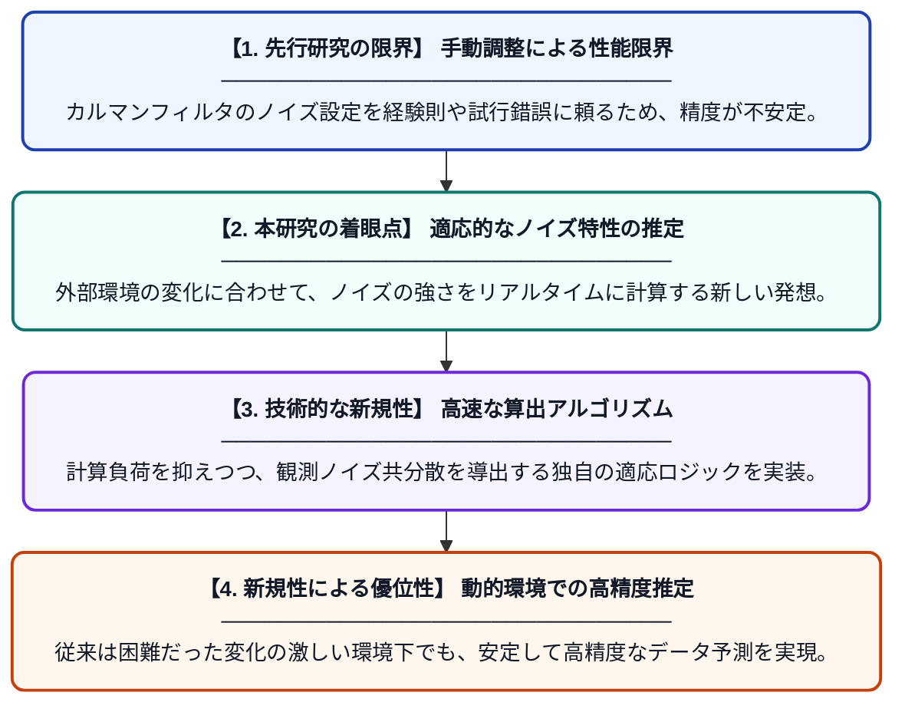

# カルマンフィルタのための新しい適応的パラメータ選択手法

**Original Title**: *Novel Adaptive Parameter Selection*

> **💡 一言要約**: カルマンフィルタのノイズ調整を自動化・高速化

| 項目 | 内容 |
|---|---|
| **著者** | NX Mung, JY Lee, TD Do |
| **掲載誌** | Robot Intelligence Technology and Applications 10 … 2026 |
| **アラートキーワード** | kalman filter |
| **原文リンク** | [https://books.google.com/books?hl=ja&lr=lang_ja|lang_en&id=T9QoEgAAQBAJ&oi=fnd&pg=PA251&dq="kalman+filter"&ots=x0uT8XSKQm&sig=ocfjW1dJMvl_E-yxG8i8nobhIKU](https://books.google.com/books?hl=ja&lr=lang_ja|lang_en&id=T9QoEgAAQBAJ&oi=fnd&pg=PA251&dq="kalman+filter"&ots=x0uT8XSKQm&sig=ocfjW1dJMvl_E-yxG8i8nobhIKU) |
| **PDF版要約** | [README.pdf](./README.pdf) |

---

## 📊 新規性の図解（先行研究との違いと本研究のブレークスルー）

## 📝 要約

カルマンフィルタにおける観測ノイズ共分散行列の調整は困難な課題ですが、本論文では高速なアルゴリズムを用いてこれを自動的に推定する新しい手法を提案しています。この手法により、リアルタイムで変化するノイズ環境下でも精度の高い状態推定が可能になります。

## ❓ どんな問題に取り組んだか

カルマンフィルタを適切に動作させるためにはノイズ共分散行列を正確に設定する必要がありますが、手動での調整は非常に困難です。また、環境の変化に応じてノイズの性質が変わる場合、固定されたパラメータでは精度の維持が難しいという課題がありました。

## ✨ 何が新しい？何がすごい？（新規性）

本研究は、観測ノイズ共分散を高速に算出するための新しい適応アルゴリズムを導入した点が画期的です。先行研究では計算負荷や収束速度に課題がありましたが、提案手法は高速な処理プロセスを通じて最適なノイズ特性を導出し、即座にフィルタへ反映させます。これにより、複雑な調整なしに動的な環境への即応性を実現しました。

## 🎓 大学1年生向けの解説

カルマンフィルタとは、センサーの「ノイズまじりのデータ」から「本当の値」を推測する計算方法です。今までは、この計算を正確に行うために人間が複雑な設定値を手動で決める必要があり、とても大変でした。この研究では、その難しい設定をコンピュータが自動で素早く計算する仕組みを作りました。これによって、どんな場所でもロボットが正確に動けるようになります。
