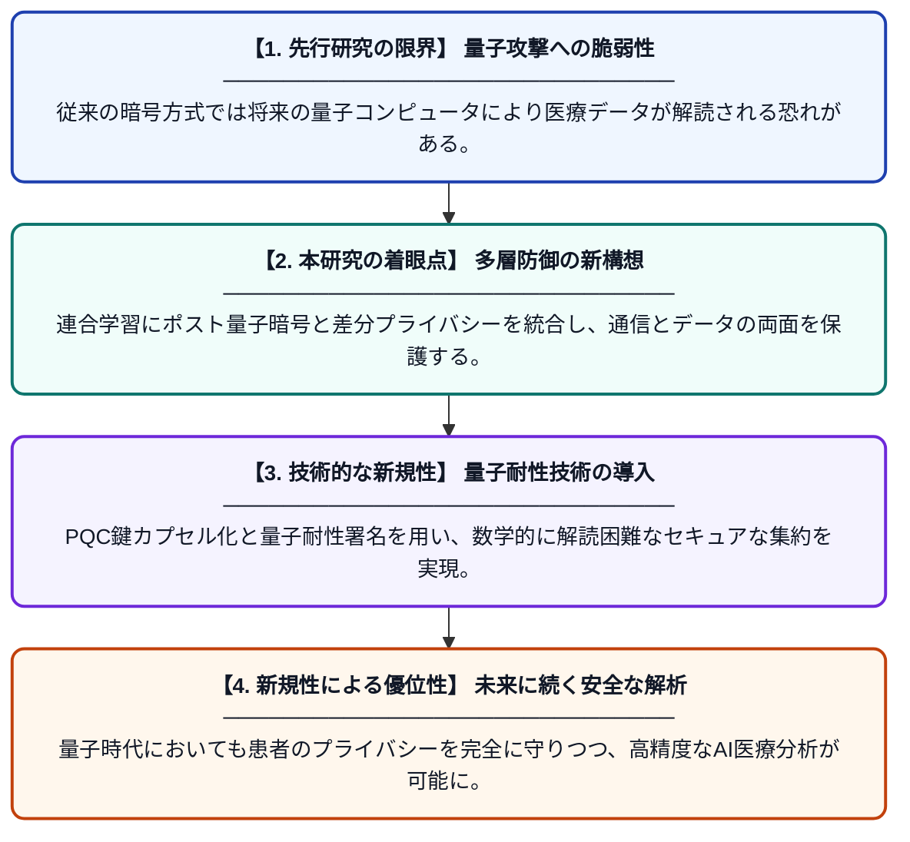

# ポスト量子時代のクラウドにおけるプライバシーを保護するAI駆動型ヘルスケア分析

**Original Title**: *Privacy-preserving AI-driven healthcare analytics in post-quantum clouds*

> **💡 一言要約**: 量子攻撃に耐える、究極の医療プライバシー保護AI

| 項目 | 内容 |
|---|---|
| **著者** | AA Hussain, CK Sharma, SV Gopal, S Bhattacharya… |
| **掲載誌** | Journal of Information and … 2026 |
| **アラートキーワード** | differential privacy |
| **原文リンク** | [https://tarupublications.com/journals/jios/volume/47/issue/10/privacy-preserving-ai-driven-healthcare-analytics-in-post-quantum-clouds](https://tarupublications.com/journals/jios/volume/47/issue/10/privacy-preserving-ai-driven-healthcare-analytics-in-post-quantum-clouds) |
| **PDF版要約** | [README.pdf](./README.pdf) |

---

## 📊 新規性の図解（先行研究との違いと本研究のブレークスルー）

## 📝 要約

量子コンピュータの脅威に対抗するため、ポスト量子暗号と連合学習を統合した次世代のヘルスケアデータ分析フレームワークを提案しています。差分プライバシーやセキュア集約を組み合わせることで、個人の機微な医療データを保護しながら、高度なAI解析を安全に実行可能です。

## ❓ どんな問題に取り組んだか

既存の医療データ分析システムは、将来の量子コンピュータによる暗号解読リスクに晒されています。また、機微な患者データを中央サーバーに集約することなく、プライバシーを厳格に守りながら共同でAIを学習させる手法の確立が急務でした。

## ✨ 何が新しい？何がすごい？（新規性）

本研究の最大の特徴は、連合学習にポスト量子鍵カプセル化（PQC）と量子耐性デジタル署名を組み込んだ点にあります。従来の連合学習が抱えていた通信経路の脆弱性を量子耐性技術で補強し、さらに差分プライバシーによって個々のデータ貢献を匿名化する多層防御を実現しました。これにより、将来的な計算能力の飛躍にも耐えうる、医療データ特有の厳しいセキュリティ要件を満たした点が画期的です。

## 🎓 大学1年生向けの解説

病院にある患者さんのデータは究極の個人情報ですが、AIに学習させるために一箇所に集めるのは盗難のリスクがあり危険です。そこで、データは病院に置いたまま、学習した「知恵」だけを安全に集める仕組みを使います。さらに、将来登場するすごい性能の量子コンピュータでも破れない最新の暗号技術を導入することで、未来の技術を使っても絶対に秘密が漏れない安全な医療AIの作り方を提案しています。
