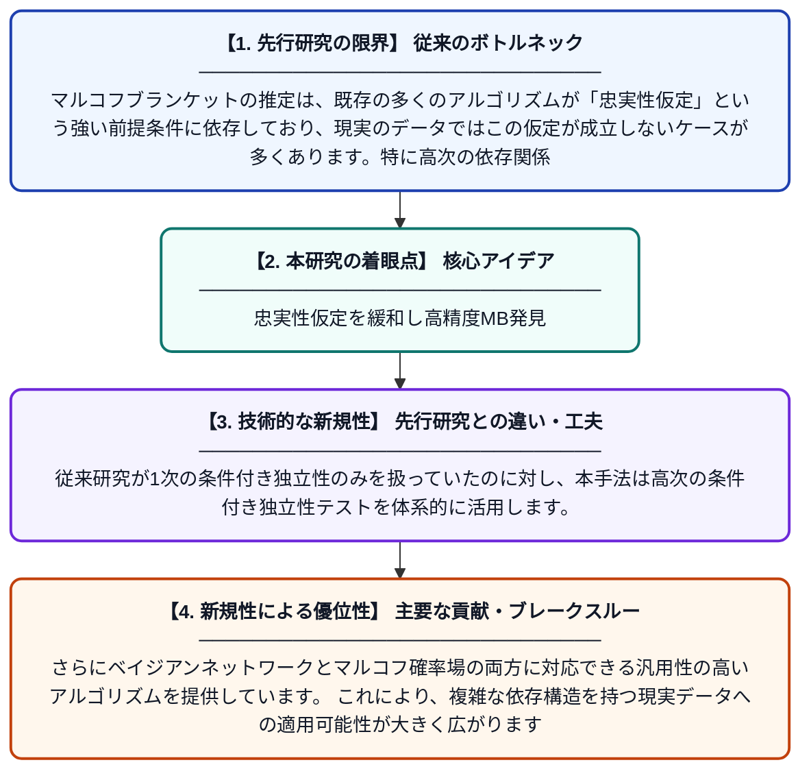

# 忠実性仮定のk次緩和によるマルコフブランケットの高次発見

**Original Title**: *High-Order Markov Blanket Discovery via a k-Order Relaxation of the Faithfulness Assumption*

> **💡 一言要約**: 忠実性仮定を緩和し高精度MB発見

| 項目 | 内容 |
|---|---|
| **著者** | LK Lee, R Krishnamoorthy, N Piatkowski |
| **掲載誌** | arXiv preprint arXiv:2607.26357 2026 |
| **アラートキーワード** | Markov random"  fields |
| **PDF** | [https://arxiv.org/pdf/2607.26357](https://arxiv.org/pdf/2607.26357) |
| **Git リポジトリ** | [https://github.com/lklee9/k-ord](https://github.com/lklee9/k-ord) |
| **原文リンク** | [https://arxiv.org/pdf/2607.26357](https://arxiv.org/pdf/2607.26357) |
| **PDF版要約** | [README.pdf](./README.pdf) |

---

## 📊 新規性の図解（先行研究との違いと本研究のブレークスルー）

## 📝 要約

本論文は、ベイジアンネットワークやマルコフ確率場における構造学習・因果発見・特徴選択において重要な役割を果たすマルコフブランケット（MB）の推定問題に取り組んでいます。従来の手法が依拠する「忠実性仮定」を厳密に緩和したk次忠実性仮定を導入し、より高次のMBを正確に発見する枠組みを提案しています。これにより、従来手法では検出困難だった変数間の依存関係を精度よく捉えることが可能になります。

## ❓ どんな問題に取り組んだか

マルコフブランケットの推定は、既存の多くのアルゴリズムが「忠実性仮定」という強い前提条件に依存しており、現実のデータではこの仮定が成立しないケースが多くあります。特に高次の依存関係を持つ変数間の関係を正しく推定することが従来手法では困難でした。この制限がベイジアンネットワーク・因果発見・特徴選択などの応用精度を低下させる要因となっていました。

## ✨ 何が新しい？何がすごい？（新規性）

本研究は「忠実性仮定」をk次に緩和した新しい理論的枠組み（k次忠実性仮定）を提案し、従来よりも現実的な条件下でマルコフブランケットを発見できる手法を実現しました。従来研究が1次の条件付き独立性のみを扱っていたのに対し、本手法は高次の条件付き独立性テストを体系的に活用します。さらにベイジアンネットワークとマルコフ確率場の両方に対応できる汎用性の高いアルゴリズムを提供しています。これにより、複雑な依存構造を持つ現実データへの適用可能性が大きく広がります。

## 🎓 大学1年生向けの解説

あるデータの中で「ある変数を予測するのに本当に必要な変数のセット」をマルコフブランケット（MB）と呼びます。例えば、病気の診断に本当に関係のある検査項目だけを自動で選び出すイメージです。従来の方法は「データと確率モデルが完全に一致している」という都合のよい仮定に頼っていましたが、現実にはその仮定が崩れることがよくあります。この論文ではその仮定を「ある程度だけ」緩めることで、より現実的な状況でも正しくMBを見つけられる新しい方法を提案しています。
