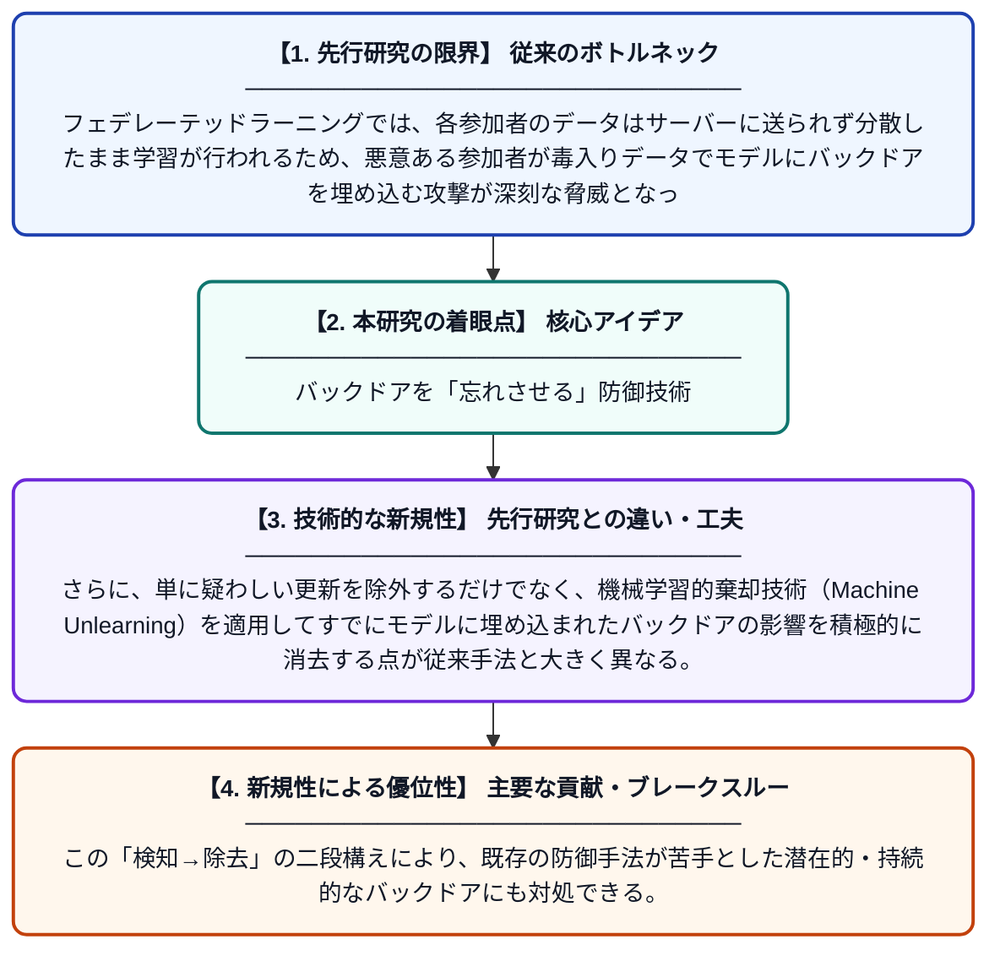

# GUARD: 影響度に基づく学習棄却によるフェデレーテッドラーニングのバックドア攻撃軽減手法

**Original Title**: *GUARD: Mitigating Backdoors in Federated Learning Via Influence-Guided Unlearning*

> **💡 一言要約**: バックドアを「忘れさせる」防御技術

| 項目 | 内容 |
|---|---|
| **著者** | Y Zhao, J Hu, G Liu, M Deng, M Shen, L Zhu, K Xu |
| **掲載誌** | IEEE Transactions on Dependable and Secure Computing 2026 |
| **アラートキーワード** | Secure Computing |
| **原文リンク** | [https://ieeexplore.ieee.org/abstract/document/11623719/](https://ieeexplore.ieee.org/abstract/document/11623719/) |
| **PDF版要約** | [README.pdf](./README.pdf) |

---

## 📊 新規性の図解（先行研究との違いと本研究のブレークスルー）

## 📝 要約

本論文は、複数の参加者が協調して機械学習モデルを訓練する「フェデレーテッドラーニング」において、悪意ある参加者が仕込む「バックドア攻撃」を防御する手法GUARDを提案する。GUARDは影響度関数（Influence Function）を用いて悪意あるデータの影響を特定し、機械学習的棄却（Unlearning）によってその影響をモデルから除去する。これにより、通常の精度を維持しつつ効果的にバックドアを無力化することができる。

## ❓ どんな問題に取り組んだか

フェデレーテッドラーニングでは、各参加者のデータはサーバーに送られず分散したまま学習が行われるため、悪意ある参加者が毒入りデータでモデルにバックドアを埋め込む攻撃が深刻な脅威となっている。既存の防御手法は異常な更新を検知・除外することに主眼を置いており、巧妙に隠された攻撃や攻撃者が防御を回避するケースに対して脆弱な場合があった。

## ✨ 何が新しい？何がすごい？（新規性）

GUARDは影響度関数を活用してモデルパラメータへの各参加者の貢献度を定量的に評価し、有害な影響を持つ更新を特定するという新しいアプローチを採用している。さらに、単に疑わしい更新を除外するだけでなく、機械学習的棄却技術（Machine Unlearning）を適用してすでにモデルに埋め込まれたバックドアの影響を積極的に消去する点が従来手法と大きく異なる。この「検知→除去」の二段構えにより、既存の防御手法が苦手とした潜在的・持続的なバックドアにも対処できる。

## 🎓 大学1年生向けの解説

フェデレーテッドラーニングとは、スマホなどの端末が自分のデータを外に出さずに、みんなで協力してAIを育てる仕組みです。しかし悪い参加者が「特定の合図を見せると誤った答えを出す」という罠（バックドア）をAIに仕込める危険があります。GUARDはまず「誰の影響でモデルがおかしくなったか」を数学的に計算して特定し、その悪影響をAIに「忘れさせる」ことで罠を取り除きます。人間でいえば、悪い記憶だけをピンポイントで消す治療のようなイメージです。これにより安全で信頼できる協調型AIシステムの実現に貢献しています。
