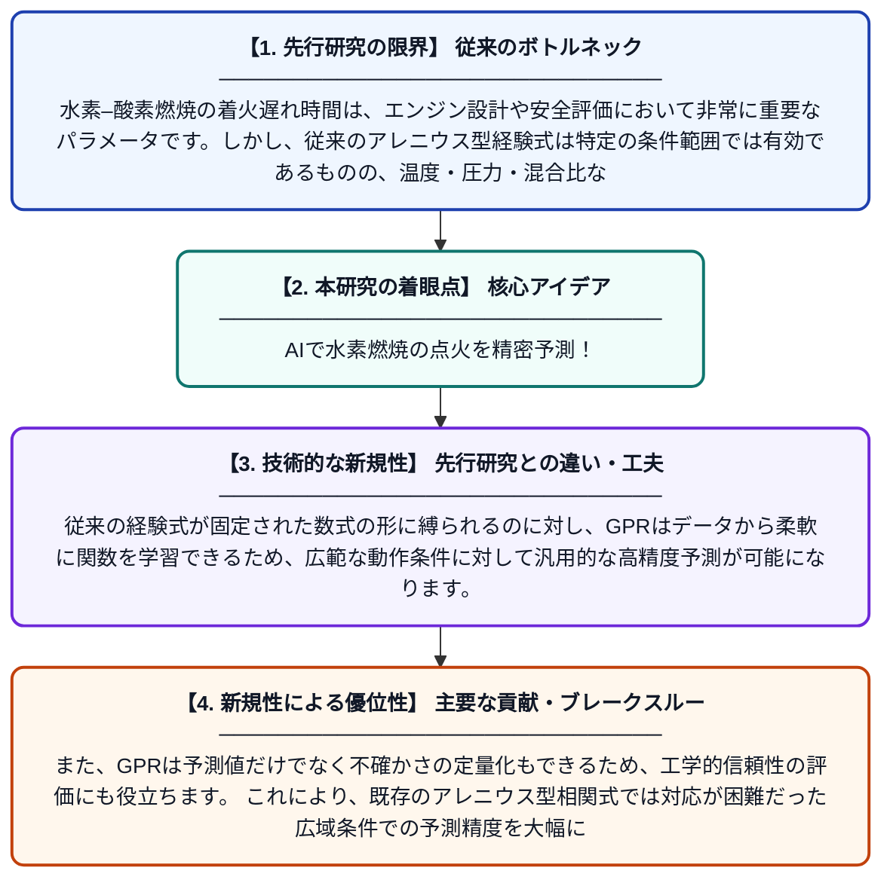

# ガウス過程回帰に基づく水素–酸素燃焼の着火遅れ時間予測

**Original Title**: *Prediction of Hydrogen–Oxygen Combustion Ignition Delay Time Based on Gaussian Process Regression*

> **💡 一言要約**: AIで水素燃焼の点火を精密予測！

| 項目 | 内容 |
|---|---|
| **著者** | Q Ma, J Fu, Q Zhou, Y Zhao, W Liang |
| **掲載誌** | Aerospace 2026 |
| **アラートキーワード** | gaussian process |
| **原文リンク** | [https://www.mdpi.com/2226-4310/13/8/663](https://www.mdpi.com/2226-4310/13/8/663) |
| **PDF版要約** | [README.pdf](./README.pdf) |

---

## 📊 新規性の図解（先行研究との違いと本研究のブレークスルー）

## 📝 要約

本論文は、水素と酸素の燃焼における着火遅れ時間（IDT）を広い動作条件にわたって高精度に予測するため、ガウス過程回帰（GPR）を用いたデータ駆動型手法を提案しています。従来のアレニウス型経験式では広範な条件下での予測精度が不十分であるという課題に対し、機械学習を活用することで精度向上を実現しています。提案手法は、既存の経験的相関式を大幅に上回る予測性能を示すことが確認されました。

## ❓ どんな問題に取り組んだか

水素–酸素燃焼の着火遅れ時間は、エンジン設計や安全評価において非常に重要なパラメータです。しかし、従来のアレニウス型経験式は特定の条件範囲では有効であるものの、温度・圧力・混合比などが広く変化する実用的な条件全体にわたって十分な予測精度を確保することが難しいという問題がありました。このため、より広い動作条件に対応できる高精度な予測手法の開発が求められていました。

## ✨ 何が新しい？何がすごい？（新規性）

本研究は、着火遅れ時間の予測にガウス過程回帰（GPR）というベイズ的機械学習手法を初めて本格的に適用した点が新しいです。従来の経験式が固定された数式の形に縛られるのに対し、GPRはデータから柔軟に関数を学習できるため、広範な動作条件に対して汎用的な高精度予測が可能になります。また、GPRは予測値だけでなく不確かさの定量化もできるため、工学的信頼性の評価にも役立ちます。これにより、既存のアレニウス型相関式では対応が困難だった広域条件での予測精度を大幅に改善することに成功しています。

## 🎓 大学1年生向けの解説

水素を燃料とするエンジンでは、燃料に火がつくまでの時間（着火遅れ時間）を正確に知ることがとても大切です。これまでは化学の式（アレニウス式）を使って計算していましたが、条件が変わると誤差が大きくなる問題がありました。この研究では、「ガウス過程回帰」というAI技術を使って、たくさんの実験データからパターンを学習し、様々な条件での着火タイミングをより正確に予測できるようにしました。AIが自動でデータの傾向を読み取るため、人間が経験式を手作りするよりも幅広い状況に対応できます。この技術は、将来の水素エンジンや宇宙ロケットの開発に役立つと期待されています。
