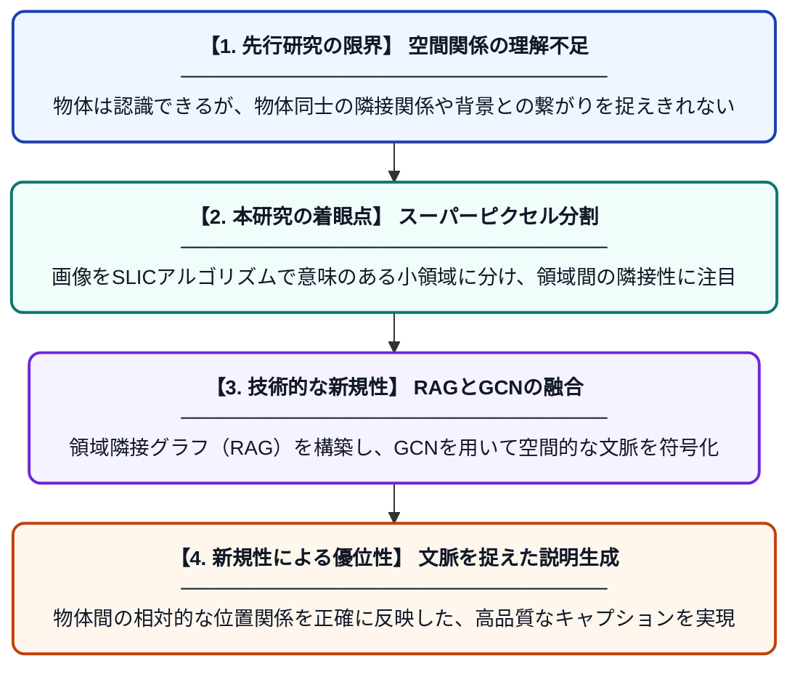

# スーパーピクセルを用いたグラフ畳み込みネットワークによる画像キャプション生成：領域認識シーン符号化アプローチ

**Original Title**: *Superpixel-Based Graph Convolutional Networks for Image Captioning: A Region-Aware Scene Encoding Approach*

> **💡 一言要約**: スーパーピクセルで画像の関係性を解き明かす

| 項目 | 内容 |
|---|---|
| **著者** | JA Tejeda Sánchez, AT Cortez, YM Martínez… |
| **掲載誌** | … International Conference on … 2026 |
| **アラートキーワード** | graph rag |
| **原文リンク** | [https://link.springer.com/chapter/10.1007/978-3-032-44182-9_14](https://link.springer.com/chapter/10.1007/978-3-032-44182-9_14) |
| **PDF版要約** | [README.pdf](./README.pdf) |

---

## 📊 新規性の図解（先行研究との違いと本研究のブレークスルー）

## 📝 要約

画像の微小な領域（スーパーピクセル）をノードとし、その隣接関係をグラフで表現する新しい画像キャプション生成手法を提案しています。SLICアルゴリズムで分割された各領域の特徴をGCNで処理することで、画像内の物体同士の空間的なつながりを深く理解し、精度の高い説明文を生成します。

## ❓ どんな問題に取り組んだか

従来の画像キャプション生成では、画像全体を一様なグリッドとして扱うか、独立した物体検出に頼る傾向があり、領域間の複雑な空間的関係性を十分に考慮できていませんでした。そのため、物体同士がどのように隣り合い、関連しているかというシーンの文脈を正確に捉えることが困難でした。

## ✨ 何が新しい？何がすごい？（新規性）

画像を意味のある塊に分ける「スーパーピクセル」と、その隣接関係を示す「領域隣接グラフ（RAG）」を導入した点が最大の特徴です。物体検出器の出力だけに依存せず、SLICアルゴリズムで抽出した領域ごとの深い特徴量をGCN（グラフ畳み込みネットワーク）で統合することで、画像内の局所的な構造と全体的な文脈を同時に符号化する仕組みを構築しました。これにより、幾何学的な配置情報を直接学習モデルに取り込むことに成功しています。

## 🎓 大学1年生向けの解説

AIに画像の内容を説明させる際、これまでは「ここに犬がいる」という個別の発見は得意でしたが、「犬が何の上に乗っているか」といった周囲との関係を捉えるのは苦手でした。この研究では、画像をパズルのピースのような小さな塊に分け、どのピースとどのピースがくっついているかを地図のように整理しました。この「つながりの地図」をAIに読み込ませることで、AIは人間のように物と物の位置関係を正しく理解し、より自然な説明ができるようになりました。
