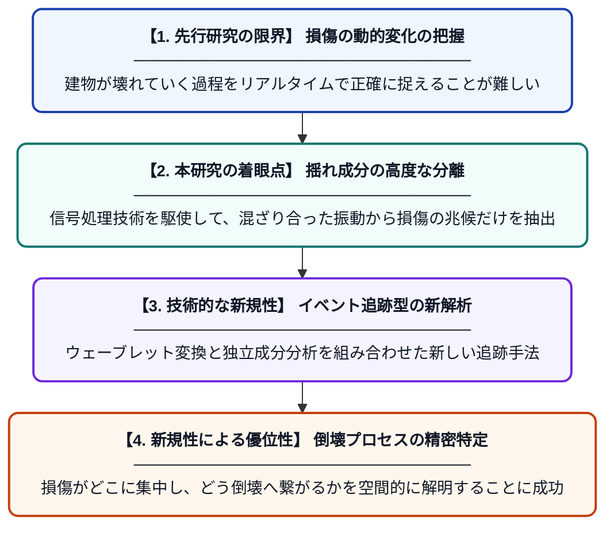

# コア・アウトリガー構造における共振誘発型損傷進展と側方倒壊：イベント誘導型モード追跡

**Original Title**: *Resonance-Induced Damage Evolution and Lateral Collapse in a Core–Outrigger Structure: Event-Guided Modal Tracking*

> **💡 一言要約**: ビルの揺れから倒壊の兆候を逃さず捉える新技術

| 項目 | 内容 |
|---|---|
| **著者** | B Feng, D Xu, Y Liu, L Ma, Y Xi |
| **掲載誌** | Buildings 2026 |
| **アラートキーワード** | independent component ... |
| **原文リンク** | [https://www.mdpi.com/2075-5309/16/21/4313](https://www.mdpi.com/2075-5309/16/21/4313) |
| **PDF版要約** | [README.pdf](./README.pdf) |

---

## 📊 新規性の図解（先行研究との違いと本研究のブレークスルー）

## 📝 要約

超高層ビルの主要な構造形式であるコア・アウトリガー構造を対象に、共振による損傷の広がりと倒壊プロセスを解析した研究です。ウェーブレット変換や独立成分分析を組み合わせた高度な信号処理手法により、構造物の動的特性の変化をリアルタイムで追跡することに成功しました。

## ❓ どんな問題に取り組んだか

地震などの共振現象による超高層ビルの損傷プロセスは非常に複雑であり、従来の解析手法では損傷がどこで発生し、どのように広がっていくかを時間・空間の両面で正確に捉えることが困難でした。特に、建物が最終的に倒壊に至るまでの非線形な挙動をリアルタイムでモニタリングする手法が不足していました。

## ✨ 何が新しい？何がすごい？（新規性）

本研究は、ウェーブレット変換と独立成分分析（ICA）を統合した「イベント誘導型モード追跡」を提案しました。スライディングウィンドウICAを用いることで、構造物の損傷に伴って刻々と変化する支配的な振動モードを動的に追跡できる点が、従来の定常的な解析手法との決定的な違いです。これにより、損傷のエネルギーが空間的にどこへ集中しているかを特定し、倒壊に至る詳細なプロセスを定式化することに成功しました。

## 🎓 大学1年生向けの解説

大きなビルが地震などで揺れるとき、どこかが壊れると建物の揺れ方が微妙に変化します。この研究は、そのわずかな揺れ方の変化を最新の数学的な手法で分析し、建物が倒れる前に「どこが危ないか」を突き止める方法を開発しました。複雑な揺れの中から重要な情報だけを取り出すことで、建物が壊れていく様子をスローモーションのように詳しく把握できます。この技術は、将来のビルをより安全に設計したり、地震の後の建物の健康診断を正確に行うために役立ちます。
